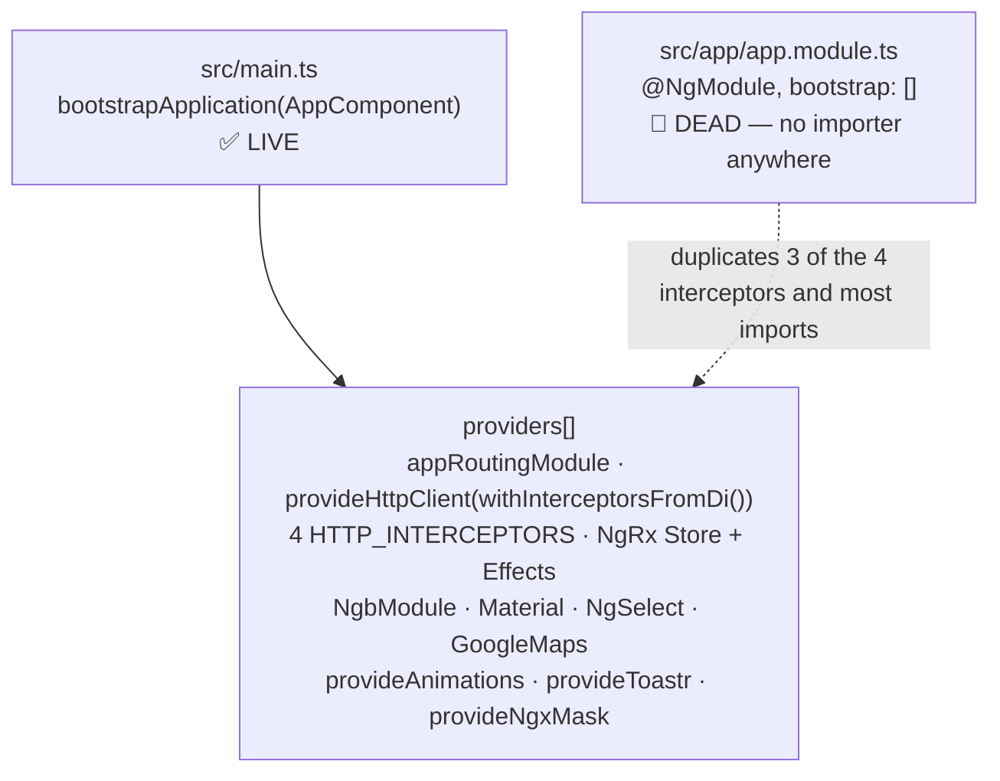
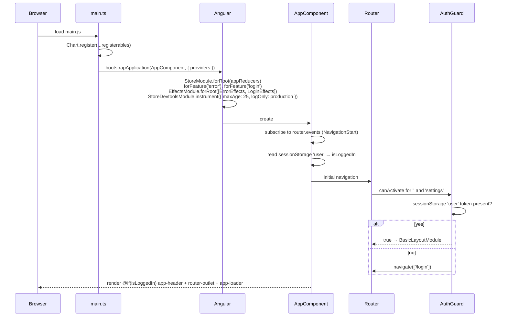
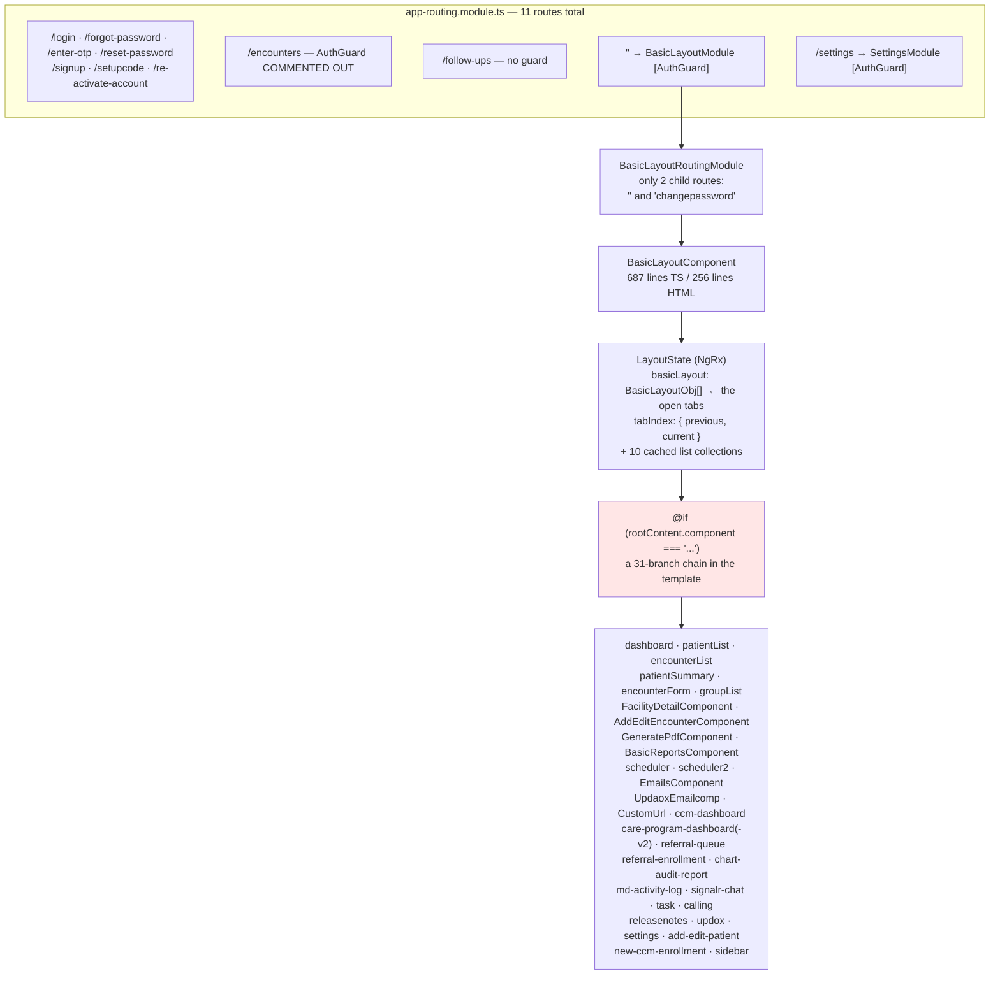
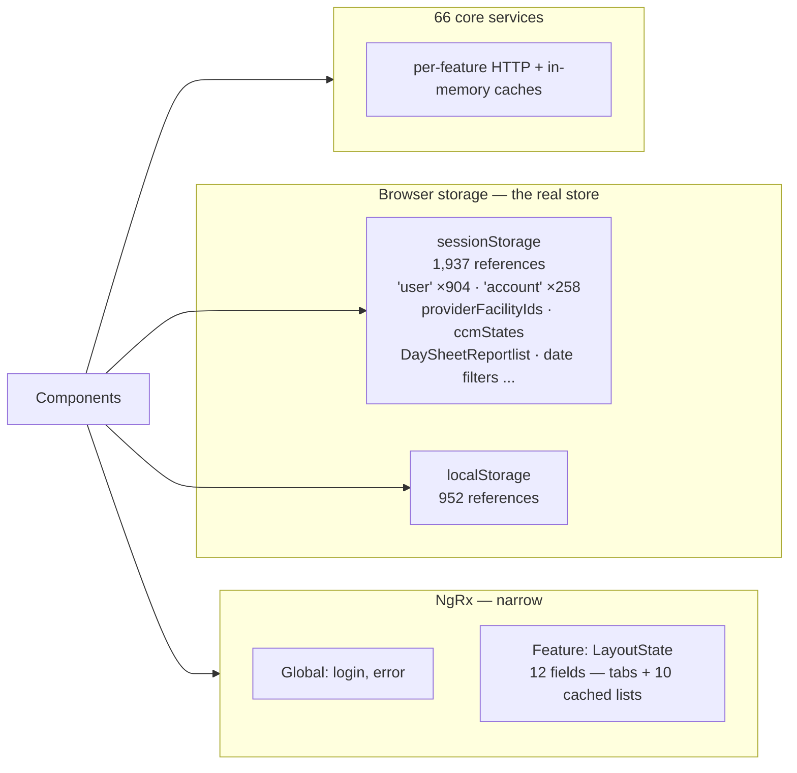

# Deep-Dive - SPA Shell & Navigation

**Date**: 2026-09-30
**Analyzed By**: ARCHITECT
**Status**: Draft (awaiting user confirmation)
**Scope**: how the Angular application boots, composes and navigates — bootstrap, routing, the tab-based shell, state management, browser storage, interceptor chain
**Evidence base**: `PacEHR` @ `3034de845`

> **Headline finding**: PacEHR does not navigate by URL. Eleven top-level routes exist, but the entire authenticated application renders inside a single `BasicLayoutComponent` that switches between 31 feature components via a string discriminator in NgRx state. There is no deep-linking, no browser back/forward, and no bookmarkable screen beyond the login page.

---

## Module Overview

| Concern | Location | Size |
|---|---|---|
| Bootstrap | `src/main.ts` | 99 lines — standalone `bootstrapApplication` |
| Dead bootstrap | `src/app/app.module.ts` | 141 lines — **never imported** |
| Root component | `src/app/app.component.ts` / `.html` | 157 / 8 lines |
| Routing | `src/app/app-routing.module.ts` | 11 routes, 8 lazy |
| Shell | `src/app/features/basic-layout/` | `basic-layout.component.ts` 687, `.html` 256 |
| Shell state | `src/app/features/basic-layout/_store/` | 984 lines across 5 files |
| Header | `src/app/_shared/components/header/header.component.ts` | **2,619 lines** |
| Global store | `src/app/_store/` | `login`, `error` only |
| Interceptors | `src/app/core/ineterceptors/` | 4 |

---

## Component Breakdown

### Two composition roots, one live



`app.module.ts` declares `bootstrap: []` and registers only three interceptors (`Auth`, `Loader`, `Encrypt`) — it is missing `CsrfInterceptor`. A grep for `AppModule` or `app.module` across `src/` returns **no importer**. It is a leftover from the NgModule→standalone migration, and anyone reading it would draw wrong conclusions about the interceptor chain.

### Interceptor chain (from `main.ts`, the live registration)

| Order | Interceptor | Role |
|---|---|---|
| 1 | `AuthInterceptor` | Adds AES-encrypted `token`, `accountID`, `userID`, `accountName` headers; retry policy; PCC error normalisation; error modal |
| 2 | `CsrfInterceptor` | Adds `X-XSRF-TOKEN` when the cookie exists — **the server never validates it** (Module 01) |
| 3 | `LoaderInterceptor` | Global spinner |
| 4 | `EncryptInterceptor` | AES-encrypts the request body |

Order matters and is correct: headers are set before the body is encrypted.

---

## Key Workflows

### Workflow 1: Application bootstrap



### Workflow 2: 🔴 Navigation — tabs, not routes



**Stories**:
1. The URL stays at `/` for every screen in the authenticated application. Users cannot bookmark a patient, share a link to an encounter, or use browser back/forward.
2. Which component renders is decided by a **string comparison** — `rootContent.component === 'patientSummary'`. A typo is a silently blank panel, not a compile error.
3. Adding a feature means editing the shell template, the state model and the reducer — the shell is a change magnet touched by every feature team.
4. All 31 components in the chain are eagerly present in the shell's template, so the eight lazy-loaded top-level routes buy little: the bulk of the app loads with the shell.
5. Two routes escape the guard: `/encounters` has `// canActivate: [AuthGuard],` commented out and `/follow-ups` never had one (Module 01).

### Workflow 3: State — three stores, unevenly used



`sessionStorage.getItem('user')` appears **904 times**. It holds the session token, user id, role and account details, and is re-parsed at each call site rather than read once through a service.

---

## Data Models

### `LayoutState` (`features/basic-layout/_store/layout.state.ts`, 441 lines)

| Field | Type | Purpose |
|---|---|---|
| `basicLayout` | `BasicLayoutObj[]` | Open tabs, each with `isTabVisible`, `isActive`, `rootContent` |
| `tabIndex` | `{ previous, current }` | Active tab |
| `patientList` | `IPatientModel[]` | Cached list |
| `patientsList` | `Patients[]` | A **second** patient collection, different type |
| `groupList`, `facilityList`, `macroList`, `accountList`, `userList`, `pqrsList`, `pccPatientsList` | arrays | Cached reference data |
| `recordCount` | `number` | Paging |

Two patient collections (`patientList: IPatientModel[]` and `patientsList: Patients[]`) coexist in one state object — a naming and modelling hazard.

### Browser storage keys (top 25 by reference count)

`user` (904), `account` (258), `providerFacilityIds` (38), `providerFacilityIdsForCareProgram` (27), `ccmDashBoardActivePage` (26), `TempfacilityList` (22), `ccmMonthDate` (21), `DaySheetReportlist` (16), `todatedatedata`/`fromdatedata` (14 each), `ccmStates` (14), `activeTabId` (12), `openNextEncounterFlag` (11), `providerFacilityIdsAllSelected` (10), `PCCConfigurationStatus` (10), `openEncounterFromDashboardScreen` (9), `isReferral` (9), `AssessmentReportFilter` (9), `savedToDate`/`savedFromDate` (8), `isFavourite` (8), `searchData` (7), `pccAccountConfig` (7), `isActiveinfo` (7), `ccmProviderFacilityIds` (7).

`DaySheetReportlist` and `TempfacilityList` suggest **result sets** — potentially patient-identifying — are being cached in browser storage.

---

## Pattern Catalog

### Pattern: ✅ modern Angular bootstrap

```typescript
// DO — standalone bootstrap, modern control flow, DI-based interceptors
bootstrapApplication(AppComponent, {
  providers: [
    appRoutingModule,
    provideNgxMask(),
    provideAnimations(),
    provideToastr(),
    provideHttpClient(withInterceptorsFromDi()),
    importProvidersFrom(/* ... */),
    { provide: HTTP_INTERCEPTORS, useClass: AuthInterceptor, multi: true },
    ...
  ]
}).catch(err => console.error(err));
```

The template also uses Angular 17+ control flow (`@if (isLoggedIn) { <app-header></app-header> }`), and 309 of 322 components are standalone. The migration off NgModules is genuinely well advanced.

### Pattern: 🔴 a dead second composition root

```typescript
// ACTUAL — app.module.ts, never imported by anything
@NgModule({
  declarations: [ /* ... */ ],
  providers: [
    { provide: HTTP_INTERCEPTORS, useClass: AuthInterceptor, multi: true },
    { provide: HTTP_INTERCEPTORS, useClass: LoaderInterceptor, multi: true },
    { provide: HTTP_INTERCEPTORS, useClass: EncryptInterceptor, multi: true },
    // ← CsrfInterceptor missing
  ],
  bootstrap: []      // ← nothing bootstraps from here
})
export class AppModule {}
```

Delete it. Two files describing the app's composition, differing in content, one of them inert, is a reliable source of wrong conclusions.

### Pattern: 🔴 string-discriminated view switching instead of routing

```html
<!-- ACTUAL — basic-layout.component.html, 31 branches -->
@if (rootContent.component === 'dashboard') { <app-dashboard ...></app-dashboard> }
@if (rootContent.component === 'patientList') { <app-patient-list ...></app-patient-list> }
@if (rootContent.component === 'FacilityDetailComponent') { <app-facility-detail ...></app-facility-detail> }
@if (rootContent.component === 'encounterList') { <app-encounter-list ...></app-encounter-list> }
@if (rootContent.component === 'patientSummary') { <app-patient-summary ...></app-patient-summary> }
...
```

```typescript
// DO — child routes under the shell, keeping the tab UI but restoring URLs
const routes: Routes = [
  { path: '', component: BasicLayoutComponent, canActivate: [AuthGuard], children: [
      { path: 'patients',            loadComponent: () => import('...').then(m => m.PatientListComponent) },
      { path: 'patients/:id',        loadComponent: () => import('...').then(m => m.PatientSummaryComponent) },
      { path: 'encounters/:id',      loadComponent: () => import('...').then(m => m.EncounterFormComponent) },
  ]},
];
```

Note the discriminator values are also inconsistent — `'dashboard'`, `'patientList'` (camelCase) sit alongside `'FacilityDetailComponent'`, `'AddEditEncounterComponent'`, `'GeneratePdfComponent'` (PascalCase class names) and `'UpdaoxEmailcomp'` (misspelled, abbreviated). There is no enum or union type constraining them.

This is the single largest architectural decision in the SPA and it should be recorded as a deliberate one if it is. Tab-based MDI shells are a legitimate pattern for clinical software where users keep several patients open at once — but it is usually implemented **with** routing (serialising open tabs into the URL), not instead of it.

### Pattern: 🔴 `sessionStorage` as the primary state store

```typescript
// ACTUAL — repeated ~904 times for 'user' alone
if (sessionStorage.length > 0 && sessionStorage.getItem('user') !== undefined && ...) {
  idToken = JSON.parse(sessionStorage.getItem('user')).token;
  userId  = JSON.parse(sessionStorage.getItem('user')).userID;
}
```

```typescript
// DO
@Injectable({ providedIn: 'root' })
export class SessionService {
  private readonly user = signal<User | null>(this.read());
  get token() { return this.user()?.token ?? null; }
  get userId() { return this.user()?.userID ?? 0; }
}
```

2,889 combined `sessionStorage`/`localStorage` references. Every one duplicates the null-checking and `JSON.parse` logic; each is a place the shape can be assumed wrongly. Changing the user object's shape means touching hundreds of files. NgRx is configured but carries only `login` and `error`.

### Pattern: 🟡 Redux DevTools instrumented in production

```typescript
// ACTUAL
StoreDevtoolsModule.instrument({
  maxAge: 25,
  logOnly: environment.production
})
```

`logOnly: true` disables time-travel dispatch but the extension still connects and exposes the last 25 state snapshots — which include `patientList`, `patientsList` and `pccPatientsList`. For a production EHR, `Sentry`-style redaction or simply omitting the module in production builds would be the safer default.

### Pattern: 🟡 god components in the shell

| Component | Lines |
|---|---|
| `header.component.ts` | **2,619** |
| `basic-layout.component.ts` | 687 |
| `layout.state.ts` | 441 |
| `layout.reducers.ts` | 304 |

A 2,619-line header is doing far more than navigation — it holds the idle timer (`BnNgIdleService`), menu permissions, account switching and notifications.

### Pattern: 🟡 three idle-detection libraries, one used

`package.json` carries `@ng-idle/core`, `@ng-idle/keepalive` **and** `bn-ng-idle`. Only `bn-ng-idle` is used (in `header.component.ts`); the `@ng-idle` imports are commented out in `app.module.ts` (itself dead) and in `header.component.ts`. Two unused dependencies shipping in the bundle.

### Pattern: 🟡 lazy loading undermined by the shell

Eight of the eleven routes use `loadChildren`, but seven of those are pre-authentication screens (login, forgot-password, OTP, reset, signup, setupcode, re-activate). The one that matters — `''` → `BasicLayoutModule` — pulls in a shell whose template eagerly references 31 feature components. The practical effect is that almost the whole application is in the main authenticated bundle.

### Test patterns (shell)

| Target | Tests |
|---|---|
| `app.component.spec.ts` | present |
| `basic-layout.component.spec.ts` | present |
| `header.component.spec.ts` | present (imports `BnNgIdleService`) |
| `auth.guard.ts` | **0** |
| `layout.reducers.ts` / `layout.effects.ts` | **0** |
| Interceptors (all 4) | **0** |

`features/basic-layout` holds 12 of the SPA's 317 specs. The guard, the reducers and the interceptors — the pieces that decide access, state and every outbound request — have none.

---

## Entry Points

| Entry | File |
|---|---|
| Bundle | `src/main.ts` |
| Root component | `src/app/app.component.ts` |
| Routes | `src/app/app-routing.module.ts` (11) |
| Shell | `src/app/features/basic-layout/basic-layout.component.ts` |
| Settings sub-app | `src/app/features/settings/settings-routing.modules.ts` |
| Dev proxy | `src/proxy.conf.json` |
| Env config | `src/environments/environment*.ts` (6) |

---

## Open Questions for the Team

1. **Was the tab shell chosen over routing deliberately?** If yes it should be an ADR; if it accumulated, restoring URLs is the highest-value structural change available in the SPA.
2. **Do users ask for deep links** — "send me a link to this patient"? That answers question 1 commercially.
3. **Can `app.module.ts` be deleted?** Nothing imports it.
4. **Is Redux DevTools acceptable in production**, given patient collections sit in the instrumented state?
5. **What is cached in `DaySheetReportlist` and `TempfacilityList`?** If those are patient-identifying result sets, browser storage retention becomes a PHI question.
6. **Why are `/encounters` and `/follow-ups` unguarded?**
7. **Can `@ng-idle/core` and `@ng-idle/keepalive` be removed?**

---

## Recommendations

| # | Recommendation | Rationale | Priority |
|---|---|---|---|
| 1 | Restore the `AuthGuard` on `/encounters` and `/follow-ups` | Two routes bypass the client-side gate | 🔴 High |
| 2 | Introduce a `SessionService` and migrate the 904 `sessionStorage.getItem('user')` sites | One shape, one parse, one null-check | 🔴 High (incremental) |
| 3 | Delete `app.module.ts` | Dead second composition root with a different interceptor list | 🟡 Medium |
| 4 | Move child routes under `BasicLayoutComponent`, keeping the tab UI | Restores deep-linking, back/forward and real lazy loading | 🟡 Medium — large but high value |
| 5 | Replace the `rootContent.component` string with a union type or enum | Typos are currently silent blank panels | 🟡 Medium |
| 6 | Exclude `StoreDevtoolsModule` from production builds | Patient collections in instrumented state | 🟡 Medium |
| 7 | Audit what patient data is written to browser storage, and clear it on logout | `DaySheetReportlist`, `TempfacilityList`, `searchData` | 🟡 Medium |
| 8 | Split `header.component.ts` (2,619 lines) | Idle, permissions, account switching and notifications in one file | 🟢 Low |
| 9 | Remove `@ng-idle/core` and `@ng-idle/keepalive` | Unused dependencies in the bundle | 🟢 Low |
| 10 | Add tests for `AuthGuard`, the four interceptors and the layout reducer | Access, state and every request — all untested | 🟡 Medium |
| 11 | Reconcile `patientList` vs `patientsList` in `LayoutState` | Two patient collections, two types, one state object | 🟢 Low |

---

**Next**: Module 10 — SPA feature areas.
