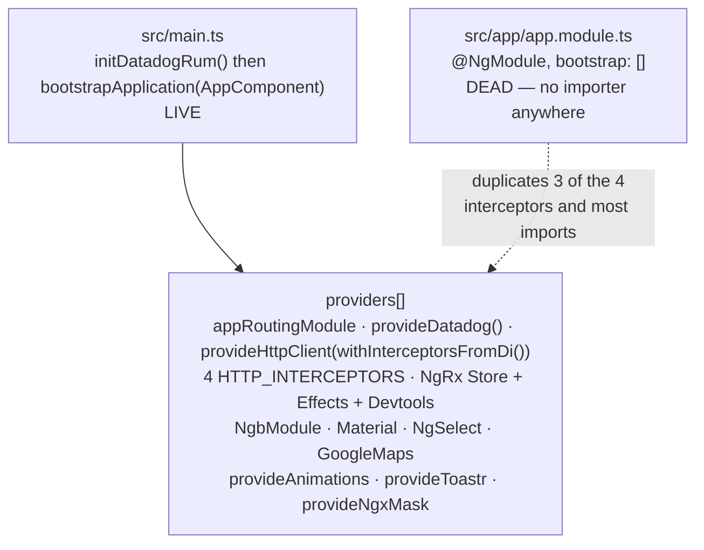
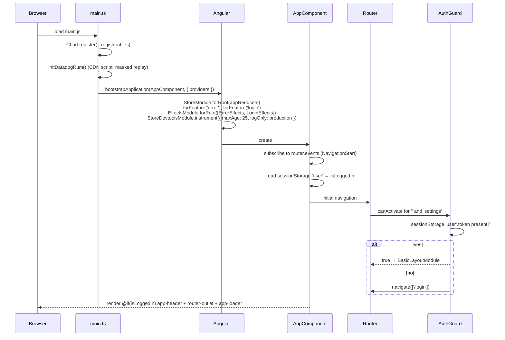
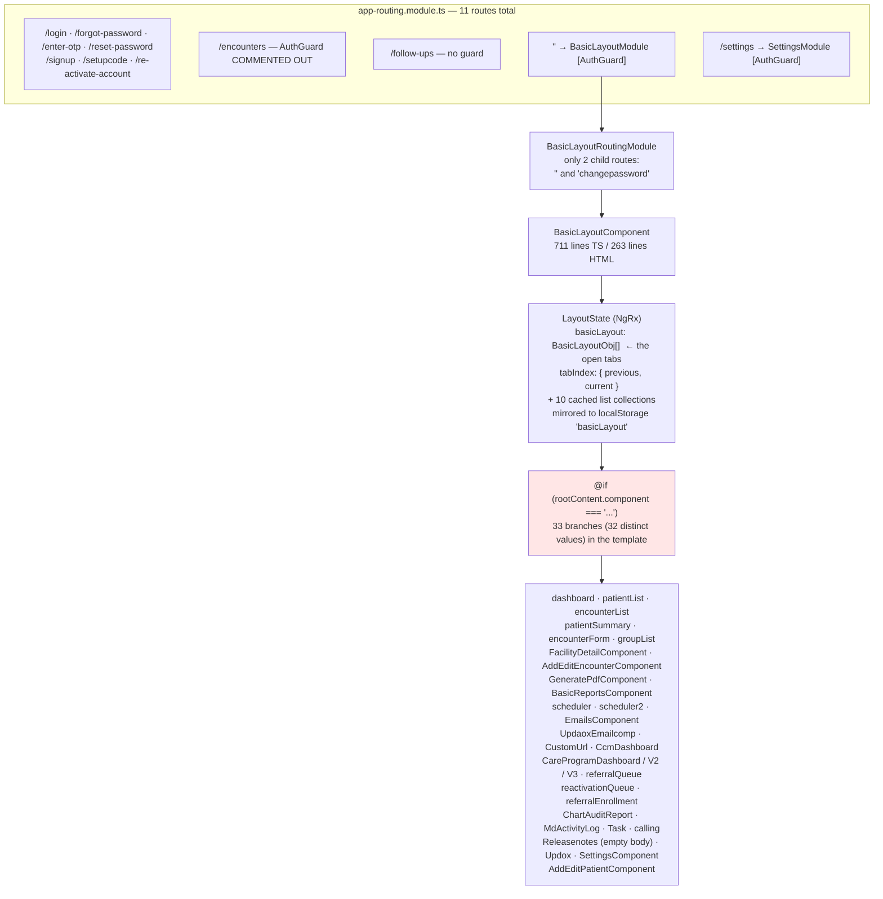
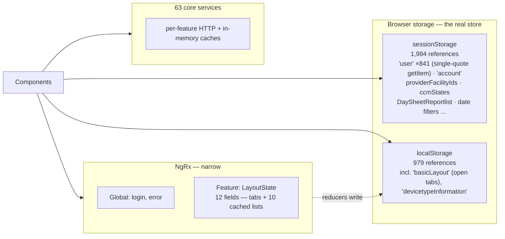
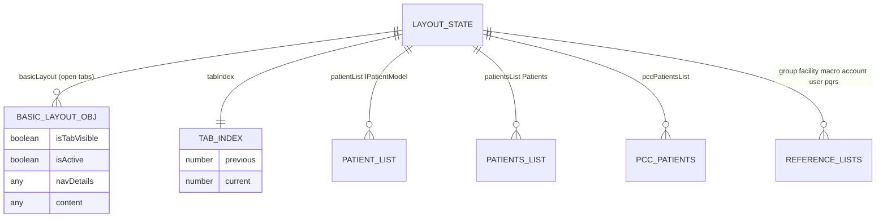

# Deep-Dive - SPA Shell & Navigation

**Date**: 2026-10-19
**Analyzed By**: ARCHITECT
**Status**: Draft (awaiting user confirmation)
**Scope**: how the Angular application boots, composes and navigates — bootstrap, routing, the tab-based shell, state management, browser storage, interceptor chain, client-side monitoring
**Evidence base**: `PacEHR` @ `401caa134` (checked-out branch is the ticket branch AITP-117 guided-workflow). Sibling repos at pacEHR_API `0f611f65c`, pacEHR_AI `ef172ea` (not used by this module). Supersedes the 2026-09-30 version (`PacEHR` @ `3034de845`).

> **Headline finding (still holds)**: PacEHR does not navigate by URL. Eleven top-level routes exist (`src/app/app-routing.module.ts`), but the entire authenticated application renders inside a single `BasicLayoutComponent` that switches between feature components via a string discriminator held in NgRx state. There is no deep-linking, no browser back/forward, and no bookmarkable screen beyond the login page.

---

## Changes since 2026-09-30

~212 commits landed in PacEHR since the earlier deep-dive (103 non-merge). Shell-relevant changes, each verified against current code:

| Change | Evidence |
|---|---|
| **Datadog RUM added** (new `core/monitoring/datadog-rum.ts`, 231 lines), bootstrapped from `main.ts`; enabled in the prod environment file, session replay sampled at 20%, `defaultPrivacyLevel: 'mask'`, `beforeSend` strips query strings | `src/main.ts:42-44`, `src/app/core/monitoring/datadog-rum.ts:88-125`, `src/environments/environment.prod.ts:9-19` |
| **Datadog user identity includes name, email and role** (`setUser`), plus account id/name | `datadog-rum.ts:175-182` |
| **New shell branches**: `reactivationQueue` (PAC-1352/1353) added to the switch; total `rootContent.component ===` branches now **33** (was 31) | `basic-layout.component.html:124` |
| Shell and header grew: `basic-layout.component.ts` 687 -> **711** lines, `.html` 256 -> **263**, `layout.state.ts` 441 -> **463**, `header.component.ts` 2,619 -> **2,636** | `wc -l` |
| Header now clears the guided-workflow note drafts (`GuidedWorkflowDraftService.clearAll()`) on logout/timeout/session change (4 call sites) | `header.component.ts:1728,1907,1978,2361` |
| Component count: 322 -> **340** (304 `standalone: true`, 0 `standalone: false`; the remaining 36 declare neither flag and rely on the Angular default); specs 317 -> **341** | grep |
| `sessionStorage` references 1,937 -> **1,994**; `localStorage` 952 -> **979**; `sessionStorage.getItem('user')` 904 -> **841** (single-quote form; 904 not reproduced) | grep |
| **Corrected (was wrong in the old doc)**: the idle timer is not `bn-ng-idle`. `BnNgIdleService` is injected but `startWatching` is commented out; the live timer is an RxJS `merge(fromEvent...)` + `switchMap(timer)` in `sessionTimeOut()` | `header.component.ts:72,1168,1178-1200` |
| **Corrected**: lazy-route split. Of 8 `loadChildren` routes, **6** are pre-authentication and **2** (`''` shell, `/settings`) are authenticated; the old doc said 7 pre-auth | `app-routing.module.ts` |
| **Added**: tab state is mirrored to `localStorage['basicLayout']` from inside reducers (a side effect in a reducer); not mentioned in the old doc | `layout.reducers.ts:41,58,69,200`; `basic-layout.component.ts:283-305` |
| **Dropped**: the "clear browser storage on logout" recommendation - logout already calls `sessionStorage.clear(); localStorage.clear();` | `header.component.ts:1909-1910` |
| Unchanged: `app.module.ts` still dead (141 lines, no importer, 3 interceptors, `bootstrap: []`); `/encounters` guard still commented out; `/follow-ups` unguarded; Redux DevTools still instrumented (`logOnly: production`); 4 interceptors with CSRF still registered only in `main.ts`; no spec for `auth.guard.ts`, reducers/effects or interceptors | see below |

---

## Module Overview

| Concern | Location | Size (now) |
|---|---|---|
| Bootstrap | `src/main.ts` | 101 lines — standalone `bootstrapApplication` (+ `initDatadogRum()`) |
| Dead bootstrap | `src/app/app.module.ts` | 141 lines — **never imported** (only self-match on `app.module`) |
| Root component | `src/app/app.component.ts` / `.html` | 157 / 8 lines |
| Routing | `src/app/app-routing.module.ts` | 11 routes, 8 lazy (6 pre-auth, 2 authenticated) |
| Shell | `src/app/features/basic-layout/` | `basic-layout.component.ts` 711, `.html` 263 |
| Shell state | `src/app/features/basic-layout/_store/` | 1,006 lines across 5 files (actions 42, effects 186, reducers 304, selector 11, state 463) |
| Header | `src/app/_shared/components/header/header.component.ts` | **2,636 lines** |
| Global store | `src/app/_store/` | `login`, `error` only |
| Interceptors | `src/app/core/ineterceptors/` | 4 interceptors + `skip-loader.token.ts` |
| Monitoring | `src/app/core/monitoring/datadog-rum.ts` | 231 lines (new) |
| Auth guard | `src/app/auth.guard.ts` | 21 lines — checks `sessionStorage['user'].token` is truthy |

---

## Component Breakdown

### Two composition roots, one live



`app.module.ts` declares `bootstrap: []` (`app.module.ts:135`) and registers only three interceptors — `Auth`, `Loader`, `Encrypt` (`:129-131`); `CsrfInterceptor` is missing. A repo-wide grep for `AppModule|app.module` in `src/` matches only `app.module.ts` itself. It is a leftover from the NgModule to standalone migration.

### Interceptor chain (from `main.ts`, the live registration, `main.ts:75-92`)

| Order | Interceptor | Role |
|---|---|---|
| 1 | `AuthInterceptor` | Adds AES-encrypted `token`, `accountID`, `userID`, `accountName` headers (reads `sessionStorage['user']` inline, `auth.interceptor.ts:73-74`); retry policy; error normalisation; error modal |
| 2 | `CsrfInterceptor` | Adds `X-XSRF-TOKEN` when an `XSRF-TOKEN` cookie exists (`csrf.interceptor.ts:18,28`) — **the server never validates it** (Module 01; carried, not re-verified in this module) |
| 3 | `LoaderInterceptor` | Global spinner; honours the `SKIP_LOADER` HttpContext token (`loader.interceptor.ts:25`) |
| 4 | `EncryptInterceptor` | AES-encrypts the request body |

Order is correct for the purpose: headers set before the body is encrypted. Interceptor behaviour was not changed since the earlier dive (`git log 3034de845..HEAD -- core/ineterceptors` shows only the loader import-cycle fix, `078b2a317`).

### Client-side monitoring (new)

`initDatadogRum()` runs before bootstrap and loads the RUM SDK from the Datadog CDN at runtime (`datadog-rum.ts:4-14,95`). Settings in the prod environment: `enabled: true`, `sessionSampleRate: 100`, `sessionReplaySampleRate: 20`, `traceSampleRate: 0`. PHI safeguards present in code: `defaultPrivacyLevel: 'mask'`, `enablePrivacyForActionName: true`, and `beforeSend: scrubEvent` which strips `?query` and `#hash` from view, referrer and resource URLs (`:44-60,122-124`). View names are the matched route template (`computeViewName`), never the concrete URL. Because the authenticated app is one route (`''`), every authenticated screen is attributed to the same view (consequence of the tab shell; inferred from `computeViewName` + routing, not observed in Datadog).

---

## Key Workflows

### Workflow 1: Application bootstrap



### Workflow 2: Navigation — tabs, not routes



**Stories**:
1. The URL stays at `/` for every screen in the authenticated application. Users cannot bookmark a patient, share a link to an encounter, or use browser back/forward.
2. Which component renders is decided by a **string comparison** — `rootContent.component === 'patientSummary'` (`basic-layout.component.html:69`). A typo is a silently blank panel, not a compile error.
3. Adding a feature means editing the shell template, the state model and the reducer — the shell is a change magnet (the new `reactivationQueue` branch at `:124` is the latest example).
4. The shell template eagerly references every feature component, so the lazy-loaded authenticated routes buy little: the bulk of the app loads with the shell. (Bundle composition not measured; inferred from template imports.)
5. Two routes escape the guard: `/encounters` has `// canActivate: [AuthGuard],` commented out (`app-routing.module.ts:34`) and `/follow-ups` never had one (`:37`).
6. Template defects visible in the switch: `CareProgramDashboardV3` appears **twice** (`:133` mounts `app-ccm-dashboard`, `:136` mounts `app-new-ccm-enrollment`, so one value renders two components); `Releasenotes` (`:142`) has an empty body (component commented out).

### Workflow 3: State — three stores, unevenly used



`sessionStorage.getItem('user')` appears **841 times** (single-quoted form; 904 in the earlier count, not reproduced with the current method — the order of magnitude is unchanged). It holds the session token, user id, role and account details, and is re-parsed at each call site rather than read once through a service.

---

## Data Models

### `LayoutState` (`features/basic-layout/_store/layout.state.ts`, 463 lines)

| Field | Type | Purpose |
|---|---|---|
| `basicLayout` | `BasicLayoutObj[]` | Open tabs, each with `isTabVisible`, `isActive`, `content` (component, data) |
| `tabIndex` | `{ previous, current }` | Active tab |
| `patientList` | `IPatientModel[]` | Cached list |
| `patientsList` | `Patients[]` | A **second** patient collection, different type |
| `groupList`, `facilityList`, `macroList`, `accountList`, `userList`, `pqrsList`, `pccPatientsList` | arrays | Cached reference data |
| `recordCount` | `number` | Paging |

Two patient collections (`patientList: IPatientModel[]` and `patientsList: Patients[]`) coexist in one state object (`layout.state.ts:34-35`).



### Browser storage keys (reference counts, call-form `get/set/removeItem('key')`)

Key names confirmed still in use: `user`, `account`, `providerFacilityIds`, `providerFacilityIdsForCareProgram`, `ccmDashBoardActivePage`, `TempfacilityList`, `ccmMonthDate`, `DaySheetReportlist`, `activeTabId`, `ccmStates`, `basicLayout` (localStorage), `devicetypeInformation` (localStorage; read by the guided-workflow feature service, `guided-workflow-feature.service.ts:70`). Per-key counts from the old list are carried, not re-verified (counts depend on quoting style).

`DaySheetReportlist` is cleaned by `core/services/sessionclear.service.ts:9` and listed in `group-scope-reset.service.ts:83`, so a clear mechanism exists for it; whether the cached rows are patient-identifying was not checked (carried).

---

## Pattern Catalog

### Pattern: ✅ modern Angular bootstrap

```typescript
// DO — src/main.ts:41-50: standalone bootstrap, DI-based interceptors
bootstrapApplication(AppComponent, {
  providers: [
    appRoutingModule,
    ...provideDatadog(),
    provideNgxMask(),
    provideAnimations(),
    provideToastr(),
    provideHttpClient(withInterceptorsFromDi()),
    { provide: HTTP_INTERCEPTORS, useClass: AuthInterceptor, multi: true },
    // ...
  ]
});
```

The template uses Angular 17+ control flow (`@if (isLoggedIn) { <app-header></app-header> }`, `app.component.html:2`). 304 of 340 components are explicitly `standalone: true`, none `standalone: false`.

### Pattern: 🔴 a dead second composition root

```typescript
// DON'T — src/app/app.module.ts:129-135, never imported
providers: [
  { provide: HTTP_INTERCEPTORS, useClass: AuthInterceptor, multi: true },
  { provide: HTTP_INTERCEPTORS, useClass: LoaderInterceptor, multi: true },
  { provide: HTTP_INTERCEPTORS, useClass: EncryptInterceptor, multi: true },
  // CsrfInterceptor missing
],
bootstrap: []
```

DO: delete the file; keep `main.ts` as the sole composition root.

### Pattern: 🔴 string-discriminated view switching instead of routing

```html
<!-- DON'T — basic-layout.component.html:57-69 -->
@if (rootContent.component === 'dashboard') { <app-dashboard ...></app-dashboard> }
@if (rootContent.component === 'patientList') { <app-patient-list ...></app-patient-list> }
@if (rootContent.component === 'FacilityDetailComponent') { <app-facility-detail ...></app-facility-detail> }
@if (rootContent.component === 'patientSummary') { <app-patient-summary ...></app-patient-summary> }
```

```typescript
// DO — child routes under the shell, keeping the tab UI but restoring URLs
const routes: Routes = [
  { path: '', component: BasicLayoutComponent, canActivate: [AuthGuard], children: [
      { path: 'patients',       loadComponent: () => import('...').then(m => m.PatientListComponent) },
      { path: 'patients/:id',   loadComponent: () => import('...').then(m => m.PatientSummaryComponent) },
  ]},
];
```

Discriminator values are inconsistent — `'dashboard'`, `'patientList'` (camelCase) next to `'FacilityDetailComponent'`, `'GeneratePdfComponent'` (class names), `'CcmDashboard'`, `'UpdaoxEmailcomp'` (misspelled), `'calling'`. No enum or union type constrains them. Tab-based MDI shells are legitimate for clinical software, but are normally built with routing (open tabs serialised into the URL), not instead of it. Whether this was a deliberate decision is unknown (Open Question 1).

### Pattern: 🔴 `sessionStorage` as the primary state store

```typescript
// DON'T — core/ineterceptors/auth.interceptor.ts:73-74 (same shape repeated across ~841 call sites)
if (sessionStorage.length > 0 && sessionStorage.getItem('user') !== undefined && ...) {
  idToken = JSON.parse(sessionStorage.getItem('user')).token;
```

```typescript
// DO
@Injectable({ providedIn: 'root' })
export class SessionService {
  private readonly user = signal<User | null>(this.read());
  get token() { return this.user()?.token ?? null; }
}
```

Roughly 2,970 combined `sessionStorage`/`localStorage` references (1,994 + 979). Each duplicates null-checking and `JSON.parse`. Positive: the guided-workflow feature service wraps its reads through `configs/account-configuration.ts` / `user-configuration.ts` helpers with a fail-closed `try/catch` (`guided-workflow-feature.service.ts:34-43`), which is the direction to follow.

### Pattern: 🔴 side effects and storage reads inside NgRx reducers

```typescript
// DON'T — layout.reducers.ts:41 (4 occurrences: :41, :58, :69, :200)
localStorage.setItem("basicLayout", "{\"accountID\":" + JSON.parse(sessionStorage.getItem('user')).accountID + ",\"userID\":" + ... + JSON.stringify(newState) + "}");
```

```typescript
// DO — keep reducers pure; persist from an effect
persistTabs$ = createEffect(() => this.actions$.pipe(
  ofType(AddTab, RemoveTab, ChangeMenu),
  withLatestFrom(this.store.select(selectLayout)),
  tap(([, layout]) => this.tabStore.save(layout))
), { dispatch: false });
```

The reducer reads `sessionStorage['user']` and writes `localStorage` on each tab add/replace, building JSON by string concatenation. The tab restore path (`basic-layout.component.ts:283-305`) re-reads it and discards it when user/account differ. The persisted `basicLayoutobject` is the full tab array including each tab's `content`/data; what patient data those objects carry was not enumerated (carried). Logout clears it (`header.component.ts:1910`). Added since the earlier dive only in the sense of being documented; the code was already present at `3034de845` (4 `localStorage.setItem("basicLayout"` sites).

### Pattern: 🟡 Redux DevTools instrumented in production

```typescript
// DON'T — main.ts:68-71
StoreDevtoolsModule.instrument({ maxAge: 25, logOnly: environment.production })
```

`logOnly: true` disables time-travel dispatch but the extension still connects and exposes up to 25 state snapshots, which include `patientList`, `patientsList` and `pccPatientsList`. DO: omit the module in production builds (e.g. `isDevMode() ? [StoreDevtoolsModule.instrument()] : []`).

### Pattern: 🟡 third-party client telemetry with user identity (new)

```typescript
// ACTUAL — core/monitoring/datadog-rum.ts:175-182
rum.setUser({ id: String(user.userID), name: user.name ?? user.userName, email: user.emailID, role: user.roleName });
rum.setAccount({ id: String(user.accountID), name: user.accountName });
```

Good: replay is masked, action names are privacy-masked, query strings are scrubbed, SDK load failure cannot break the app, and tracing is off. Open point: staff name and email are sent to a third party on every session (workforce PII, not patient PHI); whether the Datadog agreement/BAA covers this is a team question. Real-user session replay is sampled at 20% in prod.

### Pattern: 🟡 god components in the shell

| Component | Lines |
|---|---|
| `header.component.ts` | **2,636** |
| `basic-layout.component.ts` | 711 |
| `layout.state.ts` | 463 |
| `layout.reducers.ts` | 304 |

The header holds the RxJS idle timer, menu permissions, account switching, notifications and logout cleanup orchestration (it now also calls `GuidedWorkflowDraftService.clearAll()`, `facilityService.clearFacilityDropdownCache()`, `pendoService.endSession()`).

### Pattern: 🟡 unused idle-detection dependencies

`package.json` still lists `@ng-idle/core` (`:54`), `@ng-idle/keepalive` (`:55`) and `bn-ng-idle` (`:67`). All three are effectively unused: the `@ng-idle` imports are commented out (`header.component.ts:24,163,879`), and `BnNgIdleService` is injected (`:72`) but its only call (`startWatching`, `:1168`) is commented out. The live implementation is the custom RxJS `sessionTimeOut()` (`:1178-1200`). **Correction to the earlier doc**, which said `bn-ng-idle` was the one in use. Note the custom timer reacts to `mousemove|mousedown|keydown|scroll|touchstart|visibilitychange` only.

### Pattern: 🟡 lazy loading undermined by the shell

8 of 11 routes use `loadChildren`: 6 pre-authentication (forgot-password, enter-otp, reset-password, signup, setupcode, re-activate-account) and 2 authenticated (`''` shell, `/settings`). The shell template eagerly references the feature components, so the practical effect is that most of the authenticated app is in the main authenticated chunk. Not measured with a bundle analyser.

### Test patterns (shell)

| Target | Tests (now) |
|---|---|
| `app.component.spec.ts` | present |
| `basic-layout.component.spec.ts` | present (25 lines) |
| `header.component.spec.ts` | present (imports `BnNgIdleService`) |
| `auth.guard.ts` | **0** (no `auth.guard*.spec.ts`) |
| `layout.reducers.ts` / `layout.effects.ts` | **0** (no spec in `_store/`) |
| Interceptors (all 4) | **0** (no spec in `core/ineterceptors/`) |
| `core/monitoring/datadog-rum.ts` | not checked for a spec (carried) |

`features/basic-layout` holds 12 of the SPA's 341 specs. The guard, reducers and interceptors — the pieces that decide access, state and every outbound request — still have none.

---

## Entry Points

| Entry | File |
|---|---|
| Bundle | `src/main.ts` |
| Monitoring bootstrap | `src/app/core/monitoring/datadog-rum.ts` (`initDatadogRum`, `provideDatadog`) |
| Root component | `src/app/app.component.ts` |
| Routes | `src/app/app-routing.module.ts` (11) |
| Shell | `src/app/features/basic-layout/basic-layout.component.ts` |
| Settings sub-app | `src/app/features/settings/settings-routing.modules.ts` |
| Dev proxy | `src/proxy.conf.json` |
| Env config | `src/environments/environment*.ts` |

---

## Open Questions for the Team

1. **Was the tab shell chosen over routing deliberately?** If yes it should be an ADR; if it accumulated, restoring URLs is the highest-value structural change available in the SPA.
2. **Do users ask for deep links** ("send me a link to this patient")? That answers question 1 commercially.
3. **Can `app.module.ts` be deleted?** Nothing imports it.
4. **Is Redux DevTools acceptable in production**, given patient collections sit in the instrumented state?
5. **What patient data is carried in the persisted `basicLayout` tab objects and in `DaySheetReportlist` / `TempfacilityList`?** Logout clears both stores, but a closed browser without logout leaves `localStorage` populated.
6. **Why are `/encounters` and `/follow-ups` unguarded?**
7. **Is sending staff name/email/role to Datadog RUM covered by the vendor agreement?**
8. **Can `@ng-idle/core`, `@ng-idle/keepalive` and `bn-ng-idle` all be removed?**
9. **Is the double `CareProgramDashboardV3` branch intentional** (one value mounting two components)?

---

## Recommendations

| # | Recommendation | Rationale | Priority |
|---|---|---|---|
| 1 | Restore the `AuthGuard` on `/encounters` and add one on `/follow-ups` | Two routes bypass the client-side gate (`app-routing.module.ts:32-39`) | 🔴 High |
| 2 | Introduce a `SessionService` and migrate the `sessionStorage.getItem('user')` sites (841) | One shape, one parse, one null-check | 🔴 High (incremental) |
| 3 | Delete `app.module.ts` | Dead second composition root with a different interceptor list | 🟡 Medium |
| 4 | Move child routes under `BasicLayoutComponent`, keeping the tab UI | Restores deep-linking, back/forward, real lazy loading, and meaningful Datadog view names | 🟡 Medium — large but high value |
| 5 | Replace the `rootContent.component` string with a union type or enum; fix duplicate `CareProgramDashboardV3` branch | Typos are silent blank panels | 🟡 Medium |
| 6 | Exclude `StoreDevtoolsModule` from production builds | Patient collections in instrumented state | 🟡 Medium |
| 7 | Move the `localStorage['basicLayout']` write out of the reducers into an effect; audit what tab content is persisted | Impure reducers, string-built JSON, unknown PHI content | 🟡 Medium |
| 8 | Confirm the Datadog data-handling position for staff identity (name, email, role) | New third-party egress | 🟡 Medium |
| 9 | Split `header.component.ts` (2,636 lines) | Idle, permissions, account switching, notifications and logout cleanup in one file | 🟢 Low |
| 10 | Remove `@ng-idle/core`, `@ng-idle/keepalive`, `bn-ng-idle` and the dead injection | All three unused | 🟢 Low |
| 11 | Add tests for `AuthGuard`, the four interceptors and the layout reducer | Access, state and every request — all untested | 🟡 Medium |
| 12 | Reconcile `patientList` vs `patientsList` in `LayoutState` | Two patient collections, two types | 🟢 Low |

---

**Next**: Module 10 — SPA feature areas.
