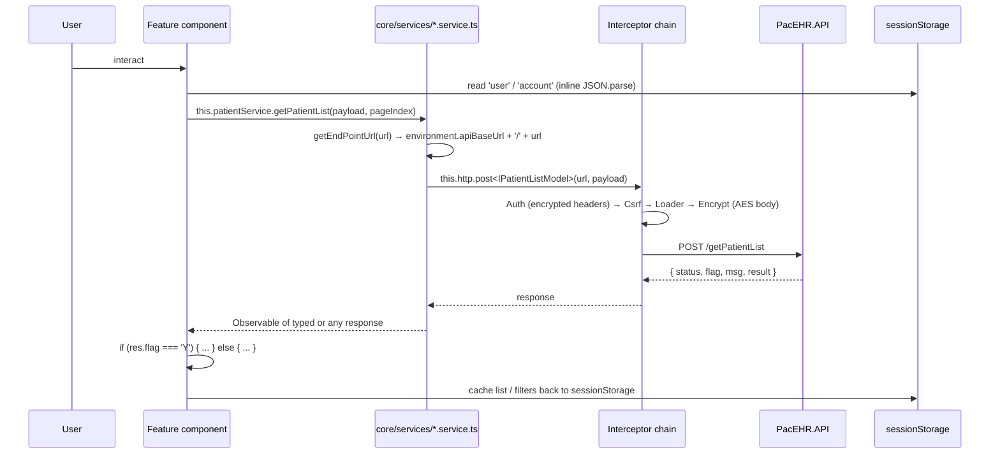
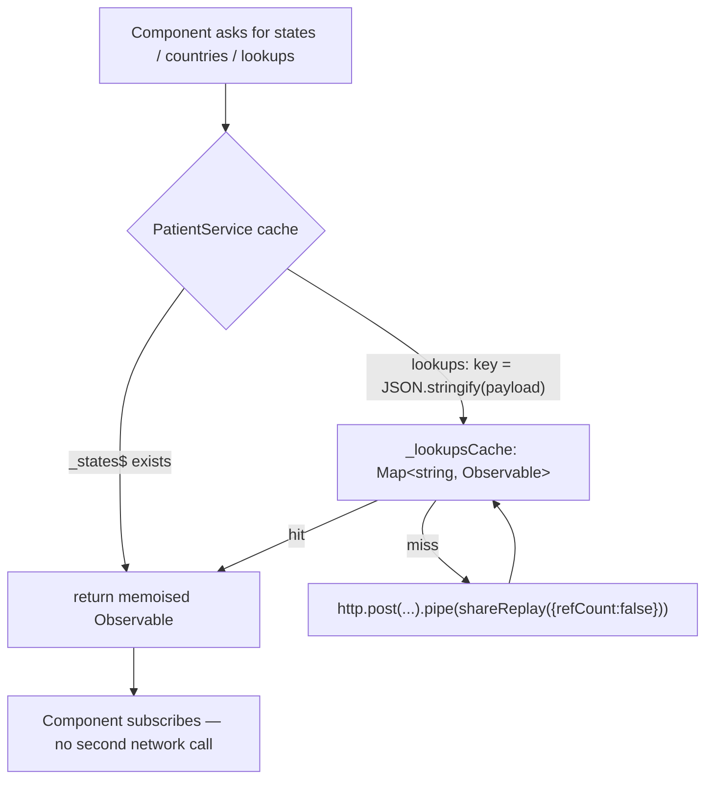
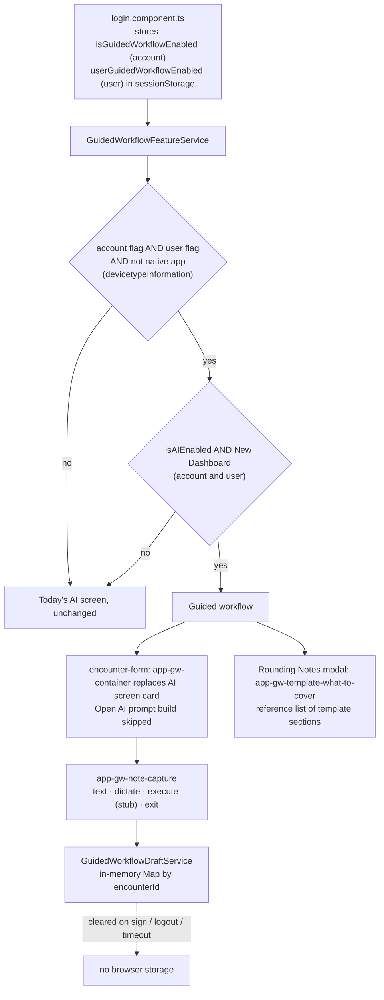
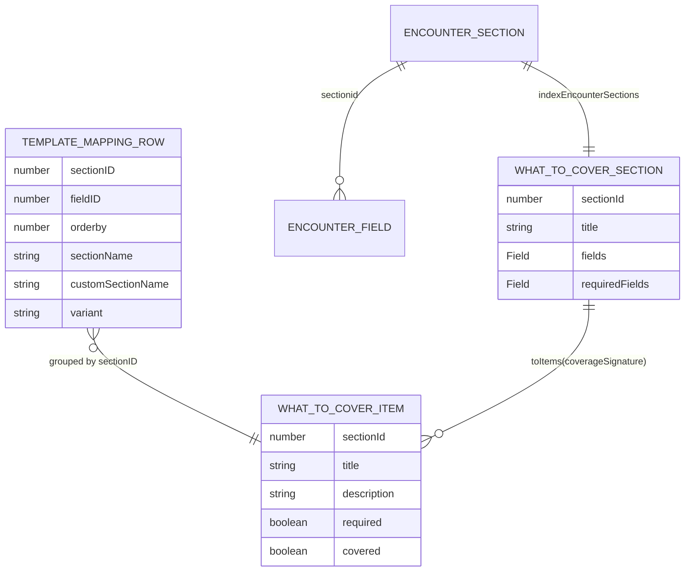
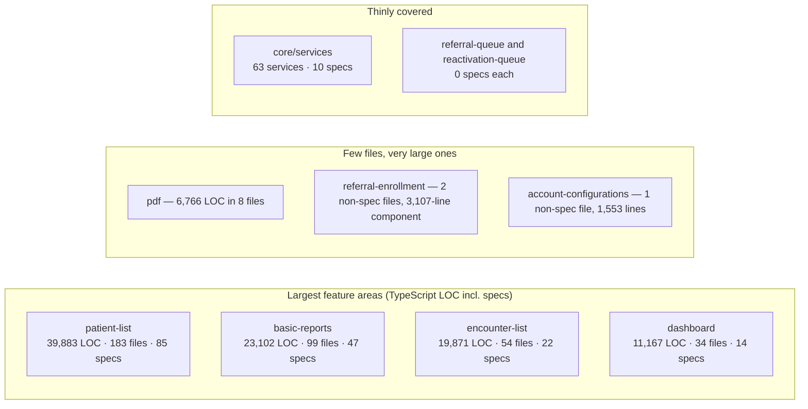

# Deep-Dive - SPA Feature Areas & Client State

**Date**: 2026-10-19
**Analyzed By**: ARCHITECT
**Status**: Draft (awaiting user confirmation)
**Scope**: the 54 feature directories under `src/app/features`, the core services they call, component conventions, forms, change detection, subscription hygiene and typing — plus the new guided-workflow feature area
**Evidence base**: `PacEHR` @ `401caa134` (checked-out branch: ticket branch AITP-117 guided-workflow). Sibling repos pacEHR_API `0f611f65c`, pacEHR_AI `ef172ea` not used by this module. Supersedes the 2026-09-30 version (`3034de845`).

LOC figures below count every `.ts` file under the directory **including specs**, as the earlier doc did (comparable). "Non-spec" is stated where used.

---

## Changes since 2026-09-30

| Change | Evidence |
|---|---|
| **New feature area `guided-workflow`** (AITP-32 / 35 / 117): 25 files added, 4 components, 3 services, 2 util modules, 9 specs; gated by account + user feature flags; wired into `encounter-form` and the Rounding Notes modal | `src/app/features/guided-workflow/**` — see "Guided workflow" below |
| Two other new feature directories: `reactivation-queue` (524-line component, **0 specs**) and `linked-record-confirm` (49-line component + spec) | `ls src/app/features`; `find ... -name '*.spec.ts'` |
| Scale: components 322 -> **340**; component TS ~125,000 -> **~133,900** lines; component HTML ~54,000 -> **~57,200** lines; specs 317 -> **341**; feature directories 50 -> **54** (3 new confirmed by tree diff; the 4th is unexplained, the old count may have been off by one) | `find`/`wc` |
| Core services: 66 -> **63** non-spec service files (10 specs beside them), 10,559 -> **12,506** lines (all `.ts` in `core/services`, specs included); service specs 7 -> **10** | `ls core/services` |
| **A generic response envelope now exists on the client**: `IApiResult<T>` `{ status, flag, msg, result }` (`core/models/referral-queue.model.ts:5-10`), used by the referral-queue service (108 references). Old doc said no `ApiResponse<T>` existed. It is still confined to that feature | grep |
| **Typed returns have started in `patient.service.ts`**: `getPatientList(...)`: `Observable<IPatientListModel>` (`patient.service.ts:61-64`). The old "ACTUAL" example (`Observable<any>`) no longer matches | read |
| `Observable<any>` in core services 647 -> **654**; `Observable<I…>` 88 -> **88** | grep |
| `SKIP_LOADER` is now used in 3 services (not "2 places in one service"): `patient.service.ts:105`, `dragon-copilot.service.ts:632`, and 5 sites in `referral-queue.service.ts` | grep |
| `shareReplay` is now in 17 core services, not only `PatientService` (old claim "one of 66" dropped). Keyed cache still lives in `patient.service.ts:39-58` | grep |
| `OnPush`: 180 of 322 -> **207 of 340** (61%) | grep |
| Subscriptions: `.subscribe(` 2,037 -> **2,139** (non-spec); `takeUntil*` 320 -> **352**; files with `ngOnDestroy` 92 -> **92** | grep |
| Forms: reactive files 158 -> **158**; `[(ngModel)]` templates 117 -> **127** | grep |
| Largest components grew: `encounter-form` 4,898 -> **4,930** TS (HTML 3,114 -> **3,381**), `referral-enrollment` 2,773 -> **3,107**, `add-edit-user` 2,216 -> **2,371**, `schedular2` 1,942 -> **2,047** | `wc -l` |
| New service in the top list: `dragon-copilot.service.ts` **969** lines (second largest service) | `wc -l` |
| Unchanged: duplicate/misspelled directories (`scheduler`+`schedular2`, `care-program-dashboard`+`-v2`, three Updox directories, `componant`, `ineterceptors`, `imunization-popup`, `updaox-email`); `patient.service.ts` 1,575 lines / 226 `this.http` calls; service specs concentrated | `ls`, grep |

---

## Module Overview

340 components (304 explicit `standalone: true`, none `standalone: false`) / ~133,900 lines of component TypeScript / ~57,200 lines of component HTML across 54 feature directories. 303 of the 341 specs live under `features/`.

### Feature areas by size (all `.ts` incl. specs)

| Feature | LOC | Files | Specs | Notes |
|---|---|---|---|---|
| `patient-list` | **39,883** | 183 | 85 | Includes `patient-summary` and the whole care-plan tree |
| `basic-reports` | **23,102** | 99 | 47 | Churn figure from the old doc (194 touches) not recomputed |
| `encounter-list` | 19,871 | 54 | 22 | Contains the largest single component; hosts guided-workflow container |
| `dashboard` | 11,167 | 34 | 14 | Hosts the Rounding Notes modal with the What-to-Cover panel |
| `emails` | 7,111 | 20 | 10 | Chat + Updox email |
| `pdf` | 6,766 | **8** | 4 | ~846 lines per file |
| `basic-layout` | 5,615 (non-spec) | 19 | 12 | The shell (Module 09) |
| `account-list` | ~6,100 (non-spec) | 19 | 6 | 12 files added since 2026-09-30 |
| `referral-enrollment` | ~3,215 (non-spec) | 2 | 2 | Two files, 3,107-line component |
| `users-list` | ~3,351 (non-spec) | 5 | 7 | |
| `schedular2` *(sic)* | ~3,020 (non-spec) | 3 | 3 | Coexists with `scheduler` (~1,481) |
| `referral-queue` | ~1,901 (non-spec) | 5 | **0** | |
| `reactivation-queue` (new) | ~524 | — | **0** | |
| `guided-workflow` (new) | 660 (non-spec; specs excluded) | 10 non-spec | 9 | |

Rows marked "non-spec" were measured excluding specs this time and are not strictly comparable with the old table; rows for `facility-list`, `settings`, `account-configurations`, `calling`, `authentication` were not re-measured with the old method (carried, not re-verified): old values 3,259 / 2,971 / 2,394 / 2,339 / 2,201.

---

## Component Breakdown

### The ten largest components (non-spec, current)

| Component | Lines |
|---|---|
| `encounter-list/encounter-form/encounter-form.component.ts` | **4,930** (+ 3,381-line template) |
| `pdf/container/generate-pdf/generate-pdf.component.ts` | 3,470 |
| `referral-enrollment/referral-enrollment.component.ts` | 3,107 |
| `emails/chat/chat.component.ts` | 2,801 |
| `_shared/components/header/header.component.ts` (Module 09) | 2,636 |
| `pdf/componant/header-pdf/header-pdf.component.ts` *(sic)* | 2,602 |
| `users-list/add-edit-user/add-edit-user.component.ts` | 2,371 |
| `patient-list/patient-list.component.ts` | 2,283 |
| `schedular2/schedular2.component.ts` | 2,047 |
| `emails/new-email/new-email.component.ts` | 1,919 |

`add-treatment-plan-new.component.ts` (1,714) is the next entry.

### Core services (63 files + 10 specs, 12,506 lines incl. specs)

| Service | Lines | Note |
|---|---|---|
| `patient.service.ts` | **1,575** | 226 `this.http` calls |
| `dragon-copilot.service.ts` | 969 | dictation; now used by guided workflow |
| `treatment-plan-dictionary.service.ts` | 688 | |
| `loader.service.ts` | 627 | |
| `twilio.service.ts` | 521 | |
| `encounter.service.ts` | 483 | |
| `chatNotification.service.ts` | 430 | |
| `EmailNotification.service.ts` | 429 | |
| `open-ai.service.ts` | 423 | |
| `signal-r-encounter.service.ts` | 411 | |

### Guided workflow (new feature area, AITP-32 / 35 / 117)

`src/app/features/guided-workflow/` — non-spec files: 4 components (`container`, `note-capture`, `what-to-cover`, `template-what-to-cover`), 3 services (`feature`, `draft`, `what-to-cover`), 2 util modules (`note-text`, `what-to-cover`), 1 model file; 9 spec files. All components are standalone and `OnPush`.

| Piece | Role (from code) |
|---|---|
| `GuidedWorkflowFeatureService` (`services/guided-workflow-feature.service.ts`) | Feature gate. `isGuidedFlagOn()` = account `isGuidedWorkflowEnabled` AND user `userGuidedWorkflowEnabled` AND not native app (`devicetypeInformation` in localStorage is `mobileapp`/`tabapp`); fails closed on parse errors. `isEnabledWithAiGate()` / `isEnabled()` add the Open AI and New Dashboard flags (`:44-61`). |
| `GuidedWorkflowDraftService` (`services/guided-workflow-draft.service.ts`) | In-memory `Map<number,string>` of the note-box text per encounter id; **memory only by design** ("the text is patient data and must not reach browser storage", `:9`); cleared when the encounter is signed (`encounter-form.component.ts:3129`) and on session change (`header.component.ts:1728,1907,1978,2361`). |
| `GuidedWorkflowWhatToCoverService` (`services/guided-workflow-what-to-cover.service.ts`) | Per-template cache (`Map<number, Observable>` + `shareReplay(1)`) over the existing `getTemplateMapping` read; a failed read is evicted and returns `[]`. Cache lives until page reload (documented in the file, `:10-14`). |
| `GuidedWorkflowContainerComponent` (`app-gw-container`) | Replaces the AI screen card in `encounter-form` when the flag is on (`encounter-form.component.html:825-829`). Owns note text, pre-fill from the Rounding Notes modal note, dictation via `DragonCopilotService`. |
| `GuidedWorkflowNoteCaptureComponent` (`app-gw-note-capture`) | Presentational note box + dictate / execute / exit buttons. |
| `GuidedWorkflowTemplateWhatToCoverComponent` + `GuidedWorkflowWhatToCoverComponent` | Reference list of template sections shown in the Rounding Notes modal (`add-rounding-notes.component.html:202-204`), `mode="reference"`. |
| `utils/what-to-cover.ts` | Builds section items from template rows (`fromTemplateMapping`), plus `indexEncounterSections` / `coverageSignature` / `toItems` for live coverage tracking of an open encounter. |

Wiring into existing areas: `encounter-form` decides once per encounter (`initGuidedWorkflow()`, `encounter-form.component.ts:4438`, called right after `aiFacade.init()` at `:925-926`), routes both "Switch To AI Screen" buttons through `onAiButtonClick()` (`:4453-4460`) so that, with the flag on, opening/closing the guided panel does **not** run `toggleScreen()` (which would book AI follow-ups and save AI ICD/CPT), and suppresses the Open AI prompt build (`:4466-4472`). Flags are administered in `account-configurations` and `users-list/add-edit-user` forms (`isGuidedWorkflowEnabled` controls) and arrive via `login.component.ts:267,656` into the session.

**Observed gaps / state of completeness**:
- `GuidedWorkflowContainerComponent.onExecute()` is an empty method (`guided-workflow-container.component.ts:87`), and the template comment says the output area is "kept empty for the AI output screen of a later story". The feature is currently a note-capture shell plus a reference checklist; no backend call is made from it.
- The live-coverage functions `indexEncounterSections`, `coverageSignature` and `toItems`, and the `checklist` mode of `app-gw-what-to-cover`, have no consumer outside their own specs (grep for the names outside `guided-workflow/utils` returns nothing). The panel is only mounted in `reference` mode.
- Dictation availability reuses the existing Nuance/Dragon check (`nuanceUser`), not a new permission.
- Three comparable but separate flag sources must stay in step (`isEnabled()` repeats `EncounterAiFacade.init()` reads; the service comment says "keep the two in step", `:15-17`).

---

## Key Workflows

### Workflow 1: A feature area's data path



### Workflow 2: Caching — now in several services



`PatientService` memoises param-less lookups in fields and payload-varying lookups in a `Map` keyed by `JSON.stringify(payload)`, with `shareReplay({ bufferSize: 1, refCount: false })` (`patient.service.ts:36-49`) and a clear method (`:58`). `shareReplay` is now present in 17 service files (e.g. `encounter.service.ts` 16 hits, `dr-first.service.ts` 6) and the guided-workflow service applies the same keyed-cache idea with failure eviction. So the claim "exists in one of 66 services" no longer holds; consistency of cache invalidation across them was not audited.

### Workflow 3: Guided workflow — gating and use



### Workflow 4: What-to-Cover read in the Rounding Notes modal

```mermaid
sequenceDiagram
  participant M as AddRoundingNotes modal
  participant T as app-gw-template-what-to-cover
  participant W as GuidedWorkflowWhatToCoverService
  participant TE as TemplateEditorService
  participant API as PacEHR.API

  M->>T: templateId (form control value)
  T->>T: ngOnChanges → toTemplateId (positive integer or null)
  T->>W: itemsForTemplate(id)
  alt cached for this id
    W-->>T: shared Observable (shareReplay)
  else not cached
    W->>TE: getTemplateMapping({ templateId })
    TE->>API: POST getTemplateMapping
    API-->>W: { flag, result: rows }
    W->>W: flag Y → fromTemplateMapping(rows) ordered by orderby, required if any Hard field
    W->>W: flag F or error → []; error evicts cache entry
    W-->>T: WhatToCoverItem[]
  end
  T-->>M: renders app-gw-what-to-cover in reference mode
```

---

## Data Models

### Typing posture

| Signal | Count (now) | Was |
|---|---|---|
| `Observable<any>` in core services (non-spec) | **654** | 647 |
| `Observable<I…>` (I-prefixed interface) in core services | 88 | 88 |
| Generic envelope on the client | `IApiResult<T>` in `referral-queue.model.ts` (referral-queue only) | none |

Models exist and are imported, and some endpoints are now typed (`getPatientList` returns `Observable<IPatientListModel>`), so the earlier "88% of return types are `any`" ratio cannot be restated with the old method (interface names without the `I` prefix are also used). The `any` count is still the dominant signal. The server still returns a dictionary envelope with `flag` (Module 02, carried); `IApiResult<T>` declares `result: T` as non-optional even though the server can omit `result` (Module 02, carried), so even the new envelope understates that risk.

### Guided workflow models (`features/guided-workflow/models/what-to-cover.ts`)



`TemplateMappingRow` declares `variant` locally because the client's `TemplateMappingModel` lacks a column the API returns (`models/what-to-cover.ts`, comment). A section is "required" when any mapped field has variant `Hard`.

### Form strategy — mixed

| Approach | Files |
|---|---|
| Reactive (`FormBuilder` / `new FormGroup`) | 158 |
| Template-driven (`[(ngModel)]`) | 127 templates |

Roughly 55/45, both approaches appearing across the same feature areas.

---

### Where the SPA's mass sits



---

## Pattern Catalog

### Pattern: ✅ a consistent service shape

```typescript
// DO — core/services/patient.service.ts:29-31
@Injectable({ providedIn: 'root' })
export class PatientService {
  private getEndPointUrl(url: string): string {
    return `${environment.apiBaseUrl}/${url}`;
  }
}
```

`providedIn: 'root'`, constructor/`inject()` injection, one private URL builder, environment-driven base URL. The new guided-workflow services follow it (`@Injectable({ providedIn: 'root' })`, `inject()`), and the Referral Queue service documents that headers and body encryption come from the interceptors (`referral-queue.service.ts:1-3`).

### Pattern: ✅ session-scoped memoisation with `shareReplay`

```typescript
// DO — core/services/patient.service.ts:36-49 and
// features/guided-workflow/services/guided-workflow-what-to-cover.service.ts:28-39
private readonly cache = new Map<number, Observable<WhatToCoverItem[]>>();
const items$ = this.templateEditor.getTemplateMapping({ templateId }).pipe(
  map(res => res?.flag === 'Y' ? fromTemplateMapping(res.result) : []),
  catchError(error => { this.cache.delete(templateId); return of([]); }),
  shareReplay(1),
);
```

Keyed cache with explicit failure eviction and documented lifetime; `refCount: false` in `PatientService` is deliberate. Caveat documented in the guided-workflow service: the cache is not cleared at logout, so an edited template can look stale until reload.

### Pattern: ✅ `HttpContext` to opt out of the global loader

```typescript
// DO — core/services/patient.service.ts:105
{ context: new HttpContext().set(SKIP_LOADER, skipLoader) }
```

Now used in `patient.service.ts`, `dragon-copilot.service.ts:632` and `referral-queue.service.ts` (5 sites). Most other background calls still trigger the global spinner.

### Pattern: ✅ feature-flag gate that fails closed (new)

```typescript
// DO — guided-workflow-feature.service.ts:34-43
isGuidedFlagOn(): boolean {
  try { return !!accountFlag && !!userFlag && !this.isNativeApp(); }
  catch { return false; }   // unparseable session JSON: fail closed
}
```

`!!` is used deliberately so INT `1` from a stored procedure counts as on, and a missing key is off. Good model for other flags; the older flags scattered across components still read `sessionStorage` inline.

### Pattern: ✅ sensitive text kept out of browser storage (new)

```typescript
// DO — guided-workflow-draft.service.ts:9-14,13
// "Memory only: the text is patient data and must not reach browser storage."
private readonly drafts = new Map<number, string>();
```

Cleared on sign and on session change (header). A conscious PHI decision that contrasts with the existing `sessionStorage` caching of result sets (Module 09). Trade-off: a page reload loses the draft.

### Pattern: 🔴 god components

```typescript
// DON'T — encounter-form.component.ts: 4,930 lines TS + 3,381 lines HTML
```

Eight components exceed 1,900 lines. `encounter-form` alone is 8,311 lines of TS+HTML for one screen. The guided-workflow integration added further branches into it (`initGuidedWorkflow`, `onAiButtonClick`, `isGuidedWorkflowEnabled`, `guidedWorkflowDraft.clear`) rather than extracting a seam — though the new UI itself sits in separate components behind one `@if` (`encounter-form.component.html:825`), which is the better direction. `referral-enrollment` (3,107-line component) and `account-configurations` (one 1,553-line non-spec file) show the same shape.

### Pattern: 🔴 `Observable<any>` as the default return type

```typescript
// DON'T — still common: Observable<any> ×654 across core/services
private readonly _lookupsCache = new Map<string, Observable<any>>();   // patient.service.ts:39
```

```typescript
// DO — typed payload, already present in places
getPatientList(payload: any, pageIndex: number): Observable<IPatientListModel> {   // patient.service.ts:61-64
  return this.http.post<IPatientListModel>(this.getEndPointUrl('getPatientList'), ...);
}
// DO — and reuse the existing envelope instead of per-feature copies
export interface IApiResult<T> { status: number; flag: string; msg: string; result: T; }  // referral-queue.model.ts:5
```

The client-side cost of the server's untyped dictionary envelope (Module 02). `IApiResult<T>` exists but is feature-local and should be promoted to `core/models`, with `result?: T` and `flag: 'Y' | 'F'` to match server behaviour (carried from Module 02). `getPatientList(payload: any, ...)` still takes untyped payload.

### Pattern: 🟡 subscription hygiene is inconsistent

| Signal | Count (non-spec) |
|---|---|
| `.subscribe(` calls | **2,139** |
| `takeUntil` / `takeUntilDestroyed` | 352 |
| Files with `ngOnDestroy` | 92 |

```typescript
// DO — header.component.ts:1192-1200, the modern form
this.idleSub = activity$.pipe(startWith(0), switchMap(() => timer(idleMs)), takeUntilDestroyed(this.destroyRef)).subscribe(...)
```

Most subscriptions are one-shot `HttpClient` calls that complete on their own. The real risk subset is long-lived sources (SignalR streams in `chatNotification`, `EmailNotification`, `signal-r-encounter`, `router.events`, NgRx selectors, `Subject` state). Not audited individually in this refresh (carried, not re-verified); the aggregate ratios are unchanged. The new guided-workflow container handles the dictation stream explicitly (`first(starting => !starting)` plus `ngOnDestroy` stop, `guided-workflow-container.component.ts:73,121`), but note its template subscribes via `async` pipes, which is safe.

### Pattern: 🟡 `ChangeDetectionStrategy.OnPush` on 61% of components

207 of 340 components use `OnPush` (was 180/322). All four new guided-workflow components are `OnPush`. Default-strategy components still include some of the largest templates.

### Pattern: 🟡 two form strategies

158 files use reactive forms; 127 templates use `[(ngModel)]` (the guided note box uses `[ngModel]`/`ngModelChange`, `guided-workflow-note-capture.component.html:7`). Reactive forms are the better fit for clinical entry and are the majority.

### Pattern: 🟡 duplicated and misspelled feature directories

| Observation | Detail |
|---|---|
| `scheduler` **and** `schedular2` | ~1,481 and ~3,020 non-spec LOC; both mounted in the shell switch |
| `updox`, `updaox-email`, `compose-updox` | three Updox-related directories |
| `care-program-dashboard`, `care-program-dashboard-v2` (under `basic-layout`), plus shell value `CareProgramDashboardV3` | three variants; V3 value is declared twice in the shell (Module 09) |
| `pdf/componant/` / `core/ineterceptors/` / `imunization-popup` / `updaox-email` | misspellings baked into import paths |

### Pattern: 🟡 uneven test distribution

| Feature | Specs |
|---|---|
| `patient-list` | 85 |
| `basic-reports` | 47 |
| `encounter-list` | 22 |
| `_shared` | 17 |
| `dashboard` | 14 |
| `basic-layout` | 12 |
| `emails` | 10 |
| `authentication` | 9 |
| `guided-workflow` | 9 (new; covers all components, services and utils) |
| `facility-list` | 7 |
| **`core/services`** | **10 of 63 services** |
| `referral-queue`, `reactivation-queue` | **0**, 0 |

341 specs across 340 components. The newest feature area is the best-tested relative to its size (9 specs for 10 non-spec files, with additional `*.guided-workflow.spec.ts` files beside `add-edit-user`, `account-configurations`, `add-rounding-notes` and `encounter-form`), while two recently added queue screens (`referral-queue`, `reactivation-queue`; ~2,400 lines) have none. Spec quality or coverage percentages were not measured.

---

## Entry Points

| Entry | Description |
|---|---|
| Shell template | `basic-layout.component.html` — the 33-branch chain that mounts features (Module 09) |
| `core/services/*.service.ts` | 63 services, the main path to the API (feature-local services also exist, e.g. `referral-queue/services`, `guided-workflow/services`) |
| `core/models/` | Shared interfaces |
| `_shared/components/` | Reusable UI, 17 specs under `_shared` |
| `features/guided-workflow/` | New guided-workflow feature area (container mounted from `encounter-form`, panel from the Rounding Notes modal) |
| `configs/` | `constants.ts`, `account-configuration.ts`, `user-configuration.ts`, `phi-masker.ts`, `prompt-sanitizer.ts` |

---

## Open Questions for the Team

1. **Are `scheduler` and `schedular2` both live?** Both are mounted in the shell template. If one is legacy, 1,481 or 3,020 lines can go.
2. **Same for `care-program-dashboard` / `-v2` / V3**, and the three Updox directories.
3. **Is `encounter-form` (8,311 lines TS+HTML) slated for decomposition?** Guided workflow added more hooks to it.
4. **Will `IApiResult<T>` be promoted to a shared envelope** (and the API made consistent)? Two changes worth doing together.
5. **Guided workflow**: what is the intended consumer of `indexEncounterSections` / `coverageSignature` / checklist mode, and what will `onExecute()` call? Currently unused/stubbed.
6. **Should misspelled directories be renamed now** or left? Cost rises with each import.
7. **Is there a coverage target?** `referral-queue` and `reactivation-queue` have none; services 10 of 63.

---

## Recommendations

| # | Recommendation | Rationale | Priority |
|---|---|---|---|
| 1 | Audit subscriptions to non-HTTP sources (SignalR, router, NgRx, Subjects) and add `takeUntilDestroyed` | The genuine leak surface inside the 2,139 subscriptions | 🟡 High |
| 2 | Promote `IApiResult<T>` to `core/models`, make `result` optional, and type the services incrementally | 654 `Observable<any>`; a shared envelope now exists in one feature | 🟡 High |
| 3 | Add specs for `patient.service.ts` (226 HTTP calls) and the other untested services | 10 of 63 covered; these define the client contracts | 🟡 High |
| 4 | Add specs for `referral-queue` and `reactivation-queue` | Recent screens, 0 specs | 🟡 Medium |
| 5 | Decompose `encounter-form` (4,930 + 3,381) | Largest file; guided-workflow hooks added to it | 🟡 Medium |
| 6 | Resolve the duplicate features: `scheduler`/`schedular2`, care-program dashboards, Updox directories | Potentially thousands of dead lines | 🟡 Medium |
| 7 | Remove or wire up unused guided-workflow code (live-coverage utils, `checklist` mode) once the story scope is confirmed | Currently no consumer; dead until wired | 🟢 Low |
| 8 | Standardise flag reads behind helper services like `GuidedWorkflowFeatureService` | Inline `sessionStorage` flag reads elsewhere | 🟢 Low |
| 9 | Extend `SKIP_LOADER` to remaining background calls | Used in 3 services; the spinner fires for the rest | 🟢 Low |
| 10 | Converge on reactive forms for new work | 158 vs 127 | 🟢 Low |
| 11 | Bring the remaining 133 components onto `OnPush` | 61% today | 🟢 Low |
| 12 | Rename the misspelled directories in one mechanical commit | Cost only grows | 🟢 Low |

---

**Next**: Module 11 — Test infrastructure & CI/CD.
