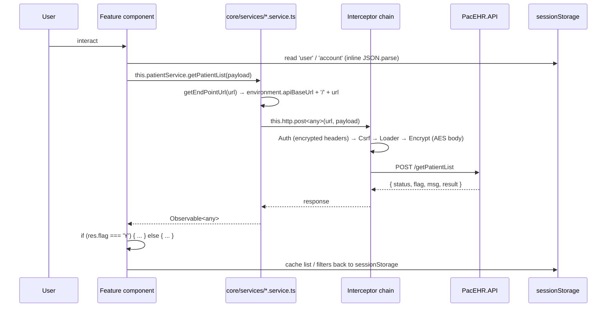
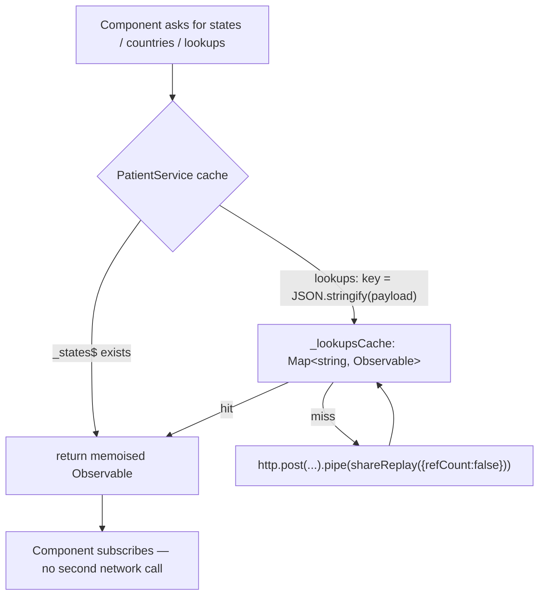
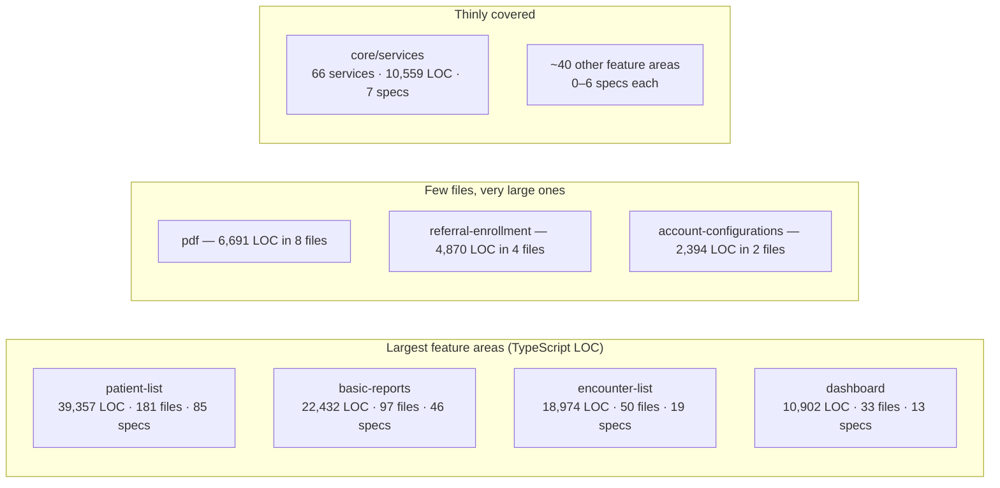

# Deep-Dive - SPA Feature Areas & Client State

**Date**: 2026-09-30
**Analyzed By**: ARCHITECT
**Status**: Draft (awaiting user confirmation)
**Scope**: the 50 feature areas under `src/app/features`, the 66 core services they call, component conventions, forms, change detection, subscription hygiene and typing
**Evidence base**: `PacEHR` @ `3034de845`

---

## Module Overview

322 components / 309 standalone, ~125,000 lines of component TypeScript and ~54,000 lines of component HTML across 50 feature directories.

### Feature areas by size (TypeScript LOC)

| Feature | LOC | Files | Notes |
|---|---|---|---|
| `patient-list` | **39,357** | 181 | Includes `patient-summary` and the whole care-plan tree |
| `basic-reports` | **22,432** | 97 | Highest churn area since 2026-09-08 (194 touches) |
| `encounter-list` | 18,974 | 50 | Contains the largest single component |
| `dashboard` | 10,902 | 33 | |
| `emails` | 7,111 | 20 | Chat + Updox email |
| `pdf` | 6,691 | **8** | ~836 lines per file |
| `basic-layout` | 5,841 | 31 | The shell (Module 09) |
| `account-list` | 5,806 | 21 | |
| `referral-enrollment` | 4,870 | **4** | ~1,218 lines per file |
| `users-list` | 3,630 | 11 | |
| `facility-list` | 3,259 | 16 | |
| `settings` | 2,971 | 14 | |
| `schedular2` *(sic)* | 2,966 | 6 | Coexists with `scheduler` (1,634 / 6) |
| `account-configurations` | 2,394 | **2** | ~1,197 lines per file |
| `calling` | 2,339 | 9 | |
| `authentication` | 2,201 | 25 | |
| Remaining 34 areas | < 2,000 each | | |

---

## Component Breakdown

### The ten largest components

| Component | Lines |
|---|---|
| `encounter-list/encounter-form/encounter-form.component.ts` | **4,898** (+ 3,114-line template) |
| `pdf/container/generate-pdf/generate-pdf.component.ts` | 3,452 |
| `emails/chat/chat.component.ts` | 2,801 |
| `referral-enrollment/referral-enrollment.component.ts` | 2,773 |
| `pdf/componant/header-pdf/header-pdf.component.ts` *(sic — "componant")* | 2,545 |
| `patient-list/patient-list.component.ts` | 2,232 |
| `users-list/add-edit-user/add-edit-user.component.ts` | 2,216 |
| `schedular2/schedular2.component.ts` | 1,942 |
| `emails/new-email/new-email.component.ts` | 1,919 |
| `.../treatment-plan-new/add-treatment-plan-new.component.ts` | 1,714 |

For comparison, `_shared/components/header/header.component.ts` (Module 09) is 2,619 lines.

### Core services (66 files, 10,559 lines)

| Service | Lines | HTTP calls |
|---|---|---|
| `patient.service.ts` | **1,575** | **226** |
| `treatment-plan-dictionary.service.ts` | 688 | |
| `loader.service.ts` | 625 | |
| `twilio.service.ts` | 521 | |
| `encounter.service.ts` | 476 | |
| `chatNotification.service.ts` | 430 | |
| `EmailNotification.service.ts` | 429 | |
| `open-ai.service.ts` | 423 | |
| `signal-r-encounter.service.ts` | 411 | |

---

## Key Workflows

### Workflow 1: A feature area's data path



### Workflow 2: Caching — a good pattern in one service



`PatientService` memoises param-less lookups in fields and payload-varying lookups in a `Map` keyed by `JSON.stringify(payload)`, with `shareReplay(refCount: false)` holding the value for the session. The intent is documented in a comment block. This is a well-implemented cache — **and it exists in one of 66 services**.

---

## Data Models

### Typing posture

| Signal | Count |
|---|---|
| `Observable<any>` in core services | **647** |
| `Observable<I…>` (typed interface) in core services | 88 |
| Model interfaces in `core/models` | present and used (e.g. `IPatientModel`, `IPccPatient`, `ILabResult`) |

Models exist and are imported — `patient.service.ts` imports 15 of them — but 88% of service return types are `any`. The interfaces describe request shapes and component state more than API responses. Because the API returns `IDictionary<string, object>` with a `flag` field (Module 02), a typed response would need a generic envelope (`ApiResponse<T>`) that does not currently exist on either side.

### Form strategy — mixed

| Approach | Files |
|---|---|
| Reactive (`FormBuilder` / `new FormGroup`) | 158 |
| Template-driven (`[(ngModel)]`) | 117 templates |

Roughly a 57/43 split, with both approaches appearing across the same feature areas.

---

### Where the SPA's mass sits



---

## Pattern Catalog

### Pattern: ✅ a consistent service shape

```typescript
// DO — every core service follows this, which makes them predictable
@Injectable({ providedIn: 'root' })
export class PatientService {
  constructor(private http: HttpClient, private referralLockService: ReferralLockService) {}

  private getEndPointUrl(url: string): string {
    return `${environment.apiBaseUrl}/${url}`;
  }
}
```

`providedIn: 'root'`, constructor injection, one private URL builder, environment-driven base URL. Sixty-six services, one shape — a real strength that makes the codebase navigable.

### Pattern: ✅ session-scoped memoisation with `shareReplay`

```typescript
// DO — from patient.service.ts, with the reasoning written down
// ── Account-static list caches (memoised once per session) ──────────────────
// State/country are param-less → a single cached observable each. Lookups vary
// by payload (page/type) → a keyed cache so every distinct payload is fetched
// once. shareReplay(refCount:false) keeps the value for the whole session.
private _states$?: Observable<any>;
private readonly _lookupsCache = new Map<string, Observable<any>>();

private cachedLookups(payload: any): Observable<any> {
  const key = JSON.stringify(payload ?? {});
  let cached = this._lookupsCache.get(key);
  if (!cached) { /* fetch + shareReplay */ }
  return cached;
}
```

The `refCount: false` choice is deliberate and correctly explained. This should be the house pattern for reference data.

### Pattern: ✅ `HttpContext` to opt out of the global loader

```typescript
// DO — SKIP_LOADER lets a background call avoid the full-screen spinner
import { SKIP_LOADER } from '../ineterceptors/loader.interceptor';
this.http.post(url, body, { context: new HttpContext().set(SKIP_LOADER, true) });
```

The idiomatic Angular mechanism, used correctly — but only in **2 places in one service**. Every other background call triggers the global spinner.

### Pattern: 🔴 god components

```typescript
// ACTUAL — encounter-form.component.ts: 4,898 lines TS + 3,114 lines HTML
```

Eight components exceed 1,900 lines. `encounter-form` alone is 8,012 lines of TS+HTML for a single screen — larger than most of the 50 feature areas. Consequences: no meaningful unit testing, merge conflicts on every touch, and change-detection cost across a template with thousands of bindings.

`referral-enrollment` (4,870 LOC in 4 files) and `account-configurations` (2,394 LOC in 2 files) show the same shape: whole features implemented as one or two components rather than a composition.

### Pattern: 🔴 `Observable<any>` as the default return type

```typescript
// ACTUAL — 647 occurrences across core/services
getPatientList(payload: any): Observable<any> {
  return this.http.post<any>(this.getEndPointUrl('getPatientList'), payload);
}

// and at the call site, the contract is rediscovered by inspection
this.patientService.getPatientList(payload).subscribe(res => {
  if (res.flag === 'Y') { this.patients = res.result; }
});
```

```typescript
// DO — one generic envelope, typed payloads
export interface ApiResponse<T> { status: number; flag: 'Y' | 'F'; msg: string; result?: T; }

getPatientList(payload: PatientListRequest): Observable<ApiResponse<IPatientModel[]>> {
  return this.http.post<ApiResponse<IPatientModel[]>>(this.getEndPointUrl('getPatientList'), payload);
}
```

This is the client-side cost of the server's untyped dictionary envelope (Module 02). Fixing it on both sides is one change, and `result` being conditionally absent (Module 02's three-builder inconsistency) is exactly the kind of bug `ApiResponse<T>` with `result?: T` would surface at compile time.

### Pattern: 🟡 subscription hygiene is inconsistent

| Signal | Count |
|---|---|
| `.subscribe(` calls | **2,037** |
| `takeUntil` / `takeUntilDestroyed` | 320 |
| Files with `ngOnDestroy` | 92 (of ~322 components) |

```typescript
// DO — the modern form, already used in app.component.ts
this.router.events.pipe(takeUntilDestroyed(this.destroyRef)).subscribe(...)
```

Most of the 2,037 subscriptions are one-shot `HttpClient` calls, which complete on their own and do not leak — so the raw ratio overstates the problem. The real risk is the subset subscribing to long-lived sources: SignalR streams (`chatNotification`, `EmailNotification`, `signal-r-encounter`), `router.events`, NgRx selectors and `Subject`-based service state. Those need `takeUntilDestroyed`, and with only 92 components implementing `ngOnDestroy`, some of them do not have it. A targeted audit of subscriptions to non-HTTP sources would size this precisely.

### Pattern: 🟡 `ChangeDetectionStrategy.OnPush` on 56% of components

180 of 322 components use `OnPush`. That is better than typical for a codebase this age, but the mix means the default-strategy components — including some of the largest templates — re-check on every tick.

### Pattern: 🟡 two form strategies

158 files use reactive forms; 117 templates use `[(ngModel)]`. Both appear inside the same feature areas, so a developer moving between screens must switch idioms. Reactive forms are the better fit for clinical data entry (validation, dirty tracking, dynamic fields) and are already the majority.

### Pattern: 🟡 duplicated and misspelled feature directories

| Observation | Detail |
|---|---|
| `scheduler` **and** `schedular2` | 1,634 and 2,966 LOC — two scheduling implementations |
| `updox`, `updaox-email`, `compose-updox` | three Updox-related directories |
| `care-program-dashboard` **and** `care-program-dashboard-v2` | both referenced in the shell template |
| `pdf/componant/` | "componant" |
| `core/ineterceptors/` | "ineterceptors" |
| `imunization-popup` | "imunization" |
| `updaox-email` | "updaox" |

Misspelled directory names propagate into every import path in the codebase, so they are costly to correct later — and they are already in 322 components' import statements.

### Pattern: 🟡 uneven test distribution

| Feature | Specs |
|---|---|
| `patient-list` | 85 |
| `basic-reports` | 46 |
| `encounter-list` | 19 |
| `_shared/components` | 14 |
| `dashboard` | 13 |
| `basic-layout` | 12 |
| `emails` | 10 |
| `authentication` | 9 |
| `facility-list` | 7 |
| **`core/services`** | **7 of 66 services** |
| Remaining ~40 feature areas | 0–6 each |

317 specs across 322 components. Two feature areas hold 41% of them. The service layer — where every API contract is expressed — has 7.

---

## Entry Points

| Entry | Description |
|---|---|
| Shell template | `basic-layout.component.html` — the 31-branch chain that mounts features (Module 09) |
| `core/services/*.service.ts` | 66 services, the only path to the API |
| `core/models/` | Shared interfaces |
| `_shared/components/` | Reusable UI, 14 specs |
| `configs/` | `constants.ts`, `account-configuration.ts`, `phi-masker.ts`, `prompt-sanitizer.ts` |

---

## Open Questions for the Team

1. **Are `scheduler` and `schedular2` both live?** Both are mounted in the shell template. If one is legacy, 1,634 or 2,966 lines can go.
2. **Same for `care-program-dashboard` vs `-v2`**, and the three Updox directories.
3. **Is `encounter-form` (8,012 lines TS+HTML) slated for decomposition?** It is the highest-risk file in the SPA.
4. **Would the team adopt `ApiResponse<T>`** if the API added a consistent envelope? The two changes are only worth doing together.
5. **Should the misspelled directories be renamed now** or left? The cost rises with every new import.
6. **Is there a coverage target for the SPA?** 317 specs / 322 components, concentrated in two areas, with 7 of 66 services covered.

---

## Recommendations

| # | Recommendation | Rationale | Priority |
|---|---|---|---|
| 1 | Audit subscriptions to non-HTTP sources (SignalR, router, NgRx, Subjects) and add `takeUntilDestroyed` | The genuine leak surface inside the 2,037 subscriptions | 🟡 High |
| 2 | Introduce `ApiResponse<T>` on both sides; type the 66 services incrementally | 647 `Observable<any>`; would catch the missing-`result` bug at compile time | 🟡 High |
| 3 | Add specs for the core services, starting with `patient.service.ts` (226 HTTP calls) | 7 of 66 covered; these define every client contract | 🟡 High |
| 4 | Decompose `encounter-form` (4,898 + 3,114) | Largest and highest-churn file in the SPA | 🟡 Medium |
| 5 | Resolve the duplicate features: `scheduler`/`schedular2`, the two care-program dashboards, the three Updox dirs | Potentially thousands of dead lines | 🟡 Medium |
| 6 | Promote the `PatientService` memoisation pattern to the other 65 services | Reference data is currently refetched per component | 🟡 Medium |
| 7 | Extend `SKIP_LOADER` to background calls | Used in 2 places; the global spinner fires for everything else | 🟢 Low |
| 8 | Converge on reactive forms for new work | 158 vs 117, both idioms in the same areas | 🟢 Low |
| 9 | Bring the remaining 142 components onto `OnPush` | 56% today | 🟢 Low |
| 10 | Rename the misspelled directories in one mechanical commit | The cost only grows | 🟢 Low |

---

**Next**: Module 11 — Test infrastructure & CI/CD.
