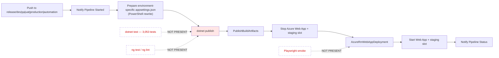
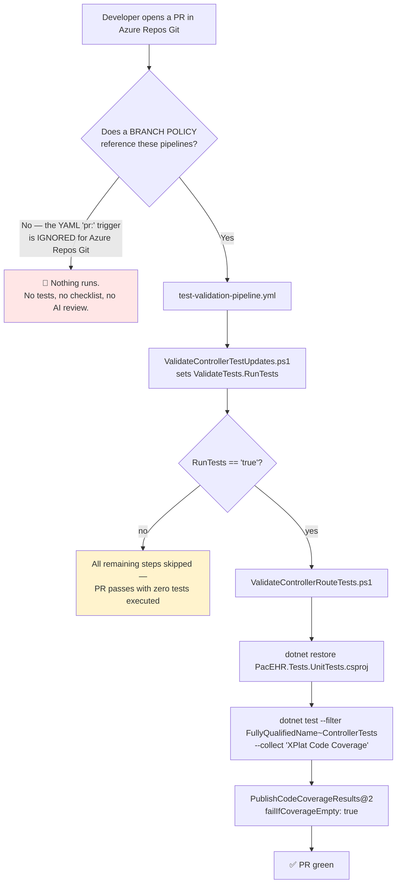
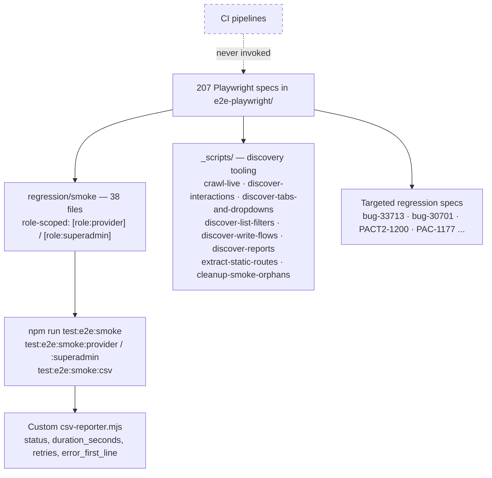

# Deep-Dive - Test Infrastructure & CI/CD

**Date**: 2026-09-30
**Analyzed By**: ARCHITECT
**Status**: Draft (awaiting user confirmation)
**Scope**: the test suites (backend unit, integration, frontend unit, Playwright E2E) and the Azure DevOps pipelines that do — and do not — run them
**Evidence base**: `pacEHR_API` @ `9f2a6ee19`, `PacEHR` @ `3034de845`

> **Headline finding**: the deploy pipelines run **no tests at all**. `deploy-pacehrapis.yml` goes straight from `dotnet publish` to `AzureRmWebAppDeployment`; `deploy-pacehrui.yml` never invokes `ng test`, `ng lint` or Playwright. The only pipeline that executes tests is a PR pipeline whose `pr:` trigger is **ignored by Azure Repos Git** unless a branch policy references it — and even then it runs only the controller subset.

---

## Module Overview

### Test assets

| Suite | Location | Volume | Framework |
|---|---|---|---|
| Backend unit | `PacEHR.Tests.UnitTests/` | **3,053 `[Fact]`/`[Theory]` in 61 files** | xUnit + Moq + AutoFixture + FluentAssertions + MockQueryable |
| Backend integration | `PacEHR.Tests.Integration/` | **0 tests** — only `GlobalUsings.cs` | xUnit |
| Frontend unit | `PacEHR/src/**/*.spec.ts` | 317 specs | Karma + Jasmine 3.6 |
| Frontend E2E | `PacEHR/e2e-playwright/` | **207 specs**, incl. a 38-file `regression/smoke` suite | Playwright 1.59 |
| Frontend E2E (legacy) | `PacEHR/e2e/` | Protractor 7 — deprecated framework | — |

### Pipelines (per repo, near-identical)

| Pipeline | Trigger | What it does |
|---|---|---|
| `deploy-pacehrapis.yml` / `deploy-pacehrui.yml` | `trigger:` on `release/{dev,qa,uat,production,automation}` | Build → publish → deploy. **No tests.** |
| `test-validation-pipeline.yml` (API only) | `trigger: none` + `pr: *` | Validate controller/test parity → run **controller tests only** → publish coverage |
| `pr-checklist-validation.yml` | `trigger: none` + `pr: *` | PowerShell checklist validation |
| `ai-pr-review.yml` | `trigger: none` + `pr: *` | Azure OpenAI code review, read-only checkout |
| `kb-refresh.yml` | — | Knowledge-base refresh |

Six environment variable files per repo: `dev`, `qa`, `uat`, `test`, `automation`, `prod`.

---

## Key Workflows

### Workflow 1: 🔴 The deploy path — no quality gate



The UI deploy is the same shape: rename `environment.<env>.ts` → `environment.ts`, install Angular CLI 18.2.19, `npm cache clean --force`, `npm install --legacy-peer-deps`, build, deploy. No test, no lint.

**Deployment also stops the web app** before deploying (`Stop Azure Web App` → deploy → `Start`), so every release is a hard downtime window rather than a slot swap — even though a staging slot exists and is deployed to.

### Workflow 2: 🔴 The PR path — may never run



Three things compound here:

1. **`pr:` triggers do not work on Azure Repos Git.** Azure Pipelines honours YAML `pr:` triggers only for GitHub and Bitbucket Cloud. For Azure Repos, PR validation must be wired through **branch policies**. All three PR pipelines declare `trigger: none` plus `pr: branches: include: ["*"]`, which on Azure Repos means they are triggered by nothing at all unless a policy exists. The repos are Azure DevOps (`git@ssh.dev.azure.com:v3/Saisystems-PaaS/...`).
2. **The test filter is `FullyQualifiedName~ControllerTests`.** Of the 3,053 tests, only those in `Controllers/` run. The `DomainServices/`, `Pcc/`, `Services/` and `Library/` suites — including `PasswordHelperTests`, `UserServiceTest`, `CCDAServicesTest` — never execute in CI.
3. **Every step is conditional on `ValidateTests.RunTests == 'true'`**, set by a PowerShell script that checks whether controllers changed. A PR that changes only domain services, SQL or the SPA runs no tests and still reports success.

### Workflow 3: The E2E suite (manual)



Config: `testDir: './e2e-playwright'`, `retries: 0`, single Chromium project, `baseURL` from `APP_BASE_URL` defaulting to `http://localhost:4200`.

---

## Pattern Catalog

### Pattern: ✅ a genuinely sophisticated E2E suite

207 specs with capabilities most teams do not build:

- **Role-scoped smoke runs** via grep tags: `test:e2e:smoke:provider` / `:superadmin` use `--grep-invert` on `[role:provider]` / `[role:superadmin]`.
- **Discovery tooling** (`_scripts/`) that crawls the running app to enumerate routes, interactions, tabs, dropdowns, list filters, write flows and reports — a pragmatic answer to a SPA that has no routes to enumerate statically (Module 09). `extract-static-routes.ts` exists precisely because the tab shell hides navigation.
- **Test-data hygiene**: `cleanup-smoke-orphans.spec.ts` removes records the smoke suite creates.
- **Custom CSV reporter** emitting `status, duration_seconds, retries, error_first_line` — built for trend analysis.
- **Documented cases**: `TEST-CASES.md`, `TEST-CASES.csv`, and a `blast-radius-31737-scheduler-provider-race.md` analysis committed alongside the specs.
- **Traceability**: specs named for tickets (`bug-33713-cognition-field-persistence`, `PAC-1177-…`, `PACT2-1200-…`).

This is the strongest quality asset in the codebase, and **no pipeline runs it**.

### Pattern: ✅ test/code parity enforcement

```powershell
# DO — ValidateControllerTestUpdates.ps1
-ControllerPath "PacEHR.API/Controllers"
-TestPath      "PacEHR.Tests.UnitTests/Controllers"
```

A PowerShell gate that fails a PR when a controller changes without a matching test change, plus `ValidateControllerRouteTests.ps1` checking that new routes have tests. Enforcing test parity in CI is a good idea well executed — its value is entirely contingent on the pipeline actually running.

### Pattern: ✅ AI-assisted PR review

```yaml
- checkout: self
  fetchDepth: 0
  persistCredentials: false   # READ-ONLY checkout (important)
- task: PowerShell@2
  displayName: "AI One-Time PR Code Review"
  env:
    AZURE_OPENAI_API_KEY: $(AZURE_OPENAI_API_KEY)
    AZURE_OPENAI_ENDPOINT: $(AZURE_OPENAI_ENDPOINT)
    AZURE_OPENAI_DEPLOYMENT: $(AZURE_OPENAI_DEPLOYMENT)
    SYSTEM_ACCESSTOKEN: $(System.AccessToken)
```

Secrets come from pipeline variables, the checkout is explicitly read-only with a comment explaining why, and it is "one-time" per PR to avoid repeat cost. Well-constructed.

### Pattern: 🔴 no coverage threshold anywhere

```yaml
# ACTUAL
- task: PublishCodeCoverageResults@2
  inputs:
    codeCoverageTool: 'Cobertura'
    summaryFileLocation: '$(Agent.TempDirectory)/**/coverage.cobertura.xml'
    failIfCoverageEmpty: true      # ← fails only if the report is EMPTY
```

```yaml
# DO
- script: |
    dotnet test --collect:"XPlat Code Coverage" \
      -- DataCollectionRunSettings.DataCollectors.DataCollector.Configuration.Threshold=85
```

`failIfCoverageEmpty` is not a threshold. Coverage is measured, published and never enforced. Karma's `coverageIstanbulReporter` likewise emits `html`, `lcovonly` and `text-summary` with **no `thresholds` block** — and is never run in CI anyway.

The project's own standard (`CLAUDE.md`, "Tests with Code — never postpone tests, ≥85% coverage") is not enforced by any automation.

### Pattern: 🔴 the integration test project is an empty shell

```
PacEHR.Tests.Integration/
└── GlobalUsings.cs
```

A project referencing xUnit, `Microsoft.EntityFrameworkCore.InMemory` and `Microsoft.NET.Test.Sdk`, containing no tests. It is in the solution and builds on every CI run. The consequences appear throughout these deep-dives:

- Module 05: the missing `IMapper` registration breaks all 20 FHIR controllers — one test that constructs controllers from the real DI container would have caught it.
- Module 02: 1,553 stored procedures are exercised only through mocked `Ipacehr_devContextProcedures`, so **the mocks define the contract**.
- Module 03: the `proc_getMultipleICDCodes` injection path is unreachable by any automated test.

### Pattern: 🔴 deployment stops the app

```yaml
- task: AzurePowerShell@5
  displayName: 'Stop Azure Web App on ${{ environment }}'
...
- task: AzureRmWebAppDeployment@4
  displayName: 'Deploy Pacehr APIs on ${{ environment }}'
...
- task: AzurePowerShell@5
  displayName: 'Start Azure Web App on ${{ environment }}'
```

Stop → deploy → start is downtime deployment. A staging slot exists and is deployed to, but there is no slot-swap step — so the slot is not being used for zero-downtime release. For a clinical system this is worth revisiting.

### Pattern: 🟡 environment configuration by file rename

```powershell
# ACTUAL — UI pipeline, one PowerShell block per environment
'Remove existing environment.ts file.'
'Rename environment.qa.ts to environment.ts.'
'Rename environment.uat.ts to environment.ts'
'Rename environment.test.ts to environment.ts'
'Rename environment.automation.ts to environment.ts'
'Update environment.prod.ts file with dynamic values'
```

Angular has first-class support for this via `fileReplacements` in `angular.json` build configurations. Doing it with five PowerShell rename blocks means the build is not reproducible locally and `ng build --configuration production` behaves differently in CI than on a developer machine.

Similarly, the API pipeline has a PowerShell step that rewrites `appsettings.json` per environment rather than relying on the six `appsettings.<Env>.json` files that already exist in the project.

### Pattern: 🟡 `npm install --legacy-peer-deps`

```yaml
customCommand: 'install --legacy-peer-deps'
```

Two problems: `--legacy-peer-deps` suppresses the peer-dependency conflicts that the Angular 18 / Material 17 / CDK 17 skew would otherwise surface (Module 00), and `install` rather than `ci` means the lockfile is advisory — CI can resolve different versions than a developer did. `npm cache clean --force` before it adds build time without addressing either.

### Pattern: 🟡 dead Protractor suite

`PacEHR/e2e/` (Protractor 7, `protractor.conf.js`) sits alongside the Playwright suite. Protractor reached end of life in 2023. `protractor`, `codelyzer` and `tslint` remain in `devDependencies`. No pipeline runs it.

### Test conventions (backend)

```csharp
// The house style — clear and modern
[Collection("DomainServiceTests")]
public class PasswordHelperTests
{
    [Fact]
    public void Hash_ReturnsNonEmptyHexString()
    {
        var hash = PasswordHelper.Hash("Password1", "");
        hash.Should().NotBeNullOrEmpty();
        hash.Should().HaveLength(64);
        hash.Should().MatchRegex("^[0-9a-f]+$");
    }
}
```

- Naming: `Method_Condition_ExpectedResult` — consistent and readable
- `[Collection(...)]` to control parallelism
- FluentAssertions throughout
- `#region` blocks grouping tests per endpoint (`MatrixCareControllerTests`)
- Hand-built `DefaultHttpContext` with `FakeAntiforgeryValidationFeature` for controller tests
- File naming is inconsistent: `UserServiceTest.cs` vs `PasswordHelperTests.cs`

### Coverage gaps by component (consolidated from Modules 01–10)

| Component | Lines | Tests |
|---|---|---|
| `JWTMiddleware` — the sole auth gate | ~280 | **0** |
| `AuditMiddleware` / `ErrorHandleMiddelware` | 180 / ~200 | **0** |
| HL7 parser (`HL7Services/`) | **2,350** | **0** |
| FHIR (20 controllers + 22 services) | ~9,400 | **0** |
| `PccCoreService` + `PccScopeValidator` | 1,221 | **0** |
| All 5 Azure Functions | — | **0** |
| All 3 background workers + 3 channels | — | **0** |
| `AuthGuard` + 4 SPA interceptors | — | **0** |
| `core/services` (SPA) | 10,559 | **7 of 66** |
| Stored procedures | 1,553 objects | **0** (mocked only) |

---

## Entry Points

| Entry | Command / trigger |
|---|---|
| Backend tests (local) | `dotnet test PacEHR.Tests.UnitTests` |
| Frontend unit (local) | `npm test` → `ng test` |
| E2E full | `npx playwright test` |
| E2E smoke | `npm run test:e2e:smoke`, `:provider`, `:superadmin`, `:csv` |
| E2E discovery | `test:e2e:crawl`, `:discover-clicks`, `:discover-tabs`, `:discover-filters`, `:discover-writes`, `:discover-reports` |
| Deploy | push to `release/{dev,qa,uat,production,automation}` |
| PR validation | branch policy (**must be verified**) |

---

## Open Questions for the Team

1. **Do branch policies reference the three PR pipelines?** This is the single most important question in this module — without them, no PR validation, no tests and no AI review run at all. One look at the repo's branch-policy settings answers it. *(Raised 2026-09-08 as verification item #1; still open.)*
2. **Why does the test filter exclude everything but controller tests?** 3,053 tests exist; a few hundred run.
3. **Why is `ValidateTests.RunTests` allowed to skip the test run entirely?** A PR touching only domain services or SQL currently runs nothing.
4. **Was downtime deployment a deliberate choice?** A staging slot is deployed to but never swapped.
5. **Should Playwright smoke run post-deploy against dev/QA?** The suite is built for it — role-scoped, self-cleaning, CSV-reporting.
6. **Is the `≥85% coverage` rule in `CLAUDE.md` an aspiration or a policy?** Nothing enforces it.
7. **Can the Protractor suite, `tslint` and `codelyzer` be deleted?**

---

## Recommendations

| # | Recommendation | Rationale | Priority |
|---|---|---|---|
| 1 | Verify/create branch policies for the PR pipelines | Everything else in this module is moot until this is confirmed | 🔴 Immediate |
| 2 | Run the **full** test suite in CI — drop the `ControllerTests` filter | 3,053 tests exist; a fraction run | 🔴 Immediate |
| 3 | Add `dotnet test` to the API deploy pipeline | Deploys currently carry no verification | 🔴 High |
| 4 | Add `ng test --watch=false --browsers=ChromeHeadless` + `ng lint` to the UI pipeline | No frontend quality gate exists | 🔴 High |
| 5 | Enforce a coverage threshold in both stacks | Coverage is measured and ignored | 🟡 High |
| 6 | Write the first integration tests: DI-container smoke (catches Module 05) + one real-DB proc test | Highest-value gap in the codebase | 🔴 High |
| 7 | Run the Playwright smoke suite post-deploy to dev/QA | The asset is built and unused | 🟡 High |
| 8 | Replace stop/deploy/start with a slot swap | Downtime per release on a clinical system | 🟡 Medium |
| 9 | Move environment config to `fileReplacements` and `appsettings.<Env>.json` | Builds are not reproducible locally | 🟡 Medium |
| 10 | Use `npm ci` and resolve the peer-dependency skew | The lockfile is currently advisory | 🟡 Medium |
| 11 | Delete the Protractor suite, `tslint`, `codelyzer` | Dead tooling | 🟢 Low |
| 12 | Standardise test file naming on `*Tests.cs` | `UserServiceTest.cs` vs `PasswordHelperTests.cs` | 🟢 Low |

---

**Next**: Module 12 — AI assistance & dictation.
