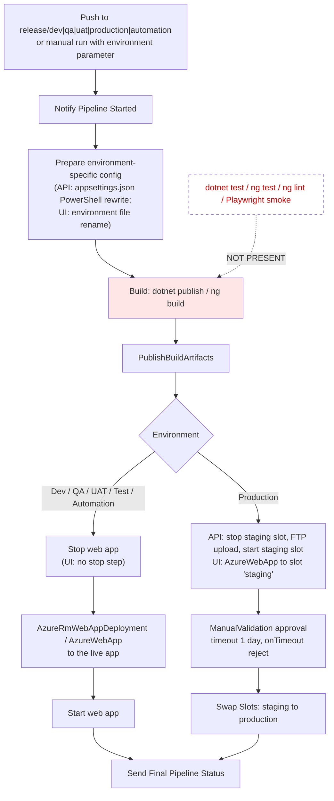
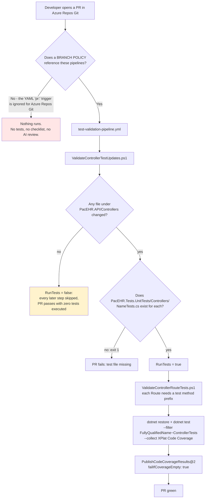
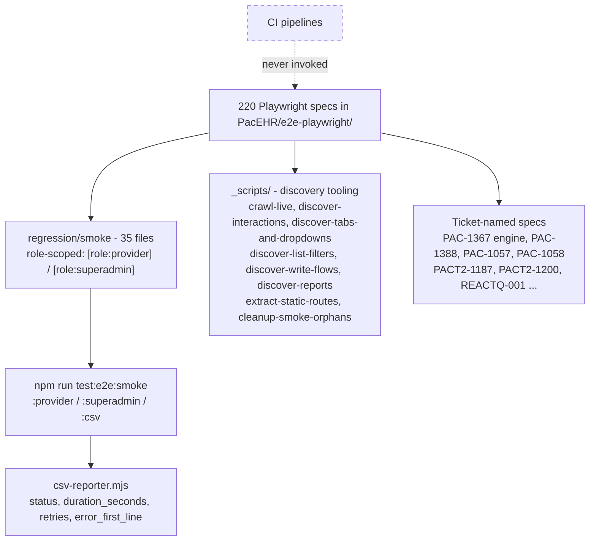
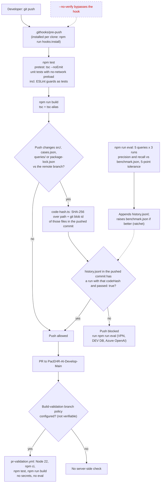

# Deep-Dive - Test Infrastructure & CI/CD

**Date**: 2026-10-19
**Analyzed By**: ARCHITECT
**Status**: Draft (awaiting user confirmation)
**Method**: AIRE `aire-brownfield-deep-dive` - refresh of the 2026-09-30 deep-dive; every count and claim re-verified against code
**Scope**: the test suites in all three repositories (backend unit, integration, frontend unit, Playwright E2E, pacEHR_AI unit/integration/eval) and the Azure DevOps pipelines, hooks and gates that do - and do not - run them
**Evidence base (HEADs analysed)**: `PacEHR` @ `401caa134`, `pacEHR_API` @ `0f611f65c`, `pacEHR_AI` @ `ef172ea`. Previous deep-dive: `pacEHR_API` @ `9f2a6ee19`, `PacEHR` @ `3034de845`.

> **Headline finding (unchanged)**: the PacEHR and pacEHR_API deploy pipelines run **no tests at all**. `deploy-pacehrapis.yml` / `deploy-pacehrui.yml` go from build to deploy with no `dotnet test`, `ng test`, `ng lint` or Playwright step. The only pipeline that executes tests in those repos is `test-validation-pipeline.yml` (API only), whose `pr:` trigger Azure Repos Git ignores unless a branch policy references it, and even then it runs only the `ControllerTests` subset.
>
> **New headline finding**: of the 3,408 `[Fact]`/`[Theory]` declarations in `PacEHR.Tests.UnitTests`, **548 (in 46 `DomainServices` test files) are removed from compilation** by `<Compile Remove="DomainServices\**" />` in the csproj and therefore never run - locally or in CI. This includes `EncounterServiceTest`, `PatientServicesTest`, `PccServiceTest`, `CCDAServicesTest` and `AIPromptServicesTest`.
>
> **Contrast**: the new `pacEHR_AI` repository has a deliberate quality gate (`npm test` + build in a PR pipeline, a `pre-push` hook, and an accuracy-evaluation gate) - the strongest gating in the workspace, with one visible gap (see Pattern "eval gate vs. HEAD").

---

## Changes since 2026-09-30

| # | Change / correction | Evidence |
|---|---|---|
| 1 | **Corrected**: the old doc said there is "no slot-swap step" and every release is hard downtime. **Production does use a staging slot**: deploy to `staging` -> `ManualValidation@0` approval (timeout 1 day, `onTimeout: reject`) -> `AzureAppServiceManage@0` "Swap Slots". Only the non-production environments stop the whole web app, deploy, and start it. | `pacEHR_API/pipelines/jobs/deploy-pacehrapis-job.yml:99-119,288-325`; `PacEHR/pipelines/jobs/deploy-pacehrui-job.yml:184-263` |
| 2 | **Corrected**: the old doc said the gate "fails a PR when a controller changes without a matching test change". `ValidateControllerTestUpdates.ps1` fails only when the expected `<Controller>Tests.cs` file **does not exist**; an existing-but-untouched test file only logs. | `pacEHR_API/pipelines/scripts/test-validation/ValidateControllerTestUpdates.ps1:40-61` |
| 3 | **Corrected**: the old doc claimed the whole `DomainServices/` suite "never executes in CI" because of the `ControllerTests` filter. True, but incomplete - 46 of the 81 `DomainServices` test files do not even compile into the test assembly. | `PacEHR.Tests.UnitTests/PacEHR.Tests.UnitTests.csproj:13-18` |
| 4 | **Re-measured**: `[Fact]`/`[Theory]` count is 3,408 in 138 files (old doc: 3,053 in 61 files; re-running the same method at the old HEAD gives 3,062 in 119 files, so the old "61 files" figure was a miscount). Growth over the window: +346 tests. Controller tests: 2,414 in 53 files (was 2,201 in 46). | grep `^\s*\[(Fact\|Theory)` over `PacEHR.Tests.UnitTests`, at both HEADs |
| 5 | **Re-measured**: Playwright specs 220 (was 207); the `regression/smoke` suite has **35** files (old doc said 38; it was 35 at the old HEAD too). Karma specs 341 (was 317); `core/services` specs 10 (was 7). | `find e2e-playwright -name '*.spec.ts'`; `git ls-tree 3034de845` |
| 6 | **New**: `PacEHR.API.Tests/Controllers/PatientControllerTests.cs` (85 tests, added 2026-01-21) is a second test project **not in `pacEHR.sln`** and not referenced by any pipeline. | `pacEHR.sln` project list; `git log -- PacEHR.API.Tests` |
| 7 | **New**: `pacEHR_AI` is now a real repository with `pipelines/pr-validation.yml`, `.githooks/pre-push`, a `tests/eval` accuracy gate (precision/recall vs `benchmark.json`, `history.jsonl` codeHash ledger), and an image-promotion pipeline across 5 ACRs. | `pacEHR_AI/pipelines/`, `.githooks/pre-push`, `tests/eval/` |
| 8 | **New**: `ValidateControllerRouteTests.ps1` now normalises route keys (letters/digits only, case-insensitive) so routes such as `.well-known/jwks.json` match test prefixes like `wellKnownJwksJson_`. | commit `f61e5c4aa` (2026-10-06) |
| 9 | **Changed**: `kb-refresh.yml` and `Invoke-KnowledgeBaseRefresh.ps1` now publish the knowledge base to the `AI-PDLC` repo instead of `pacehr-orchestration`. | commits `32cc66a92` (PacEHR), `d7e415735` (pacEHR_API), 2026-10-14 |
| 10 | **Dropped**: "Module 05: missing IMapper registration breaks all 20 FHIR controllers" and similar cross-module consequences are **carried, not re-verified** here (owned by modules 02/03/05). The coverage-gap table below was re-checked for the rows marked "re-verified". | - |
| 11 | **Unchanged and re-confirmed**: no pipeline in PacEHR/pacEHR_API runs tests on deploy; `PacEHR.Tests.Integration` is still an empty shell; no coverage threshold; `npm install --legacy-peer-deps`; Protractor/tslint/codelyzer still present; env config by file rename. | see Pattern Catalog |

---

## Module Overview

### Test assets

| Repo | Suite | Location | Volume (re-measured 2026-10-19) | Framework |
|---|---|---|---|---|
| pacEHR_API | Backend unit | `PacEHR.Tests.UnitTests/` | **3,408** `[Fact]`/`[Theory]` in 138 files; **2,860** compile (548 in 46 `DomainServices` files excluded) | xUnit 2.4.2 + Moq 4.20 + AutoFixture 4.18 + FluentAssertions 8.2 + MockQueryable.Moq |
| pacEHR_API | Backend unit (orphan) | `PacEHR.API.Tests/Controllers/PatientControllerTests.cs` | 85 tests, 1 file, **not in `pacEHR.sln`** | xUnit |
| pacEHR_API | Backend integration | `PacEHR.Tests.Integration/` | **0 tests** - `GlobalUsings.cs` + csproj only | xUnit |
| pacEHR_API | API E2E | `e2e-playwright/` (2 files) | `fast-score-api.spec.ts`, `qm-response-workflow-api.spec.ts`; no pipeline | Playwright |
| PacEHR | Frontend unit | `src/**/*.spec.ts` | **341** spec files | Karma + Jasmine |
| PacEHR | Frontend E2E | `e2e-playwright/` | **220** specs; `regression/smoke` = **35**; `_scripts/` discovery = 16 spec files + 1 `.ts` tool | Playwright `^1.59.1` |
| PacEHR | Frontend E2E (legacy) | `e2e/` | Protractor 7 - end-of-life framework | - |
| pacEHR_AI | Unit | `tests/unit/` | 34 files, ~194 top-level `test()` declarations; run with a **no-network preload** | `node:test` + tsx |
| pacEHR_AI | Integration | `tests/integration/` | 5 files (agents, database, migrations, llm, azureFilter); need live Azure services | `node:test` |
| pacEHR_AI | Accuracy eval | `tests/eval/` | 5 reference queries x 3 runs, 16 model calls, ~11 min; precision/recall gate | `node:test` + custom scorer |

### Pipelines

| Repo | Pipeline | Trigger | What it does |
|---|---|---|---|
| pacEHR_API | `deploy-pacehrapis.yml` (+ `jobs/deploy-pacehrapis-job.yml`) | `trigger:` branches `release/{dev,qa,uat,production,automation}` + manual environment parameter | Build -> `dotnet publish` -> deploy. **No tests.** Prod: staging slot + approval + swap |
| PacEHR | `deploy-pacehrui.yml` (+ `jobs/deploy-pacehrui-job.yml`) | same | `ng build` -> deploy. **No tests, no lint.** Prod: staging slot + approval + swap |
| pacEHR_API | `test-validation-pipeline.yml` | `trigger: none` + `pr: *` | Controller/test parity gates -> `dotnet test` filtered to `ControllerTests` -> coverage publish |
| both | `pr-checklist-validation.yml` | `trigger: none` + `pr: *` | Inserts a checklist into the PR description; validates `-ExpectedChecklistCount 4` |
| both | `ai-pr-review.yml` | `trigger: none` + `pr: *` | Azure OpenAI one-time PR review, read-only checkout |
| both | `kb-refresh.yml` | merge to mainline | Refreshes the application knowledge graph in the `AI-PDLC` repo (read-only on app repo) |
| pacEHR_AI | `pr-validation.yml` | `trigger: none`, `pr: none` (relies on a Build-validation branch policy on `PacEHR-AI-Develop-Main`) | Node 22 -> `npm ci` -> `npm test` -> `npm run build`. No secrets, no eval |
| pacEHR_AI | `pacehr-ai-docker-images.yml` | `trigger: none`, `pr: none` (manual) | Build the image once, save TAR artifact, push the same image DEV -> QA -> UAT -> PreProd -> Production, each stage behind its Azure DevOps Environment approvals |

Environment files: six per repo for the API/UI (`dev`, `qa`, `uat`, `test`, `automation`, `prod`); five for pacEHR_AI image promotion (`dev`, `qa`, `uat`, `preprod`, `prod` - `pipelines/variables/`).

---

## Component Breakdown

| Component | Path | Role |
|---|---|---|
| API deploy job | `pacEHR_API/pipelines/jobs/deploy-pacehrapis-job.yml` | Template-expanded per environment; PowerShell rewrite of `appsettings.json`, publish, stop/start or slot deploy, swap |
| UI deploy job | `PacEHR/pipelines/jobs/deploy-pacehrui-job.yml` | Renames `environment.<env>.ts` -> `environment.ts`, installs Angular CLI 18.2.19, `npm install --legacy-peer-deps`, `ng build` |
| Controller test-parity gate | `pacEHR_API/pipelines/scripts/test-validation/ValidateControllerTestUpdates.ps1` | Sets `RunTests` output; fails if a changed controller has no `<Name>Tests.cs` |
| Route test gate | `.../ValidateControllerRouteTests.ps1` | Every `[Route("x")]` of a changed controller must have a test method whose name prefix (before the first `_`) equals the route key |
| PR checklist | `pipelines/scripts/pr-validation/{add,validate}-pr-checklist.ps1` | PR-description checklist |
| AI PR review | `pipelines/scripts/pr-validation/pr-review.ps1` | Azure OpenAI review via pipeline secrets |
| Test-assembly manifest | `PacEHR.Tests.UnitTests/PacEHR.Tests.UnitTests.csproj` | **Compile Remove + explicit Include list** deciding which `DomainServices` tests exist |
| E2E discovery tooling | `PacEHR/e2e-playwright/_scripts/` | Crawl live app, extract routes, discover interactions/tabs/filters/writes/reports |
| CSV reporter | `PacEHR/scripts/csv-reporter.mjs` | `status, duration_seconds, retries, error_first_line` per test |
| AI pre-push hook | `pacEHR_AI/.githooks/pre-push` | Runs `npm test`, `npm run build`, then `tests/eval/code-hash.ts` |
| AI eval gate | `pacEHR_AI/tests/eval/` (`encounter.eval.ts`, `score.ts`, `code-hash.ts`, `benchmark.json`, `history.jsonl`, `cases.json`, `queries/`) | Precision/recall regression gate with a ratcheting benchmark |
| AI source-rule tests | `pacEHR_AI/tests/unit/source-rules.test.ts`, `repo.test.ts`, `no-network.ts`, `no-spawn.ts` | ESLint guards executed as tests; repo-wide facts; network/spawn bans |

---

## Key Workflows

### Workflow 1: The deploy path - no test gate; production has a slot swap



Verified in YAML: neither deploy job contains a test, lint, coverage or smoke task (`grep` for `dotnet test`, `ng test`, `ng lint`, `playwright` over `pipelines/` returns nothing in the deploy files). The only quality gate before production is the human approval between staging deploy and swap. The approval step has no automated smoke check on the staging slot to review.

Not verifiable from YAML: which slot the production `FtpUpload@2` URL (`$(ftpServerUrlProd)`) points at - that is a pipeline variable.

### Workflow 2: The PR path (pacEHR_API) - may never run, and runs only controller tests



Three things compound:

1. **`pr:` triggers do not work on Azure Repos Git** (they are honoured for GitHub / Bitbucket Cloud). All PR pipelines in the three repos declare `trigger: none` plus `pr:` (or `pr: none` in pacEHR_AI), so each needs a branch/build-validation policy. The pacEHR_AI `pr-validation.yml` header states this explicitly (`pipelines/pr-validation.yml:6-8`); the PacEHR/pacEHR_API pipelines do not. Whether the policies exist is **not verifiable from the repos** (carried open question).
2. **The test filter is `FullyQualifiedName~ControllerTests`** (`test-validation-pipeline.yml:53`). Controller tests are 2,414 of 3,408 declarations. The remaining 994 (949 in `DomainServices/`, 26 in `Services/`, 17 in `Library/`, 2 in `Pcc/`) never run in CI; 548 of the `DomainServices` ones do not compile at all.
3. **Every step after the first is gated on `ValidateTests.RunTests == 'true'`**, set only when a file under `PacEHR.API/Controllers/` changed. A PR changing only domain services, SQL or the SPA runs no tests and reports success.

Of the 100 controllers, **47 have no `<Name>Tests.cs`** (including all 20 `Fhir*Controller`s, `ECQMController`, `TokenController`, `AuthorizationController`, `HL7OutboundController`). A PR that touches any of them fails the gate at step D2 until a test file exists - which is a positive forcing function, but only if the pipeline runs.

### Workflow 3: The E2E suite (manual)



Config (`PacEHR/playwright.config.ts`): `testDir: './e2e-playwright'`, `testIgnore: ['**/_helpers/**', '**/_discovery/**']`, `timeout: 90000`, `retries: 0`, single `chromium` project, `baseURL` from `APP_BASE_URL` defaulting to `http://localhost:4200`, HTML + list + CSV reporters. New since the old doc: each feature ticket in this window (PAC-1367, PAC-1388, PAC-1393, PAC-1342, PACT2-1380) landed with its own Playwright spec - E2E authoring discipline is still active; only the pipeline wiring is missing.

### Workflow 4: pacEHR_AI quality gate - local hook plus PR build plus eval ledger



---

## Data Models

Not applicable to the test infrastructure itself (no persistent data model). The only structured artifacts are the pacEHR_AI eval ledger files, all JSON in git:

| File | Shape (verified) |
|---|---|
| `tests/eval/cases.json` | Answer key per query (Q1-Q5), written from the notes alone |
| `tests/eval/benchmark.json` | `overall {precision, recall, recallWithNormals}`, `perCase[]`, `templateId: 457`, `runsPerCase: 3`, `model: gpt-4.1-2025-04-14` - currently 94.9 / 82.9 / 84.6 |
| `tests/eval/history.jsonl` | 9 lines at HEAD; from the 6th line each carries `codeHash`, `commit`, `dirty`, `model`, `passed`, `overall`, `perCase` |

---

## Pattern Catalog

### Error handling (in pipelines and test scripts)

```powershell
# DO - fail the gate with a non-zero exit and a readable list
# pacEHR_API/pipelines/scripts/test-validation/ValidateControllerTestUpdates.ps1:58-62
if ($missingTests.Count -gt 0) {
    $missingTests | ForEach-Object { Write-Host $_ }
    Write-Error "Pipeline failed because corresponding test files were not modified."
    exit 1
}
```

```powershell
# DON'T - the message says "not modified" but the check is "does not exist"
# same file, lines 40-52: an existing, untouched test file only logs
# "Test file exists even though not updated" and passes
```

pacEHR_AI uses the same fail-loud idea in its hook, with an actionable message:

```sh
# DO - pacEHR_AI/.githooks/pre-push:6
block() { echo "pre-push: blocked: $1. Emergency bypass: git push --no-verify" >&2; exit 1; }
```

### Logging

Pipeline steps use `Write-Host` and `##vso[task.setvariable ...]` (`ValidateControllerTestUpdates.ps1:25,65`); deploy jobs notify a webhook via `pipelines/scripts/Notify-PipelineStatus.ps1` at start and in an `always()` final step. The pacEHR_AI eval writes `logs/eval/<stamp>/summary.json` and per-run CSVs (git-ignored) plus one committed line per run to `history.jsonl`.

### Database access

Not applicable to CI. Test-side DB access is mocked: all backend tests mock `Ipacehr_devContextProcedures` (no real SQL), so **the mocks define the contract** for the 1,500+ stored procedures. pacEHR_AI is the exception: `tests/integration/core/database.test.ts` and `databaseMigrations.test.ts` run against the configured Azure SQL database and **skip with a stated reason** when it is unreachable.

### API response / test shape

Backend controller tests assert the `BuildDictionaryResult` envelope; the controller test classes build a `DefaultHttpContext` with `FakeAntiforgeryValidationFeature` and set `HttpContext.Items` the way `JWTMiddleware` would (`WebUiTokenControllerTests.cs:59`, `PatientControllerTests.cs:69`).

### Naming conventions

```csharp
// DO - route-prefix naming is now machine-enforced by ValidateControllerRouteTests.ps1
// PacEHR.Tests.UnitTests/Controllers/WebUiTokenControllerTests.cs:91
public void webUiToken_SignedInUser_LooksUpThatUsersDragonId()
```

```csharp
// DON'T - inconsistent file naming across the suite (UserServiceTest.cs vs PasswordHelperTests.cs;
// the csproj Include list mixes *Test.cs and *Tests.cs)
```

Frontend specs are `*.spec.ts` beside the unit; Playwright specs are named for tickets (`PAC-1367-engine.spec.ts`); pacEHR_AI tests are `*.test.ts` mirroring `src/` (`tests/unit/agents/encounter.test.ts`).

### Pattern: strong - a sophisticated E2E suite

220 specs with role-scoped smoke runs (`--grep-invert "\[role:provider\]"` in `package.json:23-24`), discovery tooling in `_scripts/`, self-cleaning (`cleanup-smoke-orphans.spec.ts`), a CSV reporter built for trend analysis, `TEST-CASES.md`, and `blast-radius-*.md` analyses committed beside the specs (`blast-radius-31737-scheduler-provider-race.md`, `blast-radius-PACT2-297-...md`). Still **not run by any pipeline**.

### Pattern: strong - test/code parity enforcement (conditional)

```powershell
# pacEHR_API/pipelines/test-validation-pipeline.yml:19-26
-ControllerPath "PacEHR.API/Controllers"
-TestPath      "PacEHR.Tests.UnitTests/Controllers"
```

Two PowerShell gates: test file must exist for a changed controller; every `[Route]` must have a test-name prefix. Value is contingent on the pipeline actually being triggered.

### Pattern: strong - pacEHR_AI gating discipline

- **No-network preload** (`tests/unit/no-network.ts`): any network attempt in a unit test throws and sets exit code 99, so a swallowed attempt still fails the file. `no-spawn.ts` does the same for child processes.
- **Lint as a test**: `tests/unit/source-rules.test.ts` plants violations and asserts the ESLint guards report them at the right file:line, and that the tree lints clean. (There is no separate `lint` npm script; `npm test` is the lint gate.)
- **Eval ratchet**: `benchmark.json` only moves up automatically; lowering needs `npm run eval:promote` and a dated change log (`tests/eval/CLAUDE.md`).
- **Hash-keyed ledger**: the hook compares a content hash of `src/`, `cases.json`, `queries/` and `package-lock.json`, so docs/tests/pipeline edits never need a re-run.
- **One image promoted through every environment** (`pacehr-ai-docker-images.yml`), each stage behind Azure DevOps Environment approvals.

### Pattern: weak - eval gate vs. HEAD (new finding)

```text
# tests/eval/history.jsonl - last passing run
stamp 20261015-234757, commit 6d20c76, codeHash dd6601d6...
# computed codeHash of HEAD ef172ea (code-hash.ts commitHash('HEAD')): 28b90289...
# src/ changed after that run: src/guards/injection.ts (+114/-lines) and src/agents/middleware/model-call.ts
#   in commits af8f6d4 and ef172ea (both on origin/3p-dev/epic-05-Guardrails)
```

At HEAD, `origin/3p-dev/epic-05-Guardrails` contains `src/` changes whose codeHash has **no passing line** in `history.jsonl`. The hook (`.githooks/pre-push` -> `code-hash.ts:45-56`) would have refused that push. Possible causes (not determinable from the repo): `git push --no-verify`, the hook not installed in the pushing clone (it is per-clone, `npm run hooks:install`), or the ledger line is uncommitted. Because `pr-validation.yml` deliberately does not run the eval, there is **no server-side backstop** for this gate.

### Pattern: weak - no coverage threshold anywhere

```yaml
# pacEHR_API/pipelines/test-validation-pipeline.yml:57-63
- task: PublishCodeCoverageResults@2
  inputs:
    codeCoverageTool: 'Cobertura'
    failIfCoverageEmpty: true      # fails only if the report is EMPTY
```

```javascript
// PacEHR/karma.conf.js:45-49 - no `thresholds` / `check` block; reports html, lcovonly, text-summary
coverageIstanbulReporter: { dir: ..., reports: ['html', 'lcovonly', 'text-summary'], fixWebpackSourcePaths: true }
```

The project's own rule (`CLAUDE.md`: "Tests with Code - >=85% coverage") is enforced by no automation in any of the three repos. pacEHR_AI has no coverage tool configured at all.

### Pattern: weak - tests excluded from compilation (new finding)

```xml
<!-- PacEHR.Tests.UnitTests.csproj:13-18 -->
<!-- Exclude DomainServices tests that have pre-existing SP signature mismatches -->
<Compile Remove="DomainServices\**" />
<EmbeddedResource Remove="DomainServices\**" />
<None Remove="DomainServices\**" />
<!-- Re-include only the files kept up-to-date with SEC-002 changes -->
<Compile Include="DomainServices\UserServiceTest.cs" />
```

```csharp
// DO instead - fix the signature drift (the csproj comment cites "7 unrelated compile errors"
// against usp_InsertPatientDiagnosisAsync etc.) and delete the Remove, so a stale test fails the build
```

35 of 81 top-level `DomainServices` test files are re-included one by one; **46 files / 548 tests stay excluded**, among them `EncounterServiceTest.cs` (51), `PccServiceTest.cs` (42), `PatientServicesTest.cs` (40), `UpdoxServiceTest.cs` (34), `DaySheetReportServicesTest.cs` (30), `CCDAServicesTest.cs` (29), `AssessmentServicesTest.cs` (27), `AIPromptServicesTest.cs` (13). Authors have been working around it by adding new files (csproj comments for PAC-1187, PAC-1479, MatrixCareV2 "was excluded by the blanket Remove above and never ran"), which shows the drift is known - but the backlog grows.

### Pattern: weak - the integration test project is an empty shell

```text
PacEHR.Tests.Integration/
  GlobalUsings.cs
  PacEHR.Tests.Integration.csproj
```

In the solution (`pacEHR.sln:33`) and builds, but contains no tests. Consequences carried from modules 02/03/05: stored-procedure contracts are defined by mocks; DI-registration errors are invisible to tests.

### Pattern: weak - environment configuration by file rename; `npm install --legacy-peer-deps`

```powershell
# PacEHR/pipelines/jobs/deploy-pacehrui-job.yml - one PowerShell block per environment (lines 65-131) renames
# environment.<env>.ts to environment.ts; prod is rewritten with a regex (lines 133-146)
```

```yaml
# deploy-pacehrui-job.yml:172-174
customCommand: 'install --legacy-peer-deps'    # npm install, not npm ci
```

Angular `fileReplacements` and `npm ci` are the first-class alternatives. Also a labelling defect: the step `displayName: 'Install Node Version 18.20.4'` installs `versionSpec: 22.16.0` (`deploy-pacehrui-job.yml:152-154`).

### Pattern: weak - dead Protractor suite

`PacEHR/e2e/` (`protractor.conf.js`) remains; `protractor ^7.0.0`, `codelyzer ^0.0.28`, `tslint ~6.1.0` still in `devDependencies` (`package.json:129,137,139`); `tslint.json` still present. No pipeline runs it.

---

## Testing Patterns

```csharp
// House style (backend): Method_Condition_ExpectedResult, FluentAssertions, Moq on the procedures interface
// PacEHR.Tests.UnitTests/Controllers/WebUiTokenControllerTests.cs:91
public void webUiToken_SignedInUser_LooksUpThatUsersDragonId()
```

- `[Collection(...)]` to control parallelism; `#region` grouping by endpoint (`UserServiceTest.cs:786` `#region getDragonSub (PAC-584)`).
- Controller tests hand-build `HttpContext.Items` to simulate `JWTMiddleware`.
- Frontend: Jasmine specs next to components/services; new Dragon code arrived with specs (`dragon-copilot.service.spec.ts` 35 `it(`, `dragon-record-button.component.spec.ts` 5).
- pacEHR_AI: `node:test` with `tests/unit/agents/harness.ts`; a guard **corpus** (`tests/unit/guards/corpus.ts`, `guard-corpus.test.ts`) drives the injection scanner; failure-mode tests (`failure-modes.test.ts`).

### Coverage gaps by component (re-verified rows marked)

| Component | Tests today | Status |
|---|---|---|
| `JWTMiddleware` (`PacEHR.API/Library/Authentication/JWTMiddleware.cs`) - the sole auth gate | **0** (only mentioned in comments in controller tests) | re-verified |
| `AuditMiddleware` / `ErrorHandleMiddelware` | **0** (no reference in either test project) | re-verified |
| `PccScopeValidator` | **0** (no reference) | re-verified |
| FHIR controllers | **0** - no `Fhir*ControllerTests.cs`; no test references `FHIR` | re-verified |
| HL7 parser (`HL7Services/`) | **0** directly (HL7 appears only incidentally in other service tests) | re-verified; line counts carried |
| `AuthGuard` + SPA interceptors | **0** - no `*guard*.spec.ts` / `*interceptor*.spec.ts` under `src/` | re-verified |
| `core/services` (SPA) | 10 spec files of 63 service files | re-verified (was 7) |
| `PccCoreService` | **excluded** - `PccServiceTest.cs` not compiled; only `PccService*Tests.cs` additions run | re-verified |
| `phi-masker.ts`, `prompt-sanitizer.ts` | **0** (see module 12) | re-verified |
| Azure Functions, background workers/channels | **0** | carried, not re-verified |
| Stored procedures (1,5xx objects) | **0** (mocked only) | carried, not re-verified |
| `WebUiTokenController` (new, PAC-584) | **37** tests incl. signature verification against the published JWKS | new |
| `AIController` | 63 controller tests - but **not** `speechToText` (0 references) | corrected (old doc: "none found") |

---

## Entry Points

| Entry | Command / trigger |
|---|---|
| Backend tests (local) | `dotnet test PacEHR.Tests.UnitTests` (2,860 compiled tests) |
| Frontend unit (local) | `npm test` -> `ng test` |
| E2E full | `npx playwright test` |
| E2E smoke | `npm run test:e2e:smoke`, `:provider`, `:superadmin`, `:csv` |
| E2E discovery | `test:e2e:crawl`, `:discover-clicks`, `:discover-tabs`, `:discover-filters`, `:discover-writes`, `:discover-reports`, `:cleanup-smoke`, `:static-routes` |
| pacEHR_AI tests | `npm test` (typecheck + lint guards + unit), `npm run test:integration`, `npm run eval`, `npm run eval:promote` |
| pacEHR_AI hook install | `npm run hooks:install` (sets `core.hooksPath` to `.githooks`) |
| Deploy (API/UI) | push to `release/{dev,qa,uat,production,automation}` or manual run |
| AI image promotion | manual run of `pacehr-ai-docker-images.yml` |
| PR validation | branch / build-validation policy (**must be verified**, all three repos) |

---

## Open Questions for the Team

1. **Do branch / build-validation policies reference the PR pipelines in all three repos?** (Open since 2026-09-08.) Without them nothing in `test-validation-pipeline.yml`, `pr-checklist-validation.yml`, `ai-pr-review.yml` or pacEHR_AI `pr-validation.yml` runs.
2. **Why are 46 `DomainServices` test files (548 tests) excluded from compilation, and is there a plan to repair the signature drift?**
3. **Why does the CI filter run only `ControllerTests`, and why can `RunTests` skip the run entirely?**
4. **How did the pacEHR_AI commits `af8f6d4`/`ef172ea` reach the remote without a passing eval ledger line for their codeHash?** (`--no-verify`, hook not installed, or an uncommitted ledger line.)
5. **Should Playwright smoke run against the staging slot before the production approval?** The suite is role-scoped, self-cleaning and CSV-reporting; the approval step currently reviews nothing automated.
6. **Is the `>=85%` coverage rule an aspiration or a policy?** Nothing enforces it.
7. **Is `PacEHR.API.Tests` (85 tests, not in the solution) meant to be merged into `PacEHR.Tests.UnitTests` or deleted?**
8. **Can the Protractor suite, `tslint` and `codelyzer` be deleted?**

---

## Recommendations

| # | Recommendation | Rationale | Priority |
|---|---|---|---|
| 1 | Verify/create branch (build-validation) policies for every PR pipeline in all three repos | Everything else is moot until confirmed | Immediate |
| 2 | Run the full compiled unit suite in CI - drop the `ControllerTests` filter and the `RunTests` skip | 2,860 compiled tests exist; ~2,400 run, and only when a controller changed | Immediate |
| 3 | Repair and re-include the 46 excluded `DomainServices` test files (548 tests); remove the blanket `Compile Remove` | A "pass" currently hides a large stale suite; it makes `AIPromptServicesTest`, `EncounterServiceTest`, `PccServiceTest` etc. dead code | High |
| 4 | Add `dotnet test` to the API deploy pipeline and `ng test --watch=false --browsers=ChromeHeadless` + `ng lint` to the UI pipeline | Deploys carry no verification | High |
| 5 | Add a Playwright smoke step against the staging slot before the production `ManualValidation` | Gives the approver evidence; the asset is built and unused | High |
| 6 | Enforce a coverage threshold in both stacks (Coverlet threshold; Karma `check`) | Coverage is measured and ignored | High |
| 7 | Write the first integration tests: DI-container smoke + one real-DB procedure test | Highest-value gap | High |
| 8 | pacEHR_AI: add a server-side check that `history.jsonl` has a passing line for the PR head's codeHash (no secrets or model calls needed) | Closes the `--no-verify` / uninstalled-hook gap; HEAD currently has none | High |
| 9 | Move environment config to `fileReplacements` and `appsettings.<Env>.json`; use `npm ci` | Builds not reproducible locally; lockfile advisory | Medium |
| 10 | Decide the fate of `PacEHR.API.Tests` (merge into the solution or delete) | 85 tests that run nowhere | Medium |
| 11 | Delete the Protractor suite, `tslint`, `codelyzer`; fix the "Node 18.20.4" step label | Dead tooling, misleading label | Low |
| 12 | Standardise test file naming on `*Tests.cs` | `UserServiceTest.cs` vs `PasswordHelperTests.cs` | Low |

---

**Cross-references**: `12-ai-assistance-deep-dive.md` (AI/dictation tests), `13-pacehr-ai-service-deep-dive.md` (pacEHR_AI service internals - not covered here beyond its test/CI tooling).
