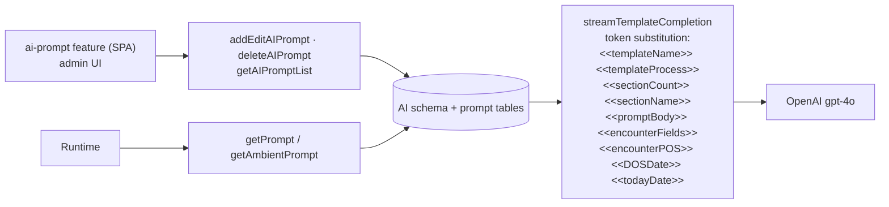

# Deep-Dive - AI Assistance & Dictation

**Date**: 2026-09-30
**Analyzed By**: ARCHITECT
**Status**: Draft (awaiting user confirmation)
**Scope**: the AI feature set — OpenAI chat completions (streaming and non-streaming), Google Cloud Speech ambient dictation, prompt management, PHI masking and prompt-injection detection
**Evidence base**: `pacEHR_API` @ `9f2a6ee19`, `PacEHR` @ `3034de845`

> **Headline finding**: `/speechToText` is an `[AllowAnonymous]` WebSocket endpoint that takes `userId`, `accountId`, `patientId` and `notesId` from the **query string** with no validation — each defaulting to `0` when unparseable. Any caller can open it, stream audio to Google Cloud Speech (billable) and have the resulting transcript attributed to any patient in any account.
>
> **Second finding**: PHI masking and prompt-injection detection are implemented well — and run **only in the browser**. The API forwards `userPrompt` to OpenAI verbatim.

---

## Module Overview

| Component | Path | Size |
|---|---|---|
| `AIController` | `PacEHR.API/Controllers/AIController.cs` | **1,152 lines, 23 routes** |
| `AIPromptServices` | `pacEHR.DomainServices/AIPromptServices.cs` | 365 lines |
| `OpenAiService` (SPA) | `PacEHR/src/app/core/services/open-ai.service.ts` | 423 lines |
| PHI masker (SPA) | `PacEHR/src/app/configs/phi-masker.ts` | 304 lines |
| Prompt sanitiser (SPA) | `PacEHR/src/app/configs/prompt-sanitizer.ts` | 115 lines |
| Prompt admin UI | `PacEHR/src/app/features/ai-prompt/` | component + `add-edit-ai-prompt` |
| Storage | `AI` schema (1 table) + app-settings rows + ambient/rounding-note tables | |

**Supplementary documents** from the 2026-09-08 run — `12a-ai-request-payload-reference.md` and `12b-ai-prompt-examples.md` — were **not regenerated** in this refresh and should be treated as stale.

### `AIController` routes (23)

| Group | Routes |
|---|---|
| Prompt management | `addEditAIPrompt`, `getAIPromptList`, `deleteAIPrompt`, `getPrompt`, `getAmbientPrompt` |
| Completions | `getCompletion`, `streamCompletion`, `streamCompletionWithData`, `streamTemplateCompletion` |
| Dictation | `speechToText` (WebSocket) |
| Ambient notes | `getAmbientDetails`, `addEditAmbientDetails`, `deleteAmbientDetails` |
| Rounding notes | `addEditRoundingNotes`, `getPatientRoundingNote`, `getRoundingNotesByEncounter`, `deleteRoundingNote` |
| Context | `getPreviousEncounterDetails`, `getPatientDetailsByProviderFacility`, `getImportPatientDetailsToEncounterForm` |
| External patients | `addExternalPatients`, `getExternalPatientDetails` |
| Logging | `addEditAILogs` |

---

## Key Workflows

### Workflow 1: 🔴 Ambient dictation over an unauthenticated WebSocket

```mermaid
sequenceDiagram
  participant B as Browser (or any WebSocket client)
  participant MW as JWTMiddleware
  participant CT as AIController.Get — /speechToText
  participant G as Google Cloud Speech V1
  participant DB as SQL

  B->>MW: GET wss://.../speechToText?notesId=&userId=&accountId=&patientId=
  Note over MW: "/speechToText" is in excludedPaths → no body decryption
  Note over MW: [AllowAnonymous] → no authentication
  MW->>CT: forward
  CT->>CT: int.TryParse(query["userId"])   → 0 on failure
  CT->>CT: int.TryParse(query["accountId"])→ 0 on failure
  CT->>CT: int.TryParse(query["patientId"])→ 0 on failure
  Note over CT: no ownership check — the caller names<br/>the patient and account it writes to
  CT->>CT: AcceptWebSocketAsync()
  loop audio frames, 48kHz mono 16-bit
    B->>CT: binary PCM
    CT->>G: StreamingRecognize (Google-Credentials.json)
    G-->>CT: interim + final transcripts
    CT-->>B: transcript JSON (deduped via sentTranscripts)
  end
  CT->>DB: persist transcript against notesId / patientId
  Note over CT: audio itself is buffered in memory;<br/>the blob upload is commented out (line 798)
```

**Stories**:
1. Exempt from authentication twice: `[AllowAnonymous]` **and** listed in `JWTMiddleware.excludedPaths`.
2. Identity comes from the query string. `int.TryParse` failure yields `0` with the comment `// or return 400 if mandatory` — the author flagged it and moved on.
3. No check that the caller may write to that `patientId` / `accountId`, and no check that they are consistent with each other.
4. Three risks: **cost** (unauthenticated Google Speech streaming), **integrity** (forged transcripts on any patient's chart), **disclosure** (transcripts stream back to the caller).
5. Pause/resume and duplicate suppression are handled carefully (`isPaused`, `pauseStartTime`, `totalPausedDuration`, `sentTranscripts`, `pendingTranscripts`) — the streaming logic itself is thoughtfully written.
6. Audio is accumulated in a `MemoryStream` per connection and the blob upload is commented out, so recordings are discarded. On a long dictation this is also unbounded memory per socket.

### Workflow 2: A chat completion — where the safety controls run


### Workflow 3: Prompt management



System prompts are stored in the database and edited through an admin screen. `StreamOpenAITemplateCompletionAsync` substitutes nine `<<token>>` placeholders into the stored system prompt at runtime.

---

## Pattern Catalog

### Pattern: ✅ a genuinely good PHI masker

**Where**: `PacEHR/src/app/configs/phi-masker.ts` (304 lines)

```typescript
/**
 * Masks ALL occurrences of the 18 HIPAA Safe Harbor identifiers in free-text
 * before content is transmitted to any external AI service.
 *
 * Two-pass strategy:
 *   1. If `patient` is supplied, exact-value masking runs first...
 *   2. The regex fallback then sweeps the text for anything we didn't know about...
 *
 * Applied to userPrompt only — system prompts are controlled templates.
 */
```

```typescript
// DO — and this is the detail that shows real thought
const NAME_COMMON_WORD_SKIPLIST = new Set<string>([
  'brown', 'black', 'white', 'gray', 'grey', 'green', 'rose',
  'young', 'old', 'short', 'long', 'sharp', 'best', 'wise', 'fair',
  ...
]);
// "stool was brown" must not become "stool was [NAME]"
```

Exact-value masking first (most reliable), regex sweep second (catches unknowns), a skiplist so surname-shaped common words do not destroy clinical meaning, a `minLength` guard so single characters are not collapsed, and a documented decision to mask only `userPrompt`. This is careful, domain-aware security engineering.

### Pattern: ✅ prompt-injection detection before send

```typescript
// DO — fail closed, before the request leaves the browser
const detected = detectInjection(prompt);
if (detected.length > 0) { return throwError(() => new PromptInjectionError(detected)); }
```

Applied consistently at all three completion entry points in `OpenAiService` (`getCompletion`, `streamCompletion`, `streamCompletionWithData`), plus masking applied to both `user_content` and `resp_content` in `AddEditAILogs` so the AI **audit log** is masked too. That last detail is easy to miss and they did not.

### Pattern: 🔴 both controls are client-side only

```csharp
// ACTUAL — AIPromptServices.GetOpenAICompletionAsync: userPrompt used as received
var body = JsonSerializer.Serialize(new
{
    model = "gpt-4o",
    stream = false,
    temperature = 0,
    messages = new[]
    {
        new { role = "system", content = systemPrompt },
        new { role = "user",   content = userPrompt }     // ← verbatim
    }
});
```

Searched across `pacEHR_API`: no `maskPhi`, no `redact`, no `detectInjection`, no prompt sanitisation of any kind. The only `Sanitize*` in the API is `SanitizeForFileName` in `AssessmentController`.

```csharp
// DO — port the masker and the injection check to the server
var safePrompt = _phiMasker.Mask(req.userPrompt, patientContext);
if (_promptGuard.Detect(safePrompt).Any()) return BuildDictionaryResult(400, "F", "Prompt rejected");
```

A browser-side control protects against accidental disclosure by the application's own UI. It does not protect against a modified client, a direct API call, or a bug in one of the SPA call sites that forgets to pass `patient`. For PHI leaving the organisation to a third-party LLM, the control belongs on the server — or on both sides. This was raised as verification item #8 on 2026-09-08 and remains open.

Note also that `maskPHI(prompt, patient)` degrades gracefully but silently when `patient` is omitted: Pass 1 is skipped and only the regex sweep runs. Several SPA call sites pass `patient?` as optional.

### Pattern: 🔴 identity from the query string on a WebSocket

```csharp
// ACTUAL
var userIdStr = HttpContext.Request.Query["userId"];
if (!int.TryParse(userIdStr, out int userId))
{
    userId = 0; // or return 400 if mandatory
}
// ... same for accountId, patientId, notesId
var webSocket = await HttpContext.WebSockets.AcceptWebSocketAsync();
await HandleSpeechToText(webSocket, notesId, userId, accountId, patientId);
```

```csharp
// DO — authenticate the upgrade, derive identity server-side
[Route("speechToText")]
[HttpGet]
public async Task Get([FromQuery] int notesId)
{
    if (!HttpContext.WebSockets.IsWebSocketRequest) { ...400... }
    var accountId = (int)HttpContext.Items["accountId"]!;   // from the session
    var userId    = (int)HttpContext.Items["userId"]!;
    if (!await _notes.BelongsToAccountAsync(notesId, accountId)) { ...403... }
    ...
}
```

WebSocket upgrades cannot carry custom headers from a browser, which is the usual reason such endpoints end up anonymous. The standard answer is a short-lived single-use ticket: the client calls an authenticated endpoint, receives a ticket, and passes it as the one query parameter — the server resolves identity from the ticket rather than trusting caller-supplied ids.

### Pattern: 🟡 API key with a committed fallback

```csharp
var settings = await _proceduresInterface.usp_getAppSettingsForMultipleAsync("OPENAI_API_KEY,OPENAI_API_URL");
var apiKey = settings.FirstOrDefault(s => s.key == "OPENAI_API_KEY")?.value
             ?? _configuration["APIkeySettings:openAIapiKey"];   // ← appsettings.json
```

Database-first with an `appsettings.json` fallback is a reasonable design, but it means the committed `openAIapiKey` is live wherever the SQL row is missing — and nothing logs which path was taken. The 2026-09-08 question *"are `OPENAI_API_KEY` / `OPENAI_API_URL` populated per environment, or is every environment on the `appsettings.json` fallback?"* is still open and gates safe rotation of the committed key.

Google credentials are worse: `PacEHR.API/Google-Credentials.json` is a service-account key file committed to the repository, with no configuration indirection at all.

### Pattern: 🟡 `gpt-4o` hardcoded, `temperature = 0`

```csharp
model = "gpt-4o",
stream = false,
temperature = 0,
```

The model id is a literal in at least two methods while the endpoint URL and key are configurable. Changing model — or routing a feature to a cheaper one — requires a code change and release. `temperature = 0` is the right default for clinical summarisation.

### Pattern: 🟡 the SPA re-implements the interceptor chain for streaming

```typescript
// ACTUAL — streamCompletionWithData bypasses HttpClient entirely
const headers: Record<string, string> = { 'Content-Type': 'application/json', 'Cache-Control': 'no-cache' };
if (idToken) {
  headers['token']       = JSON.stringify(utilityFunctions.encrypt(JSON.stringify(idToken), 'SecretKey123'));
  headers['accountID']   = utilityFunctions.encrypt(JSON.stringify(accountId.toString()), 'SecretKey123');
  headers['accountName'] = utilityFunctions.encrypt(JSON.stringify(accountName), 'SecretKey123');
  headers['userID']      = utilityFunctions.encrypt(JSON.stringify(userId.toString()), 'SecretKey123');
}
const encryptedBody = utilityFunctions.encrypt(JSON.stringify({ systemPrompt, userPrompt: maskPHI(userPrompt, patient), additionalData }), 'SecretKey123').toString();
fetch(url, { method: 'POST', headers, body: encryptedBody })
```

`fetch` is required for SSE-style streaming (Angular's `HttpClient` cannot expose a readable stream), so bypassing it is justified. The cost is that the header-building and body-encryption logic from `AuthInterceptor` and `EncryptInterceptor` is duplicated inline — a fourth copy of the `'SecretKey123'` literal, and a path that will silently miss any future interceptor change.

### Pattern: 🟡 `AIController` mixes four concerns

1,152 lines covering prompt CRUD, completions, WebSocket audio streaming, ambient/rounding-note CRUD, external-patient lookup and AI logging. The WebSocket handler alone (`HandleSpeechToText` and its helpers) is several hundred lines with its own state machine. These are three separable controllers.

Note also the instance fields at the top of the controller:

```csharp
private DateTime? audioStartTime = null;
private readonly HashSet<string> sentTranscripts = new();
private readonly MemoryStream _audioBuffer = new();
```

Controllers are transient per request, so these are effectively unused — the live versions are the locals inside `HandleSpeechToText`. Leftover fields that suggest shared state where there is none.

### Test patterns (AI)

| Target | Tests |
|---|---|
| `ai-prompt.component.spec.ts` (SPA) | present |
| `AIController` (1,152 lines, 23 routes) | — none found |
| `AIPromptServices` | — none found |
| `phi-masker.ts` (304 lines, 18 HIPAA identifiers) | **0** |
| `prompt-sanitizer.ts` (115 lines) | **0** |
| `HandleSpeechToText` state machine | **0** |

`phi-masker.ts` is pure, dependency-free, and its correctness determines whether PHI reaches a third party. Like `PccScopeValidator` (Module 04), it is an ideal test target with zero tests. The skiplist behaviour alone — "stool was brown" must survive, "Patient: Brown" must not — is exactly the kind of rule that needs regression tests.

---

## Entry Points

| Entry | Route | Auth | Notes |
|---|---|---|---|
| Dictation | `GET /speechToText` (WebSocket) | 🔴 **anonymous** | ids from query string |
| Completion | `POST /getCompletion` | authenticated | non-streaming |
| Streaming | `POST /streamCompletion`, `/streamCompletionWithData`, `/streamTemplateCompletion` | authenticated | SSE via `fetch` |
| Prompt admin | `POST /addEditAIPrompt`, `/getAIPromptList`, `/deleteAIPrompt` | authenticated | |
| Prompt runtime | `POST /getPrompt`, `/getAmbientPrompt` | authenticated | |
| Ambient notes | `POST /getAmbientDetails`, `/addEditAmbientDetails`, `/deleteAmbientDetails` | authenticated | |
| Rounding notes | `POST /addEditRoundingNotes`, `/getPatientRoundingNote`, `/getRoundingNotesByEncounter`, `/deleteRoundingNote` | authenticated | |
| AI logging | `POST /addEditAILogs` | authenticated | masked client-side |

---

## Open Questions for the Team

1. **Is `/speechToText` reachable from the public internet?** If yes, this is the highest-priority item in the whole deep-dive series.
2. **Was client-only PHI masking a deliberate, accepted decision?** *(Open since 2026-09-08.)* If yes it should be recorded with its rationale; if not, the masker needs a server-side port.
3. **Are `OPENAI_API_KEY` / `OPENAI_API_URL` populated in the SQL app-settings table for every environment?** *(Open since 2026-09-08.)* This gates rotation of the committed key.
4. **Has `Google-Credentials.json` been rotated since it entered git history?**
5. **What is the BAA position with OpenAI and Google Cloud Speech?** Masked or not, encounter content is leaving the organisation.
6. **Do all SPA call sites pass the `patient` context to `maskPHI`?** Without it only the regex pass runs.
7. **Should the model id be configurable** alongside the key and URL?
8. **Is the discarded audio intentional?** The blob upload is commented out — if recordings are needed for review or dispute, they are not being kept; if they are deliberately not kept, the commented code should go.

---

## Recommendations

| # | Recommendation | Rationale | Priority |
|---|---|---|---|
| 1 | Authenticate `/speechToText` via a short-lived ticket; derive `userId`/`accountId` server-side and authorise `patientId` | Unauthenticated, caller-asserted identity on a billable clinical endpoint | 🔴 Immediate |
| 2 | Port `maskPHI` and `detectInjection` to the API | The controls protecting PHI from a third-party LLM run only in the browser | 🔴 Immediate |
| 3 | Rotate `Google-Credentials.json` and the committed `openAIapiKey`; purge from git history | Live third-party credentials in source control | 🔴 Immediate |
| 4 | Add unit tests for `phi-masker.ts` and `prompt-sanitizer.ts` | Pure, dependency-free, and correctness equals PHI containment | 🔴 High |
| 5 | Confirm the SQL app-settings rows exist per environment, then remove the `appsettings.json` key fallback | Makes rotation safe and the active path unambiguous | 🟡 High |
| 6 | Bound the per-socket `MemoryStream` audio buffer, or remove it | Unbounded memory per dictation session | 🟡 Medium |
| 7 | Make the model id configurable | Hardcoded `gpt-4o` in two methods | 🟡 Medium |
| 8 | Split `AIController` into prompt / completion / dictation controllers | 1,152 lines, four concerns, one WebSocket state machine | 🟡 Medium |
| 9 | Extract the duplicated header/encryption logic used by the `fetch` streaming path | Fourth copy of the shared-secret literal | 🟢 Low |
| 10 | Delete the unused instance fields on `AIController` | Imply shared state that does not exist | 🟢 Low |
| 11 | Regenerate or retire `12a-ai-request-payload-reference.md` and `12b-ai-prompt-examples.md` | Not refreshed in this pass; 301 commits stale | 🟢 Low |

---

**End of the 12-module deep-dive series.** Next workflow: `aire-brownfield-requirements`.
