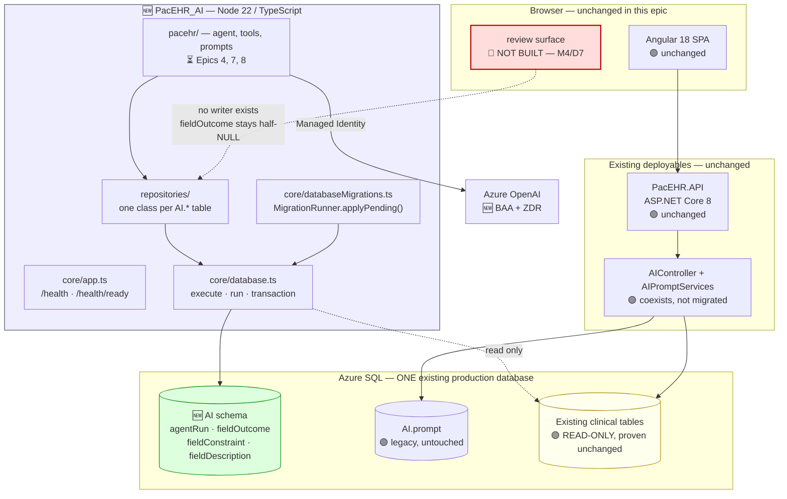
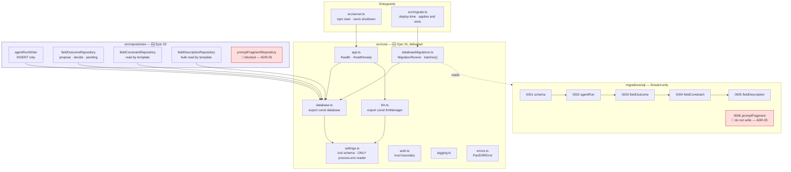
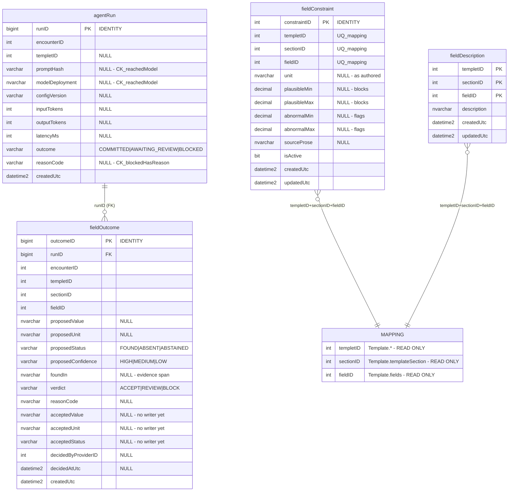

# Target Architecture — PacEHR Encounter Agent, Data Layer (Epic 02)

**Date**: 2026-10-05
**Author**: ARCHITECT
**Status**: Draft — awaiting user approval
**Version**: 1.0
**Based On**: `docs/architecture/current/00-system-overview.md` + `docs/requirements.md` (rev. 2026-10-05)
**Scope**: Epic 02 — the `AI` schema, its migration mechanism and its repository surface.
Epics 01 and 03–12 appear only where they constrain this design.

---

## Overview

### Current System

PacEHR is a layered modular monolith: an Angular 18 SPA over an ASP.NET Core 8 API of ~1,012
RPC-style endpoints, with business logic predominantly in 1,553 T-SQL stored procedures against a
1,120-table SQL Server database. AI assistance today is `AIController` (1,152 lines, 23 routes)
calling OpenAI directly, with PHI masking that `design/12-ai-phase1-implementation-architecture.md`
§0.1 measured as **switched off** (`phi-masker.ts:133` returns its input unchanged).

### What We Are Changing

Adding an `AI` schema — four tables today, five when `AI.promptFragment` unblocks — to the **same
production database**, created by a forward-only idempotent migration runner owned by a new
standalone Node/TypeScript service. The tables record what the extraction agent proposed, what the
clinician decided, and the per-mapping configuration the agent reads. No existing clinical table is
altered, dropped or written to.

### Architecture Approach

**A new architecture style is introduced, deliberately.** The existing system is a database-centric
.NET monolith; the new service is a Node/TypeScript process built on module-level singletons with
no DI container and no domain layer. This is a departure from both the current system *and* from
`SPEC/rulebooks/aire-clean-architecture.md`. It is recorded as **ADR-02** and **ADR-03** below
rather than left implicit.

---

## Delta Summary

| Component | Status | Change Description |
|---|---|---|
| `PacEHR_AI` service | 🆕 New | Standalone Node 22 / TypeScript process. Owns AI code *and* the `AI.*` DDL. |
| `AI` schema | 🟡 Modified | Already exists in production carrying `AI.prompt`, but **no `CREATE SCHEMA` exists in source control** (defect X9). `0001` adds a guarded create, correct against both a production and an empty database. |
| `AI.agentRun` | 🆕 New | One append-only row per invocation, including guard-blocked runs. |
| `AI.fieldOutcome` | 🆕 New | Proposal beside decision, per field per run. The measurement asset. |
| `AI.fieldConstraint` | 🆕 New | Per-mapping numeric bounds, two bands. |
| `AI.fieldDescription` | 🆕 New | Per-mapping AI-facing description. |
| `AI.promptFragment` | 🔴 Deferred | **Not built.** Blocked on ADR-05 / D11. |
| `AI.prompt` (legacy) | 🟢 Unchanged | Coexists. Not migrated, not read, not written by this service. |
| `AIController`, `AIPromptServices` | 🟢 Unchanged | Owner decision: coexist, do not migrate. |
| Every existing clinical table | 🟢 Unchanged | Read-only, and **proven** unchanged by `post-apply-checks.sql` check #5. |
| `pacEHR_API` SSDT project | 🟡 Modified | No longer the sole deployment authority over this database. See ADR-04. |
| Angular SPA | 🟢 Unchanged | No change in this epic. The review surface (M4) and authoring surfaces (M6) are out of scope and unowned — see Risks. |

---

## Technology Stack

| Category | Technology | Version | Status | Notes |
|---|---|---|---|---|
| Runtime | Node.js | >=22.13 | 🆕 Added | Floor is the highest any installed package declares; no ceiling |
| Language | TypeScript | 5.x, ES modules, NodeNext | 🆕 Added | `.js` specifiers resolve to `.ts` at compile time |
| SQL driver | `mssql` (node-mssql over tedious) | ^12.7.2 | 🆕 Added | Natively async — one `execute()`, no sync twin |
| Validation | zod | 4.6.5 | 🆕 Added | Settings schema; Epics 3–4 reuse for template schemas |
| Agent framework | LangChain JS | 1.5.14 | 🆕 Added | Epic 4; pinned so a resolver conflict surfaces early |
| Logging | pino | — | 🆕 Added | Synchronous stdout destination, no exit listener at import |
| JWT | jose | — | 🆕 Added | Dedupes in-flight JWKS fetch itself — no cache of ours |
| Test runner | `node:test` + tsx | built-in | 🆕 Added | Not vitest — settled by shipped code |
| Database | Azure SQL (existing) | — | 🟢 Unchanged | **Same instance as the live EHR.** New schema only |
| Model host | Azure OpenAI | — | 🆕 Added | Replaces the OpenAI-direct path; ZDR is a hard gate (M6) |
| Auth | Entra managed identity | — | 🟡 Modified | API key is a local-development fallback only |

**No technology alternatives are presented for the runtime choice**: it was settled by owner
decision before this workflow and is recorded as ADR-02, not reopened.

---

## Target System Context



**Two things this diagram is drawn to make visible.** First, the new service and the existing API
reach the *same* database — that is the whole risk surface of this epic. Second, the review surface
is dashed and red because it does not exist: `AI.fieldOutcome`'s accepted-value columns have no
writer, so without M4 the table is permanently half-NULL and the edit-rate metric the programme
rests on cannot be computed.

---

## Component Architecture (Target)



### Component contracts

| Component | Public surface | Contract |
|---|---|---|
| `database` | `execute(sql, params)`, `run(sql, params)`, `transaction(work)` | Module-level singleton. `transaction()` hands the callback an `execute` bound to the connection and **never hands out the transaction object**, so no statement can escape it. Closes GAPS #17. |
| `MigrationRunner` | `applyPending()` | One public method. Reads `migrations/sql/` in filename order, splits each file on `GO`, sends each batch through the `database` singleton. **Opens no second connection.** |
| `agentRunWriter` | `record()` | One SQL constant, `INSERT_AGENT_RUN_SQL`, using `OUTPUT INSERTED.[runID]` — insert and id in one round trip, unaffected by a trigger. No update or delete path exists. |
| `fieldOutcomeRepository` | propose · decide · pending-queue read | The decision update is scoped `AND [decidedAtUtc] IS NULL` and names only accepted-value columns. The proposal insert never touches them. Both mutation-tested. |
| `fieldConstraintRepository` | read by template | ⚠️ `DECIMAL(6,2)` surfaces as a JS double — see ADR-06. |
| `fieldDescriptionRepository` | bulk read by template | One description per mapping, enforced by the composite PK. |

**Why there are no interfaces, no DI container and no domain layer**: see ADR-03.

---

## Data Model Changes

### New entities



**`MAPPING` is not a table.** It is the `(templetID, sectionID, fieldID)` triple that already
identifies a field's use within a template, in existing read-only clinical tables. The two
configuration tables key on it and hold **no foreign key to it** — a foreign key would be a write
dependency on tables this service may only read.

### Design properties worth stating

| Property | Mechanism | Why |
|---|---|---|
| ABSENT ≠ ABSTAINED | `CK_fieldOutcome_proposedStatus` admits three values | Production writes `NA` for both today. Edit rate, the review queue and Epic 10's metrics are all computed by querying `proposedStatus`; collapsing the values makes every one of those queries lie. |
| Confidence is a band | `VARCHAR(6)` + CHECK, never a float | Nothing in the runtime produces a calibrated probability. A numeric column would store a number the model invented about itself. |
| Nullability is conditional, not loose | `CK_agentRun_reachedModel` / `CK_agentRun_blockedHasReason` | A blocked run has no prompt hash; a *successful* run without one would destroy reproducibility. Every row is "reached the model, here is the hash" or "did not, here is the reason". |
| Two bands, not one | separate `plausible*` / `abnormal*` pairs | `plausible` blocks a value, `abnormal` flags and keeps it. One unlabelled pair fails silently in both directions — real abnormal readings pass unflagged, or real hypertensive readings are refused as implausible. |
| Bounds are `DECIMAL`, not `FLOAT` | `DECIMAL(6,2)` | A bound is compared; binary floating point makes a boundary comparison a coin toss. ⚠️ See ADR-06 — the driver reintroduces the double. |
| Live spelling preserved | `templetID`, `sectionID`, `fieldID` | REQ-02-09. A column is named what it is named. |

### Migration plan

| Step | Action | Risk | Rollback |
|---|---|---|---|
| 1 | `0001` — guarded `CREATE SCHEMA [AI]` via `EXEC` | **Low** — no-op in production, where the schema already exists | None needed; it is a no-op |
| 2 | `0002`–`0005` — four guarded `CREATE TABLE` + indexes | **Low** — additive, new schema only | Forward script only |
| 3 | `post-apply-checks.sql` — read-only verification, output kept as deployment evidence | — | — |
| 4 | `0006` promptFragment | 🔴 **Blocked** — ADR-05 | — |

**Strategy: zero-downtime, additive-only, forward-only.** No down-migration exists; undoing a bad
migration is a new forward script, never an edit to a merged one. Idempotency is by existence check
against `sys.schemas` / `sys.objects` / `sys.indexes`, **not** by a tracking ledger table — a ledger
would be a sixth table in an epic already explaining why it ships five.

`CREATE SCHEMA` must be the first statement in its batch and `mssql` sends a file as one batch,
hence `EXEC('CREATE SCHEMA [AI]')`. Scripts use `GO` freely: the runner splits on it and sends each
part as its own batch, because `CREATE INDEX` cannot reference a table the same batch is creating.

### The verification gate

`migrations/verification/post-apply-checks.sql` is read-only and run after every apply. Check #5 is
the one that matters:

```sql
SELECT s.name, o.name, o.type_desc, o.modify_date
FROM sys.objects o JOIN sys.schemas s ON o.schema_id = s.schema_id
WHERE s.name <> 'AI' AND o.modify_date >= CAST(GETDATE() AS DATE);   -- expect 0 rows
```

**Any row is a failed deployment.** Stop, keep the output, do not proceed.

> ⚠️ Check #4 reads *"The five tables exist — expect: 5 rows."* Against the current script set it
> returns 4, because `AI.promptFragment` is not built. The check must be amended to 4 or the
> expectation annotated, or the first real deployment reports a false failure.

---

## API Changes

**None in this epic.** No HTTP route is added, modified or removed. The only externally reachable
surfaces the new service exposes are the two local health endpoints from Epic 01:

| Method | Path | Description | Auth |
|---|---|---|---|
| GET | `/health` | Liveness. No I/O. | None |
| GET | `/health/ready` | Readiness. Checks Azure SQL and the model concurrently, each bounded at 15 s. Returns 200 or 503 with a reason code per check (`HTTP 403`, `ELOGIN`, `TIMEOUT`), never the error text. | None |

⚠️ **Every readiness hit is a billed model call** — right for a person, wrong for a platform probe.
Epic 11 must not wire `/health/ready` to a load-balancer probe.

The endpoints that consume this epic's tables — `/ai/encounter/extract` and
`/ai/encounter/resolve` — belong to Epic 9. **No breaking change to any existing contract.**

---

## Security Design

### Authority model — application-enforced

> **Revised against the as-built code.** The epic text specified three database roles and a
> table-by-table `GRANT` matrix. Owner decision 2026-10-05 withdrew them. See ADR-01.

| Concern | Mechanism |
|---|---|
| Who the service is | One database principal. Deployed code authenticates with managed identity, `managedIdentityClientId` from `settings().azureClientId`. SQL login (`AZURE_SQL_USER`/`AZURE_SQL_PASSWORD`, both or neither) is a **local-development fallback only**. |
| Who may write what | Decided **above the data layer**. One repository class per table; a table has a write path only where a caller is entitled to one. |
| `AI.agentRun` immutability | The **absence of code** — one SQL constant, insert-only. Mutation-tested. 🔴 Not a server-side control — see ADR-01's cost note. |
| `AI.fieldOutcome` decision scope | `AND [decidedAtUtc] IS NULL` on the update; proposal columns never appear in an `UPDATE`. Mutation-tested. |
| Deploy vs runtime separation | The migration identity is distinct from the runtime principal. Schema-creation rights are never held by the identity serving clinician requests. |
| Verification | `post-apply-checks.sql` asserts **0** `AI` roles and **0** `AI`-object grants — the inverse of the original design, so a reintroduced role is detected. |

### Data protection

| Rule | Enforcement |
|---|---|
| No clinical value in a log line, trace attribute or error message | ESLint guard rules, run inside `npm test` |
| `process.env` confined to `src/core/settings.ts` | ESLint guard rule + planted-violation test |
| No value reaches SQL by interpolation | `@name` placeholders bound with `request.input()`; tagged-template `query` banned by lint |
| PHI token map is request-scoped, never a module singleton | `CLAUDE.md` § Clinical and PHI rules — the one place the singleton pattern is forbidden |
| `AI.fieldOutcome` holds PHI | `proposedValue`, `acceptedValue`, `foundIn` are clinical values. Retention purge is time-based; **no patient-request erasure path exists** (Q7) |

### Roles

Reconciled against the Roles & Permissions Matrix in `docs/requirements.md`. **No new role is
introduced by this design**; the three proposed database roles are withdrawn there and here.
Mapping the four human actors (platform engineer, compliance officer, AI/clinical admin, clinical
template administrator) onto concrete `Account.roles` `roleID` values remains **unresolved** (Q3),
and with database roles withdrawn that mapping is now the only authority mechanism for the
admin-authored tables.

---

## Error Handling

| Category | Design |
|---|---|
| Refusal vs fault | `PacEHRError` subclasses are refusals → 4xx. Anything else → 500. The boundary dispatches on `instanceof`. |
| Configuration fault | One plain `Error` naming every missing or invalid variable, **keys only, never a value** — the value may be the API key. Never a `PacEHRError`: a configuration fault is a 500, never a refusal. |
| Guard failure | Ends the run before a model call. **Fail closed.** Declared `beforeAgent: { canJumpTo: ['end'] }`, blocks by returning `{ jumpTo: 'end' }`. **A guard never throws** — a jump still runs `afterAgent` so the audit row is written; a throw skips it and destroys the audit row for exactly the runs most worth auditing. Both measured. |
| Retention refusal | Purge with an unset window deletes **zero** rows and logs a refusal naming the setting, never a row's content. The setting must be `z.coerce.number().int().positive().optional()` — **never `.default(0)`**, which would turn an unmade compliance decision into a full-table DELETE. |
| Promise hygiene | Every promise awaited or returned. `core/` installs no `unhandledRejection` listener — a listener switches the crash off and runs on in an unknown state. The entrypoint owns that decision. |
| Pool errors | The mssql pool's `'error'` listener is attached in the getter that builds it; an `'error'` event with no listener kills the process. The listener logs fields only. |

---

## Observability

| Concern | Design | State |
|---|---|---|
| Logging | One root logger, pino on synchronous stdout, no exit listener at import. Each module takes `logger.child({ module: 'core.database' })`. Fields first, literal message second. | ✅ Built |
| Audit | `AI.agentRun` — one row per invocation, written server-side, including blocked runs. Replaces the browser-written log with client-asserted token counts that is simply absent when the client fails. | ✅ Built |
| Metrics | Token counts, latency, outcome, reason code — columns on `AI.agentRun`, recorded in a `finally`. | ✅ Schema built; no call path yet (Epic 4) |
| Alerting / SLO | 🔴 **None.** `PEA-1005` states outright that no threshold, alert or SLO is asserted. Nobody learns the service is broken except a clinician mid-encounter. | 🔴 Gap |
| Spend ceiling | 🔴 **None.** `maxRetries = 2` is the entire resilience story. No TPM sizing, no concurrency cap, no budget alarm, no recursion limit. | 🔴 Gap |

---

## Technical Decisions

### ADR-01 — Authority over `AI.*` is enforced in the application, not by database `GRANT`s

**Status**: Accepted (owner decision, 2026-10-05) · **Supersedes** the epic text's role/grant design

**Context.** Epic 02 specified three roles — `aiServiceRuntime`, `aiPromptAdmin`,
`aiTemplateAdmin` — and a table-by-table grant matrix, with `aiServiceRuntime` holding `SELECT +
INSERT` on `AI.agentRun` and a column-scoped `UPDATE` on `AI.fieldOutcome`. Provisioning three
principals had **no precedent in 2,857 SQL files** and no owner (blockers D2/M1), and was the hard
blocker on four stories' security DoDs.

**Decision.** No `AI`-schema role and no `GRANT` is created. The service connects as one principal.
Which caller may read or write what is decided above the data layer, by the repository surface.
`0002_create_ai_roles.sql` is withdrawn and the remaining scripts renumbered `0002`–`0005`.

**Consequences.**
- ✅ Closes D2 and M1. The affected DoD items are **withdrawn, not passed** — the honest reading.
- ✅ No provisioning dependency on a DBA, no new principals to rotate.
- 🔴 **`AI.agentRun` immutability becomes a convention, not a control.** Nothing at the server
  refuses an `UPDATE` or `DELETE` against the audit table. The specified guarantee — a record *"no
  application code can have edited after the fact"* — degrades to *no application code does edit
  it*.
- 🔴 The epic's sharpest verification check (runtime principal holds `SELECT + INSERT` only) is
  gone. `post-apply-checks.sql` now asserts the inverse: 0 roles, 0 grants.

**The cheap substitute, if the compliance claim is load-bearing**: an `INSTEAD OF UPDATE, DELETE`
trigger on `AI.agentRun` that throws. It needs no principal, no grant and no provisioning — roughly
six lines, and it restores a server-side control without reopening D2/M1. **Recommended.**
Tracked as Q10.

---

### ADR-02 — A standalone Node service, not .NET projects inside the existing solution

**Status**: Accepted (owner decision) · **Supersedes** `design/12-ai-phase1-implementation-architecture.md` §2 Option B

**Context.** That document (2026-09-09) assessed five build options and recommended **Option B** —
`PacEHR.AI.*` .NET projects inside the existing solution, behind a thin adapter preserving the four
legacy routes — explicitly deferring **Option C** (separate deployable, new contract) to Phase 2/3.
Its stated reason for deferring C: it conflicts with S2 (frontend retained, backend-only Phase 1)
and S8 (incremental, not big-bang), and adds a deployable to an org with a known CI/CD gap.

**Decision.** Build Option C: a standalone Node/TypeScript service in its own repository, owning
both the AI code and the `AI.*` DDL. Epic 02 Rev 8 records it as *"Node only, greenfield — no prior
implementation exists in any language."*

**Consequences.**
- ✅ The module is contract-first by construction, which is what Option B was supposed to buy
  *toward* C anyway. No adapter is written and later thrown away.
- ✅ Engineering standards are set fresh (`PacEHR_AI/CLAUDE.md`) rather than inherited from a
  526-line `Program.cs` with ~250 hand-written DI registrations.
- 🔴 **Two deployment mechanisms now write to one database** — this service's `MigrationRunner` and
  `pacEHR_API`'s SSDT project. See ADR-04.
- 🔴 **Shadow mode becomes cross-process.** `12-ai-phase1-implementation-architecture.md` §2 called
  shadow mode the unique advantage of Option B — both engines on the same production request, old
  serving the user, new logging only, producing a field-by-field divergence baseline before any
  ground truth exists. Across two deployables that is a harder build, and it is **the answer to the
  client's hardest question** (how to prove no regression). It is not re-planned anywhere.
- 🔴 A second egress path and a second BAA boundary to evidence.
- 🔴 `12-ai-phase1-implementation-architecture.md` §2 notes the CI gate is already broken —
  `test-validation-pipeline.yml`'s `pr:` trigger is ignored by Azure DevOps for Azure Repos Git, so
  unit tests are **not gated** today. Adding a deployable before fixing the gate compounds that.
  Epic 11 (M11) owns it and is unowned.

**Alternatives considered**: Option A (patch in place) — rejected, cannot deliver M1/M3/M15.
Option B — rejected by owner decision, assessed above. Option D (buy Dragon Copilot for the speech
layer) — orthogonal, still recommended for Phase 1.5. Option E (fine-tune) — not Phase 1, nothing
to fine-tune on.

---

### ADR-03 — Module-level singletons, not clean-architecture layering

**Status**: Accepted (user decision, this workflow) · **Deviates from** `SPEC/rulebooks/aire-clean-architecture.md`

**Context.** The rulebook prescribes a domain layer of pure entities, repository *interfaces* in the
domain, use-case classes in an application layer, and dependencies injected through constructors.
`PacEHR_AI/CLAUDE.md` prescribes the opposite shape and the shipped Epic 01 code implements it:
instances exported on the last line of their defining module, expensive members as self-overwriting
lazy getters, one class per surface with one public method, and explicit prohibitions — *"no
function that exists to call one other function"*, *"no wrapper over a wrapper"*, *"yagni:
abstraction with one implementation"*, *"a class earns its place by owning construction; it never
earns it by forwarding."*

**Decision.** `PacEHR_AI/CLAUDE.md` governs. No domain layer, no repository interfaces, no DI
container.

**Rationale.**
- A repository interface with exactly one implementation is the rulebook's own `yagni:` tag.
- The singleton pattern here is load-bearing, not incidental: a caller constructing its own copy
  pays for a second TLS handshake, a second JWKS fetch or a second compiled agent, **and no test
  catches it** — the cost lands in production, under load, as latency no local measurement
  predicted.
- Testability, the usual argument for DI, is already solved: a test seeds an instance member with
  `Object.defineProperty` before first read and the getter never runs; `Reflect.deleteProperty`
  restores it. This is why expensive members are never `#private` fields.
- The rulebook is generic guidance; `CLAUDE.md` is the standard this repository's reviewers apply.

**Consequences.** Reviewers must read `PacEHR_AI/CLAUDE.md`, not the clean-architecture rulebook,
when reviewing this service. `aire-brownfield-patterns` must record this deviation explicitly rather
than leaving two contradictory standards in force — it is the single most likely source of spurious
review findings.

---

### ADR-04 — Two deployment mechanisms over one database

**Status**: 🔴 Open — consequence of ADR-02, no mechanism designed

**Context.** `pacEHR_API/PacEHR.Database` is an SSDT project of 2,857 `.sql` objects that deploys by
schema comparison against the whole database. `PacEHR_AI` deploys `AI.*` by forward-only numbered
scripts. **Both target the same production database.**

**The specific hazard.** An SSDT publish computes a diff against its own model of the database. The
`AI` schema's new tables are not in that model. Depending on publish settings, a drift-detection or
"drop objects not in source" option would see four tables it does not know and **propose dropping
them.** Nothing in either repository prevents this today.

**Required before first production apply** — none of this is designed yet:
1. The SSDT publish profile must exclude the `AI` schema explicitly (and that exclusion must be
   tested, not assumed).
2. Ownership of `AI.prompt` must be settled — it lives in the `AI` schema, predates this work, and
   is deployed by SSDT.
3. A documented answer to "who applies what, in which order, on a release where both change."

**Status**: unowned. Belongs to Epic 11 (M11), which has no owner. Tracked as Q6.

---

### ADR-05 — `AI.promptFragment` is deliberately not built

**Status**: 🔴 Blocked on D11 · **Recommendation stated, decision outstanding**

**Context.** PEA-205's §3.1 DDL ships a filtered unique index:
`WHERE ([accountId] IS NOT NULL AND [templetID] IS NOT NULL)`. Its own inline comment says to use
computed sentinels — which is not what the DDL does — while §3.3 analyses the problem properly and
recommends sentinel `0`, warning *"do not ship a plain `UNIQUE` over nullable columns and assume it
means what it reads like."* The spec contradicts itself across two sections.

**Why the filtered index is worse than either option it replaces.** It enforces uniqueness only
where **both** columns are non-null — that is, account-scoped `template_override` fragments alone.
A global `contract` fragment has both columns NULL, falls outside the filter, and can be inserted
**twice at the same version with no error.** Two simultaneously-active v1 contract fragments is
precisely the near-duplicate-fork defect the audit already found in live `AI.prompt` data.

**Recommendation**: adopt §3.3 option A — `accountId` and `templetID` `NOT NULL DEFAULT 0`, the two
conditional CHECKs testing `= 0` rather than `IS NULL`, and a plain
`UNIQUE (kind, scope, accountId, templetID, version)`. It matches `usp_getPrompt.sql` tier 3, which
already uses `accountId = 0` for universal prompts, and needs no filter and no computed column.

**Consequence.** REQ-02-01 is undelivered, and Epic 8 (prompt ownership) has no storage. ~30 minutes
to decide; a schema change afterwards. **This is the one place in this epic where building to the
written spec would have shipped a hole.**

---

### ADR-06 — `DECIMAL` bounds compared in SQL, not in Node

**Status**: Proposed — decide before the first bound check is written

**Context.** `AI.fieldConstraint` stores bounds as `DECIMAL(6,2)` precisely because binary floating
point makes a boundary comparison a coin toss. **node-mssql surfaces `DECIMAL` as a JS double**, so
reading a bound into Node and comparing there reintroduces the exact defect the column type was
chosen to avoid. The shipped DDL carries a `ponytail:` note saying the resolution belongs to the
read path.

**Decision (proposed).** Push the comparison into SQL, where the operands stay `DECIMAL`. If a
comparison must happen in Node, it carries an explicit documented tolerance derived from the column
scale — never a bare `<=`.

**Consequence if ignored.** A value exactly on a bound — a blood pressure of exactly 200, a weight
exactly at the plausible maximum — flips between pass and fail unpredictably. It fails silently, in
both directions, and is reported as an intermittent validator bug long after the cause is cold.
Tracked as Q13.

---

## Risks

| # | Risk | Severity | Owner |
|---|---|---|---|
| R1 | **`AI.fieldOutcome`'s accepted-value columns have no writer.** The review surface (M4) is out of scope in Epics 9/10/11 and D7 is undecided. Without it the table is permanently half-NULL and edit rate — the programme's headline metric — cannot be computed. | 🔴 | Product (D7) |
| R2 | **No deployment path (M11).** Every story's exit criterion ends *"against staging"*. Code can be merged; it cannot be proven. Nothing in this epic can be *closed*. | 🔴 | DevOps, unowned |
| R3 | **SSDT may propose dropping the `AI` tables.** ADR-04, no mechanism designed. | 🔴 | Epic 11 |
| R4 | **`AI.agentRun` is not immutable at the server.** ADR-01. | 🔴 | Architecture + Compliance |
| R5 | **`AI.promptFragment` undelivered.** ADR-05, blocks Epic 8. | 🔴 | Architecture (30 min) |
| R6 | **Retention window undecided (D4).** Longest lead time in the epic; two documents have already stalled on it. Purge fails closed meanwhile — correct, but the table grows at ~10.95M rows/year. | 🔴 | Clinical + Compliance |
| R7 | **Clinician identity undefined (Q3).** `decidedByProviderID INT` has no agreed source. The audit cannot answer "who decided this." | 🔴 | Architecture |
| R8 | **Nothing owns writing to the encounter form** (GAPS #1). The product's only output has no implementation, and `REQ-02-07` forbids this service writing a clinical table. | 🔴 | Architecture |
| R9 | **No alerting, no SLO, no spend ceiling.** | 🟠 | Epic 10/11 |
| R10 | **`DECIMAL` boundary comparison** (ADR-06). | 🟠 | Epic 6 |
| R11 | **No patient-request erasure path** for PHI in `AI.fieldOutcome`. | 🟠 | Compliance |
| R12 | **`post-apply-checks.sql` check #4 expects 5 tables; 4 ship.** First real deployment reports a false failure. | 🟡 | Epic 02 |

---

## Delta vs. the previous design document

`docs/architecture/design/12-ai-phase1-implementation-architecture.md` (2026-09-09) remains the
authority on Parts 0, 1, 4 and 5 — the code reconciliation, the requirements traceability spine,
the accuracy-measurement argument, and the phase plan. **This document supersedes it on two points
only**, both recorded above as ADRs:

| Point | That document | This document |
|---|---|---|
| Build shape | Option B — .NET projects in the existing solution, legacy adapter, Option C deferred to Phase 2/3 | **Option C** — standalone Node service (ADR-02) |
| Component style | Not specified below module level | **Module-level singletons, no DI, no domain layer** (ADR-03) |

Everything else in that document stands, including the ZDR gate (M6), the faithfulness-over-
correctness metric argument (§4.2), the post-edit corpus (§4.3) and the Dragon Copilot migration
(Phase 1.5).

---

**Diagram Preview (Human-readable)**: `docs/architecture-diagrams/02-target-architecture-diagrams-brownfield.md`

**Next workflow**: `aire-brownfield-patterns`
