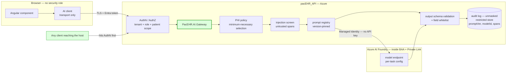
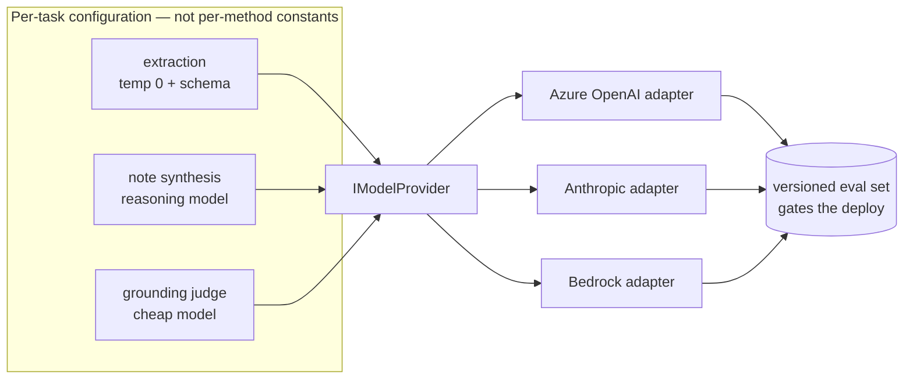
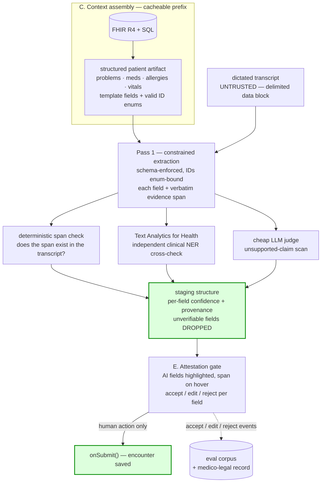
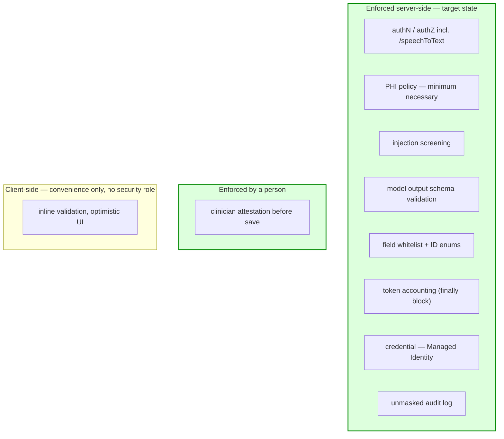

# Target Architecture — AI Assistance & Dictation

**Date**: 2026-09-08
**Designed By**: ARCHITECT
**Status**: Draft — **partially superseded 2026-09-09**

> ⚠️ **Read `12-ai-phase1-implementation-architecture.md` first.** Client requirements received
> after this note was written (Sept 2026) fix Phase 1 scope to the backend AI APIs, make zero data
> retention a hard gate, and rule several items here out of scope. Code verification on 2026-09-09
> also established that `maskPHI` is a no-op (`phi-masker.ts:133`), that the code path is
> OpenAI-direct rather than Azure OpenAI, and that no AI confidence scores exist — all three of
> which this note assumed otherwise. The model landscape (Part 1) and the accuracy techniques
> (Part 2) remain valid; the architecture and sequencing in Part 3 are superseded.
**Module 12 (target state)** — supplement to `docs/architecture/current/12-ai-assistance-deep-dive.md`

> **Relationship to the deep-dive.** `current/12-ai-assistance-deep-dive.md` establishes what is
> built today and names eight recommendations plus three open questions. This document does not
> restate those findings; it answers three forward-looking questions asked against them:
> which models are available under healthcare compliance, what raises response accuracy, and
> what architecture addresses both. Every recommendation here traces to a defect or open
> question in the deep-dive, cited by `file:line` where one exists.
>
> **This is not the `aire-brownfield-architecture` deliverable.** That workflow writes
> `docs/architecture/design/02-target-architecture-brownfield.md` covering the whole system.
> This is a module-scoped design note that should be folded into it when that workflow runs.

---

## Framing — the question the deep-dive leaves open

The deep-dive's headline stands: the proxy boundary is correct, everything downstream of it is
unvalidated. Above that sits a layer neither document settles, and it changes every answer below.

**Compliance is not a property of a model. It is a property of a contract, an endpoint and a
deployment boundary.** `gpt-4o` is available under a HIPAA BAA and also available with no BAA at
all — same weights, same API shape, opposite regulatory position. Today `AIPromptServices` calls
`api.openai.com` directly from an Azure App Service using a key resolved from SQL app settings,
and **no BAA is referenced anywhere in Module 7 or Module 12**.

Two facts from the deep-dive sharpen this:

1. **`maskPHI` is client-side only.** "We mask, therefore no PHI reaches the provider" is not
   defensible — any caller that can reach the host bypasses it (`current/12`, diagram 2), and it
   masks 18 Safe Harbor identifiers out of `userPrompt`, not the dictated transcript body, which
   is dense clinical PHI by construction.
2. **Three cloud boundaries are in play.** Azure (hosting, SQL, Blob), OpenAI direct
   (completions), Google Cloud (Speech V1, diarization on — raw patient audio). Three BAAs,
   three egress paths, three audit surfaces.

Everything in this document assumes those two are resolved first.

---

## Part 1 — Model options under healthcare compliance

### Tier 1: frontier models under a cloud BAA

| Route | Models | BAA mechanics | Fit |
|---|---|---|---|
| **Azure AI Foundry / Azure OpenAI** | GPT-5 family, o-series, **plus Anthropic Claude and Google Gemini in the Foundry catalog** | BAA arrives via Microsoft's Online Services Terms at no additional cost; one BAA covers the whole catalog — no per-model request | 🟢 **Strongest fit.** Already `thesnfist-{env}-eastus2-pacehr` with Key Vault, App Insights, Service Bus. Adds Private Link, **Entra Managed Identity (retires the API key entirely)**, Purview, data-zone residency, PTUs |
| **AWS Bedrock** | Claude (`claude-opus-5`, `claude-sonnet-5`), Llama, Nova | HIPAA-eligible under the AWS BAA | 🟡 Strong models; a second cloud and a second egress path |
| **Google Vertex AI** | Gemini, Claude on Vertex | Google BAA covers Vertex, Gemini on Vertex, Healthcare API **and Cloud Speech-to-Text** | 🟡 Worth checking regardless — may already cover the existing Speech V1 usage |
| **Anthropic first-party** | Claude Opus 5 / Sonnet 5 | HIPAA-ready org tier. Covers the Messages API incl. prompt caching, structured outputs, memory. **Excludes** Batch, Files, Code Execution, Web Fetch | 🟡 Strong on long-context clinical summarisation. See the retention conflict below |
| **OpenAI direct** | GPT-5 family | BAA via `baa@openai.com`; requires Enterprise **and a ZDR-enabled project**. Covers chat completions, responses, batch, embeddings. Excludes live web search and image inputs | 🟡 Cheapest to legitimise — the path already 90% built |

> 🔴 **Retention postures conflict across providers.** Anthropic's Covered Models **require**
> 30-day retention and are **not** available with zero data retention enabled. OpenAI's HIPAA
> path **requires** ZDR. "ZDR everywhere" is therefore not a coherent policy — retention posture
> must be decided per provider and written down per provider.

### Tier 2: clinical-domain and self-hosted open weights

| Option | Notes |
|---|---|
| **MedGemma 1.5** (Google, open weights, Jan 2026) | Multimodal text + imaging, fully fine-tunable, self-hostable. Published MedQA figures range ~85–91% **depending on variant** (the 4B v1.5 reports ~69%) — verify the specific variant before citing a number. Deployable on Azure ML managed endpoints inside the VNet; PHI never leaves the tenant |
| **Meditron, OpenBioLLM** | Open-weight clinical fine-tunes |
| **John Snow Labs Healthcare NLP & LLM** | Signs a BAA; strong deterministic clinical NLP |
| **Self-hosted Llama / Mistral / Qwen** | On HIPAA-eligible Azure/AWS/GCP infrastructure |

**Caveat, stated plainly.** Self-hosting moves the compliance burden *to us* — encryption at
rest, audit logging, eval harness, model lifecycle all become our responsibility. Worth it for
high-volume deterministic work (de-identification, coding, field extraction). Not worth it for
the flagship note draft, where frontier quality is the product.

### Tier 3: purpose-built clinical services (the buy-vs-build option)

Two of these already solve the exact defect in the extraction path.

| Service | What it gives us |
|---|---|
| **AWS HealthScribe** | HIPAA-eligible ambient clinical documentation. Transcript + preliminary clinical note **with evidence links from every generated sentence back to the source transcript**. That property is precisely what `add-rounding-notes.component.ts:873` lacks |
| **Microsoft Dragon Copilot** (Nuance DAX successor) | Azure-native, Epic/Cerner integration, documented 30-day retention of audio, transcript and note. Marketplace apps + agents as of HIMSS 2026 |
| **Azure Text Analytics for Health + FHIR structuring** | **Not an LLM.** Deterministic clinical NER — symptoms, diagnoses, medications, with negation and assertion detection — emitting FHIR-compliant resources. The single highest-value addition to the stack: an independent cross-check on LLM extraction output |

### Speech layer

Current: **Google Cloud Speech V1** — the older API, `LINEAR16 / 48 kHz / mono`,
`EnableSpeakerDiarization = true` (`AIController.cs:438`).

| Option | Notes |
|---|---|
| **Azure AI Speech** | Collapses dictation into the same BAA boundary as everything else |
| **AWS Transcribe Medical / HealthScribe** | Medical vocabulary out of the box, PrivateLink support |
| **Deepgram Nova-3 Medical** | BAA available, strongest medical-WER claims, streaming, EU residency GA Jan 2026 |
| **Stay on Google** | Acceptable **if** covered by a Google BAA — confirm; and move off V1 to Chirp/v2 regardless |

---

## Part 2 — Accuracy

Ordered by leverage. Each item maps to something specific in the current implementation.

### 1. 🔴 Grounding beats model choice — feed the model the structured record

Today the model receives a system prompt plus free-text transcript. It does **not** receive the
patient's structured record — despite a FHIR R4 surface (Module 5), PointClickCare / MatrixCare
feeds (Module 4) and 1,048 tables being available.

Assemble a **structured patient artifact**: active problems, medication list, allergies, recent
vitals, prior encounter, and the encounter template's field definitions *with their valid ID
enumerations*. Published 2026 work (medRxiv) measured structured patient artifacts reducing
unsupported claims to **8.4% in single-pass generation — a 40% relative reduction** versus
baseline, before adding any retrieval.

### 2. 🔴 Stop asking for JSON in prose — constrain the decode

`getEncounterRequirement()` (`add-rounding-notes.component.ts:873`) pins a JSON shape inline and
instructs the model to answer `"NA"` when unsure. Every current provider supports
schema-constrained output — Azure OpenAI structured outputs, Anthropic `output_config.format` /
`strict: true`, Vertex `responseSchema`. That converts *hope it is JSON* into *guaranteed to
validate*.

Then go further: `encounterTempleteID`, `eventTypeId`, `POSID` and `facilityID` should be
**`enum`-constrained to the IDs actually valid for that account and patient**, not free strings.
That removes an entire class of wrong-record writes **at the decoder**, before any validation
code runs.

### 3. 🔴 Two-stage extract-then-verify with evidence spans

- **Stage 1** — extract each field **plus the verbatim transcript span it came from**.
- **Stage 2** — verify the span exists and supports the value: a deterministic string check,
  plus Azure Text Analytics for Health as an independent NER cross-check (does the LLM's
  medication list match the clinical NER's?), plus a cheap LLM judge for unsupported claims.
- Unverifiable fields are **dropped, not guessed**.

Citation-enforced prompting is consistently the highest-performing grounding strategy in the
2026 literature, and it is what HealthScribe's evidence links implement.

### 4. 🟠 `temperature = 0` is not determinism, and is wrong for half the workloads

Hardcoded `0` in all four `AIPromptServices` methods. For structured extraction, `0` plus a
schema constraint is correct. For **narrative note drafting** it produces flat, repetitive prose
— and it does not buy reproducibility regardless. These are two workloads sharing one config.

This is why deep-dive recommendation #6 (lift model and temperature into configuration) is an
**accuracy prerequisite**, not tidiness.

### 5. 🟠 `gpt-4o` is a 2024-generation, non-reasoning model

Current reasoning-capable models — GPT-5 family on Azure, Claude Opus 5 / Sonnet 5 with adaptive
thinking and effort control, Gemini 2.5+ — materially outperform it on multi-step clinical
summarisation. Do not upgrade uniformly. **Route by task**: cheap fast model for extraction,
reasoning model for note synthesis, cheap model again for the grounding judge.

### 6. 🟠 Prompt versioning and evals — the loop that is entirely missing

Prompts live in two places: the DB library (`usp_getAiPrompts`) and inline code literals. A
clinical prompt change is a code deploy for some features and a DB row for others — and
**nothing measures whether any change helped.**

Required: one prompt registry with version IDs, the version ID logged on every completion, and a
held-out gold set of real de-identified encounters with clinician-graded reference notes.

| Metric | Why it is the right one |
|---|---|
| **Unsupported-sentence ratio** | Direct hallucination measure; deterministic to compute given evidence spans |
| **Omission rate** on required note elements | The failure mode that actually harms patients — a note that omits an allergy is worse than one that pads |
| **Field-level precision / recall** on extraction | Scores the auto-commit path against gold |
| **Edit distance, AI draft → clinician-signed note** | The best production proxy available, and **both artefacts are already stored** |

### 7. 🔴 Three defects make accuracy unmeasurable today

No model upgrade helps until these are fixed:

- `usp_addEditAILogs` stores **masked** text (`AddEditAILogs` applies `maskPHI` to both
  `user_content` and `resp_content`) — the log cannot evidence what was sent or reproduce a bad
  output.
- Token counts route through `localStorage.OpenAIStreamTokenData` and are **misattributed to the
  next completion** when a log write fails (`add-rounding-notes.component.ts:1007`,
  `encounter-ai.facade.ts:618`) — per-account figures are not billing-grade.
- `event: error` frames are written by the server and **never read by the client** — every
  truncated note is silently a possible provider failure.

### 8. 🔴 Prompt injection is a live clinical vector

A dictated transcript is attacker-influenceable content: **anyone in the room can speak into
it.** `detectInjection` is client-side and runs on `userPrompt` only.

Server-side fix: place untrusted transcript inside a delimited **data** block, never in the
instruction position; use the provider's operator channel for instructions (on Claude,
mid-conversation system messages); and validate output against the schema regardless of what the
transcript said.

### 9. 🔴 Attestation is an accuracy control, not only a safety one

`timer(1000)` → `onSubmit()` removes the one reviewer who could catch an error. Attest-before-save
with AI-populated fields diff-highlighted is both the compliance answer **and** the source of the
training signal for item 6.

---

## Part 3 — Target architecture

**Design principles**: one gateway · server-enforced guards · model-agnostic · one cloud
boundary · evidence-linked output · clinician attestation.

### A. Move the trust boundary from browser to server — `PacEHR.AI.Gateway`

The only code path to any model. Enforces server-side what is today client-side or absent:

- identity / tenant / role authorisation — this also closes `/speechToText` `[AllowAnonymous]`
- PHI policy as **minimum-necessary field selection**, not regex masking after the fact
- injection screening on untrusted spans
- prompt registry resolution, version-pinned
- **output schema validation and field whitelist**
- full audit log — unmasked, in a restricted store — carrying prompt version, model ID, latency,
  tokens and evidence spans
- **Managed Identity to the model endpoint. No API key anywhere.**

That last point retires the committed key, the SQL-app-settings fallback and all four duplicated
credential blocks in a single change. `AIPromptServices` is already the natural seam — all four
methods funnel through it and it is the only place holding the credential.

Contrast with `current/12` diagram 2: the guards move from the left boundary to the middle one,
and the credential disappears entirely.

### B. Provider abstraction and task routing

One `IModelProvider` behind the gateway; adapters for Azure OpenAI, Anthropic, Bedrock. Model,
temperature and effort come from configuration **per task**, not hardcoded per method. Enables
A/B-ing a model against the eval set without a deploy, per-task cost routing, and provider
failover.

Today model (`gpt-4o`) and `temperature = 0` are hardcoded in four service methods. Lifting them
to per-task configuration is what makes a model change a config change and an A/B measurable.

### C. Context assembly service — the accuracy engine

Builds the structured patient artifact from FHIR R4 + SQL. Deterministic and cacheable, which
makes it the ideal **stable prompt-cache prefix** (patient artifact + template stable, transcript
volatile). At current token volumes that is a material cost lever alongside the accuracy gain.

### D. Two-pass generation with a verification stage

Constrained extraction with evidence spans → deterministic span check + Text Analytics for Health
cross-check + cheap LLM judge for unsupported claims. Output carries per-field confidence and
provenance.

Contrast with `current/12` diagram 4: `timer(1000)` is gone, and the edge that reached the saved
encounter unvalidated now passes through verification and a human.

### E. Attestation gate replaces auto-commit

Model output lands in a **staging structure**, never directly on the encounter form. The UI
highlights AI-populated fields with their evidence span on hover; the clinician accepts, edits or
rejects per field; `onSubmit()` fires on human action only. Every accept / edit / reject is
recorded — simultaneously the eval corpus and the medico-legal record.

### F. Normalised streaming contract

The server parses provider deltas instead of re-emitting them verbatim, and emits a normalised
envelope — `token` / `usage` / `error` / `done`. Usage is recorded server-side in a `finally` at
stream close. The client handles `error` explicitly. This retires the `localStorage` token store
and the invisible-error defect together.

### G. Speech consolidation

Move to Azure AI Speech, or adopt HealthScribe / Dragon Copilot wholesale. Authenticate the
socket. **Decide the audio-retention posture explicitly** — the commented-out blob leg at
`AIController.cs:798` is the worst of both worlds: it reads as planned-but-unfinished, and
ambiguity about whether PHI audio is retained is itself the compliance finding.

### H. Evaluation and monitoring plane

- **Offline** — versioned gold set; nightly eval on every prompt or model change; deploys gated
  on it.
- **Online** — sampled unsupported-sentence ratio; field-level accept rate from the attestation
  gate; draft-to-signed edit distance; per-tenant drift alerts in Application Insights.

### Where each control layer sits in the target state

Target-state counterpart to `current/12` diagram 5. The "Neither" box is empty; nothing that
matters is left to the browser.

---

## Sequencing

| Phase | Work | Why here |
|---|---|---|
| **0** | Confirm/sign BAAs · rotate the committed key · server-side schema validation + field whitelist · remove `timer(1000)` auto-submit · read `event: error` · authenticate `/speechToText` | The cost of *not* doing these is regulatory, not technical |
| **1** | Gateway extraction · Managed Identity · prompt registry · server-side token accounting | Makes everything after it measurable |
| **2** | Azure AI Foundry endpoint · provider abstraction · move off `gpt-4o` | One BAA; model choice becomes configuration |
| **3** | Context assembly · structured outputs · evidence spans · attestation UI | The actual accuracy work |
| **4** | Eval plane · routing and caching · then buy-vs-build against HealthScribe / Dragon Copilot with real numbers | That call can only be made once it can be measured |

---

## Blocking questions

These gate Phase 0 and cannot be answered from the codebase.

1. **Does a BAA exist today** for the OpenAI path, and for Google Cloud Speech? Nothing in
   Module 7 or Module 12 references one.
2. Deep-dive open question #2 — are `OPENAI_API_KEY` / `OPENAI_API_URL` populated per-environment
   in the SQL app-settings table, or is every environment on the `appsettings` fallback? This
   determines whether key rotation is safe or breaking.
3. Deep-dive open question #3 — is client-side-only `maskPHI` / `detectInjection` an **accepted**
   design decision or an unfinished one? The answer decides whether Phase 0 is a fix or a
   re-litigation.

---

## Sources

Model availability and BAA coverage (retrieved 2026-09-08):

- Anthropic — [BAAs for Commercial Customers](https://privacy.claude.com/en/articles/8114513-business-associate-agreements-baa-for-commercial-customers) · [API and data retention](https://platform.claude.com/docs/en/manage-claude/api-and-data-retention)
- OpenAI — [Data controls in the OpenAI platform](https://developers.openai.com/api/docs/guides/your-data) · [What the OpenAI HIPAA BAA actually covers](https://www.protecto.ai/blog/openai-hipaa-baa-what-it-actually-covers-and-what-leaves-phi-exposed/)
- Microsoft — [Azure OpenAI + Azure AI Foundry Enterprise Guide (2026)](https://www.epcgroup.net/azure-openai-service-enterprise-2026) · [BAA for Azure Foundry models](https://learn.microsoft.com/en-us/answers/questions/5824024/baa-for-azure-foundry-models) · [Text Analytics for Health](https://learn.microsoft.com/en-us/azure/ai-services/language-service/text-analytics-for-health/overview) · [Dragon Copilot at HIMSS 2026](https://www.microsoft.com/en-us/microsoft-cloud/blog/healthcare/2026/03/05/unify-simplify-scale-microsoft-dragon-copilot-meets-the-moment-at-himss-2026/)
- AWS — [HealthScribe](https://aws.amazon.com/healthscribe/) · [HealthScribe HIPAA eligibility](https://www.hipaajournal.com/aws-healthscribe-hipaa-eligible-ai-transcription-tool/)
- Cross-provider — [BAAs with OpenAI, Anthropic & AWS Bedrock: 2026 Healthcare Guide](https://www.tactionsoft.com/blog/baas-with-openai-anthropic-aws-bedrock/) · [HIPAA-Eligible Model Providers in 2026](https://callsphere.ai/blog/vw1f-hipaa-eligible-model-providers-2026)
- Speech — [Deepgram Nova-3 Medical](https://deepgram.com/solutions/medical-transcription)

Accuracy and hallucination research:

- [Representation Before Retrieval: Structured Patient Artifacts Reduce Hallucination in Clinical AI Systems](https://www.medrxiv.org/content/10.64898/2026.02.13.26346256v1.full) (medRxiv, 2026)
- [Reducing Hallucinations in Medical AI Through Citation Enforced Prompting in RAG Systems](https://www.mdpi.com/2076-3417/16/6/3013) (MDPI)
- [A framework to assess clinical safety and hallucination rates of LLMs for medical text summarisation](https://www.nature.com/articles/s41746-025-01670-7) (npj Digital Medicine)
- [Ambient AI Documentation and HIPAA: A 2026 Compliance Guide](https://medcurity.com/ambient-ai-documentation-hipaa/)
- [Healthcare LLMs Compared 2026: MedGemma, Meditron +20](https://nirmitee.io/blog/healthcare-llm-landscape-2026-medgemma-meditron-clinical-model-guide/)

---

**Diagram Preview (Human-readable)**: `docs/architecture-diagrams/12-ai-assistance-target-architecture-diagrams.md`
