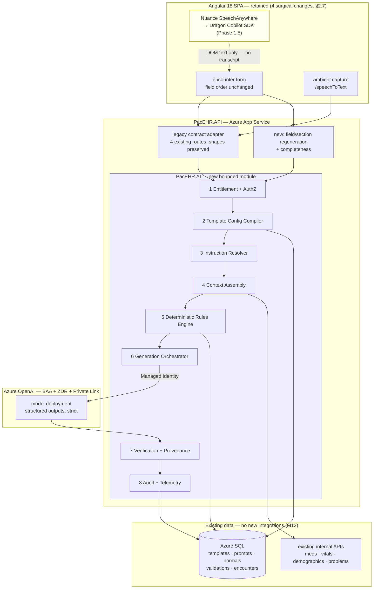
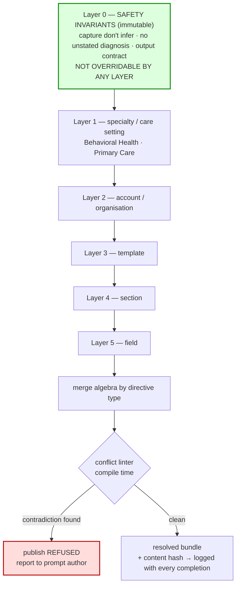

# AI Phase 1 — Implementation Architecture, Options & Plan

**Date**: 2026-09-09
**Designed By**: ARCHITECT
**Status**: Draft — input to the Friday scope discussion
**Module 12** — supersedes parts of `design/12-ai-assistance-target-architecture.md`

> **Inputs to this document**
> 1. `docs/architecture/current/12-ai-assistance-deep-dive.md` — as-built AI flow
> 2. Client requirements & constraints (Mahesh + SarahLena, Sept 2026)
> 3. Fresh code verification performed 2026-09-09 — **which contradicted both of the above
>    in three places.** Those are Part 0 and must be settled before scope is fixed.

---

## Part 0 — Reconciliation: what the code actually does

Three claims were checked against the source. All three came back different from what the
deep-dive and the client brief assert. Two of them change the Phase 1 plan.

### 0.1 🔴 `maskPHI` is a no-op. PHI is transmitted and logged unmasked.

```typescript
// PacEHR/src/app/configs/phi-masker.ts:132
export function maskPHI(text: string, patient?: PatientPhiContext): string {
  return text;                    // ← line 133. Everything below is unreachable.
  if (!text) return text;
  // ~170 lines of masking logic — dead code
```

`git blame`: the masker was written by Tirupati Rao on 2026-05-17; the `return text;` was added
by Niteen Naik on **2026-05-19** (PR 9709, "dx falg risk level-phi mask"). Two days later.

The deep-dive characterises `phi-masker.ts` as *"Exemplary implementation; client-side only"*.
That is wrong in the way that matters: it is not client-side-only, it is **switched off**.

Consequences, all of which are live today:

| Consequence | Why it matters now |
|---|---|
| Full PHI reaches the model provider on every AI call | The BAA/ZDR question stops being theoretical — see 0.2 |
| `usp_addEditAILogs` stores **raw PHI** in `user_content` and `resp_content` | `AddEditAILogs` applies `maskPHI` — a no-op. The AI log table is a PHI store |
| 🔴 **The 10-month log handover to 3Pillar is not pre-de-identified** | Client requirement 5 assumes "patient names and identifiers will be removed". Nothing in the pipeline removes them. **De-identification is a real ETL workstream, not a formality** |
| The accuracy hypothesis "masking degrades model context" is dead | Worth noting: it does *not* apply. Masking is not running, so it is not hurting accuracy. Do not spend time here |

**Do not simply delete line 133.** Turning the masker on would change model input on every
route overnight and move accuracy in an unmeasured direction — and it would mask the very
`Date of Service` the extraction prompt asks the model to return. The correct sequence is:
decide the PHI posture server-side (0.2), then apply it deliberately with measurement.

### 0.2 🔴 The code path is OpenAI-direct, not Azure OpenAI

The client states *"Azure OpenAI is being used today."* The code says otherwise:

| Evidence | Location |
|---|---|
| Auth header is `Authorization: Bearer {apiKey}` — OpenAI style, not Azure's `api-key` | `AIPromptServices.cs:172, 226, 278, 330` |
| Keys in config are OpenAI platform keys (`sk-proj-…`), not Azure 32-hex keys | `appsettings.json:42`, `.QA:44`, `.Test:43`, `.Uat:47`, `.Automation:53`, `.Development:64` |
| Same key reused across base/QA/Test/Uat/Automation; Development has its own | six tracked files |
| No `api-version`, no deployment name, no `openai.azure.com` anywhere in the service | — |

The one path by which the client could still be right: `OPENAI_API_URL` from
`usp_getAppSettingsForMultiple` **replaces the whole request URI**, so production could point at
an Azure OpenAI v1-compatible endpoint (which does accept `Bearer`) while the committed keys are
legacy leftovers.

> 🔴 **Verification required before Friday.** Read `OPENAI_API_URL` and `OPENAI_API_KEY` from the
> production app-settings table. This is the difference between *"we are on a BAA-covered Azure
> endpoint and the committed keys are stale"* and *"unmasked PHI is going to `api.openai.com` on a
> key committed to the repo."* Both are recoverable; they are not the same conversation, and
> everything in Part 3 assumes the answer.
>
> Either way the six committed keys must be revoked and rotated — see deep-dive open question 2.

### 0.3 🟠 No AI confidence scores exist in the codebase

The client brief states the system has *"AI-generated confidence scores at the field, section and
template levels"* and proposes using them for monitoring and auditing.

A full search of both repositories finds `confidence` in exactly two unrelated places:

- `ImoController.cs:84,111` / `Imo.cs:36,185,201` — IMO **terminology-matching** confidence, from
  the IMO coding vendor. Not AI note generation.
- `HIE.cs:70,113` — `matchConfidencePercent`, HIE **patient-matching** confidence.

Neither is a note-generation confidence score. There is no per-field, per-section or per-template
AI confidence anywhere in `AIController`, `AIPromptServices`, `AIDto`, `open-ai.service.ts`,
`encounter-ai.facade.ts` or `add-rounding-notes.component.ts`.

**Implication for the Friday discussion:** the proposed monitoring approach rests on a signal that
does not exist yet. It is straightforward to add (Part 3, §7) — but it is Phase 1 *scope*, not an
existing asset, and the plan must say so. Possible explanations to check: an unmerged branch, or
the IMO confidence being recalled as an AI score.

### 0.4 ✅ Confirmed as briefed

| Client statement | Code evidence |
|---|---|
| "If OpenAI returns invalid JSON, the system makes another API call to fix the JSON" | `encounter-ai.facade.ts:270-281` — a second `getCompletion` with system prompt *"You are a JSON repair assistant"* |
| "Instructions at template, section and field levels, sometimes conflicting" | Confirmed, with a specific mechanism — see 0.5 |
| "Dragon speech-to-text does not have direct/native support; the integration uses workarounds" | Confirmed and identified — see 0.6 |

### 0.5 🔴 Root cause of the instruction conflicts: selection, not composition

`usp_getPrompt(@userId, @accountId, @encounterId)` is **winner-takes-all with early `RETURN`**:

```
Priority 1: encounterTempletes.promptId  → SELECT … RETURN   ← exits here
Priority 2: accountId = @accountId AND isUniversal = 1 → SELECT … RETURN
Priority 3: accountId = 0 AND isUniversal = 1 → SELECT …
```

**A template-level prompt therefore replaces the universal prompt rather than layering on top of
it.** Every safety rule held in the universal prompt — including SarahLena's primary rule, *do not
create a diagnosis the provider did not provide* — is silently dropped for any template that has
its own prompt.

That is a mechanical, reproducible explanation for inconsistent hallucination behaviour, and it
matches the client's observation that hallucinations *"do not happen in one specific field
consistently."* They track which prompt won, not which field.

Two supporting observations:

- `AI.prompt` has `templateId`, `accountId`, `type`, `isUniversal` — **but no section or field
  column.** Section- and field-level instructions are therefore *embedded in prompt body text*,
  which is why they cannot be reconciled programmatically today.
- The proc's own header shows repeated recent patching: *"priority based prompts … Feb 03 2026"*,
  *"getPrmopt issue changes … 17-02-2026"*. Its comment for priority 2 says "non-universal" while
  the predicate says `isUniversal = 1`. The precedence logic is already known-fragile.

### 0.6 🟠 "Dragon" is Nuance SpeechAnywhere — a legacy browser bundle with a documented successor

| Fact | Location |
|---|---|
| Vendor script loaded straight into the page from `speechanywhere.nuancehdp.com` | `PacEHR/src/index.html:17-19` |
| Driven through vendor globals `NUSA_initialize`, `NUSA_initializeVuiForm`, `NUSAI.Data.speechBar` | `core/utils/nuance-speech.util.ts` |
| The "workaround" is a crash-safe wrapper written because *"the vendor bundle dereferences…"* | `nuance-speech.util.ts:2-4` (PAC-1064), bundle build 5.6.10.1 |

This is **Dragon Medical SpeechKit, Browser edition** — and it is architecturally significant far
beyond being untidy:

> 🔴 **The backend cannot see Dragon dictation.** Dragon writes recognised text directly into DOM
> form fields. There is no transcript stream, and no server-side API. The API only ever sees the
> *final field value*, indistinguishable from typing.

That splits the AI engine's input into two modalities with different verifiable properties:

| Modality | Backend sees | Evidence spans available? |
|---|---|---|
| Google ambient dictation (`/speechToText`) | transcript rows, per-speaker, timed | ✅ yes — real source spans |
| Nuance Dragon | final field text only | ⚠️ no — text is already a field value |

**The hazard this creates for per-field regeneration** (a hard client requirement): if AI-generated
text sits in a field and is then read back as context on a second pass, the model can cite its own
prior output as evidence for itself. Provenance must be captured **at input time** — every field
value tagged `dictated | typed | ai-generated | rules-derived` — or verification becomes circular.
This is cheap to build in Phase 1 and expensive to retrofit.

**The good news, and it is genuinely good:** Microsoft publishes a supported migration off this
exact bundle.

| Successor | What it fixes |
|---|---|
| **Dragon Copilot SDK for JavaScript** | Detects elements added/removed via `data-dragon-container` attributes **without reinitialising** — precisely the failure `nuance-speech.util.ts` wraps. Documented migration path from SpeechKit Browser edition |
| **Dragon Copilot APIs for partners** (REST) | Licence service, **Dragon data-exchange service**, **ambient session service** — the server-side hook that does not exist today |

Same Microsoft BAA boundary they are already in. Not API-compatible with SpeechKit, so it is a
re-implementation and its own workstream — but it converts "a limitation to design around" into
"a scheduled migration."

---

## Part 1 — Requirements → architectural consequence

Every client constraint, and what it forces in the design. This is the traceability spine.

| # | Requirement / constraint | Architectural consequence |
|---|---|---|
| M1 | One common AI framework, not per-template prompts | Single engine; per-template behaviour comes from **compiled configuration**, not from separate prompts |
| M2 | Must still support template differences (BH vs Primary Care assessment/plan) | Specialty layer in the instruction hierarchy; per-template JSON schema |
| M3 | Template/section/field instructions conflict — must be fixed | Replace selection with **layered composition + compile-time conflict linting** (§3.3) |
| M4 | Remove the "invalid JSON → second call to repair" workaround | **Schema-constrained decoding** (`strict: true`); delete `encounter-ai.facade.ts:270-281` |
| M5 | Dragon has no native support; workarounds today | Input-modality abstraction + input-time provenance (§0.6, §3.5) |
| M6 | HIPAA + **zero data retention** mandatory | Azure OpenAI + Modified Abuse Monitoring under Limited Access. **ZDR is a hard gate that overrides model preference** (§2.6) |
| M7 | Azure OpenAI used today | ⚠️ contradicted by code — verify (§0.2) |
| M8 | Model priority: accuracy → HIPAA → flexibility | In practice ZDR filters the candidate set *first*, then accuracy ranks within it. Say so explicitly |
| M9 | No verified ground-truth dataset | Phase 1 measures **faithfulness and non-regression**, which need no ground truth (§4) |
| M10 | Confidence scores exist at field/section/template | ⚠️ do not exist — Phase 1 scope (§0.3, §3.7) |
| M11 | Hallucinations are not localised to one field | Per-field provenance on **every** field, not a watchlist |
| M12 | No PCC / MatrixCare / FlexiCare integration work | Context Assembly consumes **existing internal APIs only** |
| M13 | Providers cannot be required to change template structure or field order | 🔴 **Config must be *derived* from existing template metadata.** No new authoring format, no migration (§3.2) |
| M14 | UI validations acceptable if they improve accuracy | Rules engine callable independently of generation, so Phase 2 UI can reuse it |
| M15 | Correct one field without re-running the whole note | 🔴 **Field- and section-level generation as first-class operations** — the single biggest shape driver (§3.6) |
| M16 | CPT from visit time + provider type | **Deterministic rules table — remove from the LLM entirely** (§3.5) |
| M17 | ICD from existing problem list | **Lookup + rank — remove from the LLM entirely** (§3.5) |
| S1 | AI captures, never infers medical information | Primary metric is **faithfulness**, and it is measurable without ground truth (§4.2) |
| S2 | Phase 1 = backend AI APIs; existing frontend retained | **Strangler behind the existing contract** (§2.2). Note: "retained" ≠ "zero diffs" — see §2.7 |
| S3 | Phase 2 = guided workflow + chatbot; Phase 1 must enable it | 🔴 Model the note as a **structured document tree with provenance**, not `htmlData` string accumulation |
| S4 | Section completeness / missing-required highlighting | Required-element checklist emitted by the Config Compiler in Phase 1; surfaced by UI in Phase 2 |
| S5 | Medications, vitals, demographics, history not pulled properly | Context Assembly is both an accuracy fix and a requirement in its own right |
| S6 | Shortcuts — "All ENT normal", eventually by voice | `Template.templatefieldNormals` **already exists** → deterministic macro expansion (§3.5) |
| S7 | SarahLena's ideal notes as initial reference | Becomes the **rubric** for the golden set, not the dataset itself (§4.4) |
| S8 | Pre-prod matching prod; golden UAT; incremental releases; real refactoring | Feature-flagged strangler + shadow mode (§2.2, §4.3) |
| S9 | AI visibility depends on role/permission (QA users saw no AI button) | **Server-side AI entitlement claim**, not a client-side visibility check (§3.1) |

---

## Part 2 — Build options, expanded

The client has already decided the largest question: *Phase 1 is the backend AI APIs, the existing
frontend continues to be used.* So the real choice is **how to rebuild the backend**, not whether
to touch the frontend. Five options, assessed against that.

### Option A — Patch in place

Harden the existing `AIController` / `AIPromptServices` / facade flow. Add structured outputs,
delete the JSON-repair call, add server-side schema validation, remove the auto-submit timer,
settle the PHI posture.

| | |
|---|---|
| **Effort** | Low — weeks. No new deployables, no new pipelines |
| **Delivers** | M4, M6, and the Part 0 compliance items |
| **Does not deliver** | M1, M3, M15, S3. `usp_getPrompt` stays winner-takes-all so conflicts persist; the monolithic completion shape is baked into a 1,493-line facade and a 1,152-line controller, so per-field regeneration is not reachable |
| **Risk** | Directly contradicts S8 ("proper refactoring instead of repeatedly applying quick fixes") |
| **Verdict** | 🟢 **Necessary, insufficient.** Adopt as **Phase 0** for the compliance-critical subset only. Do not present it as the Phase 1 answer |

### Option B — Strangler: new engine behind the existing contract ✅ recommended

A new bounded module (`PacEHR.AI.*` projects inside the existing solution) implements the
orchestrator. The four existing routes keep their exact request/response and SSE shapes via a thin
adapter, so the Angular app is undisturbed. A feature flag routes traffic per tenant/template. The
old path stays live until parity is demonstrated.

| | |
|---|---|
| **Effort** | Medium. One solution, existing pipelines, existing App Service |
| **Delivers** | All of M1–M4, M13–M17, S1, S2, S4–S6, S8. S3 becomes reachable because the internals are contract-first |
| **Why it fits uniquely well** | **Shadow mode.** Both engines can run on the same production request, old serving the user and new logging only. That produces a field-by-field divergence baseline *before any ground truth exists* — which is the answer to the client's hardest question (§4.3). It also satisfies "incremental releases" and "pre-prod matching prod" naturally |
| **Costs** | The adapter is throwaway work. The legacy SSE shape cannot carry per-field structure, so M15 needs **one new endpoint** plus a small frontend change (§2.7). Dual maintenance during transition |
| **Verdict** | 🟢 **Recommended.** The only option that satisfies every stated constraint simultaneously |

### Option C — Clean-slate AI service + new frontend flow

Separate deployable, new API contract, new Angular AI module.

| | |
|---|---|
| **Effort** | High |
| **Delivers** | The cleanest long-term engine; natural home for the Phase 2 chat and guided workflow |
| **Blockers** | Directly conflicts with S2 (Phase 1 is backend-only, frontend retained) and with S8 (big-bang cutover is not incremental). Adds a deployable to an org with known CI/CD gaps — Module 11 records that `test-validation-pipeline.yml`'s `pr:` trigger is ignored by Azure DevOps for Azure Repos Git, so unit tests are **not gated** today. Adding infrastructure before fixing the gate compounds risk |
| **Verdict** | 🟡 **Defer to Phase 2/3** — and note it is *reachable from* Option B at no rework cost, provided B's module is built contract-first with its own internal API. That is the main reason to build B carefully rather than quickly |

### Option D — Buy: Dragon Copilot / AWS HealthScribe for note generation

| | |
|---|---|
| **Delivers** | Vendor-owned accuracy, compliance and evidence linking; fast to stand up |
| **Blockers** | The product *is* template-driven structured encounters against their own field IDs. No vendor will populate `encounterTempleteID` / `POSID` / `facilityID` against SaiSystems templates, and M13 forbids reshaping templates to suit a vendor. Behavioural-health coding is roadmap item 3 — a differentiator, not a commodity |
| **Verdict** | 🟢 **Adopt as a hybrid, for the speech layer only.** Buy Dragon Copilot (SDK + partner REST APIs) to replace the SpeechAnywhere workaround and gain a server-visible transcript; build the structured-extraction engine. This is the best answer to M5 and it stays inside the Microsoft BAA boundary |

### Option E — Fine-tune or self-host a clinical model

| | |
|---|---|
| **Blockers** | Nothing to fine-tune *on* — M9, there is no labelled data yet. ZDR is already achievable on Azure OpenAI, so the main compliance driver for self-hosting is absent. Adds MLOps, eval and security ownership |
| **The real point** | 🟢 **Phase 1 done properly manufactures this option.** The post-edit corpus (§4.3) *is* a fine-tuning dataset. Revisit at Phase 3 with data in hand |
| **Verdict** | 🔴 **Not Phase 1.** Do not spend Friday on it |

### Recommendation

**A as Phase 0 → B for Phase 1, built C-shaped internally → D for the speech layer → E revisited at Phase 3.**

### 2.6 Model selection under a hard ZDR gate

The stated priority is accuracy → HIPAA → flexibility. In practice **ZDR filters the candidate set
before accuracy ranks it**, so the order of operations is the reverse of the stated priority. Worth
naming explicitly on Friday.

| Route | ZDR status | Verdict |
|---|---|---|
| **Azure OpenAI / Foundry** | ZDR via **Modified Abuse Monitoring**, Limited Access program. Not a portal toggle — requires EA/MCA and approval, typically 5–10 business days, up to ~4 weeks at peak | 🟢 **Recommended.** BAA via Online Services Terms, Entra managed identity, Private Link, structured outputs. 🔴 **Apply for Limited Access now** — it is the longest-lead-time item in the whole plan and it gates go-live |
| **Anthropic first-party Claude** | 🔴 Covered Models **require 30-day retention and are unavailable under ZDR** | 🔴 **Ruled out by M6.** A direct casualty of the ZDR requirement, regardless of accuracy |
| **Claude / Gemini via Azure Foundry** | Governed by Microsoft's terms, not Anthropic's | 🟡 **Verify** whether Modified Abuse Monitoring extends to non-OpenAI Foundry models. If it does, this is the flexibility answer for M8 |
| **OpenAI direct** | ZDR available, Enterprise tier only | 🟡 Viable but adds a second BAA and a second egress path for no gain over Azure |
| **Self-host** | ZDR by construction | See Option E |

**Model version is not optional.** Structured outputs with `strict: true` — the mechanism that
deletes the JSON-repair call (M4) — require `gpt-4o-2024-08-06` or later and API version
`2024-08-01-preview` or later. The current hardcoded `gpt-4o` predates it. So M4 forces a version
bump regardless of any accuracy argument.

**On automatic model switching** (present in existing documentation): recommend dropping it.
You cannot switch on a metric you cannot yet compute (M9), switching invalidates the prompt cache
and destroys the comparison baseline, and it makes every incident harder to reproduce. Model choice
should be **configuration plus a manual promotion gated on the eval set**. Revisit no earlier than
Phase 3.

### 2.7 Being precise about "the existing frontend continues to be used"

S2 is achievable but is not a zero-diff proposition, and the plan should not pretend otherwise.
Three things currently live in the browser that cannot stay there:

| Client-side today | Why it must move | Frontend diff |
|---|---|---|
| Inline system prompts (`add-rounding-notes.component.ts:873` and others) | M1/M3 require one server-composed instruction bundle | Delete the literals; send identifiers instead |
| `timer(1000)` → `onSubmit()` auto-commit | M15 and S1 both require a human gate | Remove the timer; render the staged result |
| `maskPHI` / `detectInjection` as the only guards | Bypassable by construction; §0.1 shows one is already off | Remove as security controls; keep only as UX hints |
| Per-field regeneration | M15 needs a new endpoint the legacy SSE shape cannot express | One new call + per-field UI affordance |

Everything else — routing, layout, the encounter form, field order — is untouched. Recommend
framing this to the client as **"no UX redesign in Phase 1; four surgical frontend changes."**
That is honest and still meets the intent.

---

## Part 3 — Target architecture, high level to low level

### 3.0 End-to-end context



### 3.1 Component 1 — Entitlement & AuthZ

Answers **S9** — the QA users who saw no AI button.

Today AI visibility is decided in the browser and `/speechToText` is `[AllowAnonymous]`. Target:
a server-side **AI entitlement claim** resolved from role/permission configuration, returned to
the client as capability metadata *and* enforced on every AI route. The button disappears because
the server says the capability is absent, not because a component checked a flag.

Also closes: authenticate `/speechToText`; reject unparseable/zero identifiers rather than
defaulting to `0`.

### 3.2 Component 2 — Template Config Compiler 🔑

**This is the answer to Friday question 1** ("one generic AI engine vs. different templates"),
and the reason M13 is satisfiable at no cost to providers.

The insight from code verification: **the per-template configuration does not need to be authored.
It can be compiled from metadata that already exists.**

| Existing source | What it contributes |
|---|---|
| `Trimmed.pr1_template_field` | `field_data_type`, `unit`, `finding_type`, **`loinc_term`, `loinc_unit`, `snomed_code`, `snomed_term`** — a machine-readable field contract with terminology bindings already attached |
| `Template.templateSection` | section identity and `orderby` — field order preserved by construction |
| `Template.templatefieldNormals` | normal findings per template+field → macro expansion and defaults (**S6**) |
| `dbo.TemplateFieldValidation` | existing field/section validation constraints |
| `AI.prompt` | instruction text (`templateId`, `accountId`, `type`, `isUniversal`) |

Compiler outputs, per template, cached and content-hashed:

1. **A strict JSON Schema** — one property per field, types from `field_data_type`, units from
   `unit`, and **`enum` constraints on every ID-bearing field** (`encounterTempleteID`,
   `eventTypeId`, `POSID`, `facilityID`) scoped to the IDs valid for that account and patient.
2. **A resolved instruction bundle** (§3.3).
3. **A required-element checklist** — the completeness model for **S4** and the omission metric
   for §4.
4. **A normals/macro map** for **S6**.
5. **Terminology bindings** — LOINC/SNOMED per field, so extracted values can be validated against
   the coding system the template already declares.

Consequences worth stating on Friday: **one engine, zero provider-facing change, and no new
authoring UI in Phase 1.** Template differences (BH vs Primary Care, **M2**) fall out of the data
rather than being hand-maintained per template.

### 3.3 Component 3 — Instruction Resolver 🔑

**The fix for M3 and for §0.5.** Replaces winner-takes-all selection with composition.



Instructions stop being free text and become **typed directives** with a scope, so they can be
merged deterministically instead of concatenated hopefully:

| Directive type | Merge rule | Rationale |
|---|---|---|
| `prohibition` | **union — never overridden** | A safety rule must not be removable by a narrower layer. This is precisely what breaks today |
| `required` | union | Narrower scopes add requirements, never remove them |
| `format` | most-specific wins | A field format legitimately overrides a template default |
| `style` | most-specific wins | Narrative tone is a local decision |
| `vocabulary` | most-specific wins, must satisfy the LOINC/SNOMED binding | Terminology stays consistent with the template contract |

Two properties that matter more than the algebra:

- **Conflicts become a build error, not a runtime surprise.** The linter refuses to publish a
  bundle where two directives of the same type and scope contradict, and reports which prompt rows
  collide. That converts "sometimes these conflict" into something a prompt author sees before
  release.
- **Section and field levels need schema support.** `AI.prompt` has no section or field column
  today (§0.5), so those instructions are buried in body text. Phase 1 adds `sectionId` and
  `fieldId` (nullable) plus a `directiveType`, and migrates existing prompt bodies. This is small,
  and nothing else in the design works without it.

Every completion logs the **resolved bundle hash**, making generations reproducible and A/B
comparison meaningful.

### 3.4 Component 4 — Context Assembly

Addresses **S5** and **M12**: existing internal APIs only, no PCC/MatrixCare/FlexiCare work.

Builds a deterministic, cacheable **structured patient artifact**: demographics, active problem
list, medication list, allergies, recent vitals, prior encounter. Two reasons this earns priority:

1. It is the client's own gap — medications especially are not being pulled today.
2. It is the **stable prefix** for prompt caching (artifact + compiled config stable; transcript
   volatile), which is where the token cost of per-field regeneration is recovered.

It also supplies the deterministic inputs for §3.5 — the problem list *is* the ICD source (**M17**).

### 3.5 Component 5 — Deterministic Rules Engine (no model call) 🔑

The highest-confidence accuracy win available, because it **removes work from the model entirely.**
The client's own requirements define these deterministically:

| Requirement | Today | Target | Testable by |
|---|---|---|---|
| **M16** CPT from visit time + provider type | model-assisted | rules table lookup | conventional unit tests, 100% expected |
| **M17** ICD from existing problem list | model-assisted | lookup + rank over the problem list; IMO confidence already available (`ImoController.cs:84`) | unit tests + fixture set |
| **S6** "All ENT normal" | manual selection | join `Template.templatefieldNormals` and expand | unit tests |
| **S4** section completeness | absent | evaluate the compiled required-element checklist | unit tests |

Anything answered by a rule must not be asked of a model. Three benefits at once: accuracy becomes
provable rather than estimated, cost and latency drop, and **these four requirements are gradeable
on day one without any ground-truth dataset** — which materially de-risks the Phase 1 acceptance
conversation.

The rules engine is deliberately callable **independently of generation**, so Phase 2 UI validation
and real-time feedback (**M14**, S3) reuse it rather than reimplementing it.

### 3.6 Component 6 — Generation Orchestrator 🔑

**Shaped by M15** — correct one field without re-running the note. This is the biggest structural
departure from today's design and the reason Option A cannot deliver Phase 1.

Generation decomposes into addressable units rather than one monolithic completion:

```
GenerateNote(encounterId)              → fan-out over sections
GenerateSection(encounterId, sectionId)
GenerateField(encounterId, fieldId)    ← M15, first-class
```

Each unit carries its own context envelope, its own compiled sub-schema, its own idempotency key
and its own cache entry. Consequences:

- **M15 is native, not bolted on.** Re-running one field is the same code path as running all of
  them, with a narrower scope.
- **M4 is closed at the decoder.** Each unit requests `strict: true` structured output against its
  compiled schema. Invalid JSON becomes unreachable, so `encounter-ai.facade.ts:270-281` — the
  "JSON repair assistant" — is **deleted, not retried.** Note the schema constraint: Azure's strict
  mode accepts only primitive JSON Schema types, so dates must be modelled as strings with a format
  directive, never as `DateTime`.
- **S3 becomes reachable.** The note is a **structured document tree of fields with provenance and
  version**, not `htmlData` string accumulation. Phase 2 chat refinement addresses nodes in that
  tree; without this shape, conversational refinement has nothing to point at.
- Untrusted transcript is always placed in a delimited **data** block, never the instruction
  position.

### 3.7 Component 7 — Verification & Provenance

Delivers **M10, M11, S1**.

Every field in the result carries:

| Attribute | Values | Purpose |
|---|---|---|
| `source` | `dictated` · `typed` · `transcript` · `patient-api` · `rules-derived` · `ai-generated` | **The input-time provenance that prevents circular evidence** (§0.6) |
| `evidence` | span reference into transcript or patient artifact | Faithfulness verification, and the Phase 2 "why did it say that" affordance |
| `grounded` | deterministic boolean | Computed by span check — trustworthy |
| `modelConfidence` | model self-report | Monitoring only |

> 🔴 **Keep `grounded` and `modelConfidence` separate and label them as such.** The client already
> recognises that confidence is not accuracy. The design should make that structural rather than
> a caveat in a document: `grounded` is computed and auditable, `modelConfidence` is self-reported
> and is a monitoring signal only. Confidence must never gate a clinical write.

Provenance is emitted for **every** field, not a hallucination watchlist — directly because of
**M11**, hallucinations are not localised.

### 3.8 Component 8 — Audit & Telemetry

The eval corpus and the compliance record are the same artifact.

Per generation unit: resolved instruction-bundle hash · compiled schema version · model + version ·
input provenance · per-field evidence and `grounded` flag · `modelConfidence` · latency · tokens
recorded **server-side in a `finally`** — retiring `localStorage.OpenAIStreamTokenData` and its
misattribution defect.

Two corrections to today's logging, both prerequisites for measuring anything:

- Store **unmasked** content in a restricted store with its own access control. Today
  `usp_addEditAILogs` applies a no-op mask (§0.1), so it *is* already unmasked — the work is to
  make that deliberate and access-controlled rather than accidental.
- Normalise the streaming envelope (`token` / `usage` / `error` / `done`) and **read the
  `event: error` frame client-side.** Until that lands, every truncated note is silently a possible
  provider failure and no accuracy number can be trusted.

---

## Part 4 — Measuring accuracy without a ground-truth dataset

**Friday question 2, and the client is right that it is the hardest one.** The way through is to
stop treating "accuracy" as one thing. It is four, with very different costs.

### 4.1 The decomposition

| Question | Needs ground truth? | Phase 1 answer |
|---|---|---|
| **Deterministic correctness** — valid JSON, CPT, ICD, macros, completeness | ❌ No | Conventional unit tests. Gate at 100% |
| **Faithfulness** — did it invent anything? | ❌ **No** | Automated span/provenance check on every generation |
| **Completeness** — did it miss a required element? | ❌ No | Compiled required-element checklist |
| **Correctness** — is the value clinically right? | ✅ Yes | Post-edit corpus + golden set (4.3, 4.4) |

### 4.2 Faithfulness is the Phase 1 headline metric 🔑

SarahLena's primary rule — *AI should capture information, not make up or infer medical
information; AI should not create a diagnosis the provider did not provide* — **is a faithfulness
requirement, not a correctness requirement.** That is the key unlock: faithfulness is measurable
with no reference dataset at all, because the reference is the input.

Every generated clinical statement must be traceable to a cited span in the transcript, the
patient artifact, a normals macro, or the rules engine. Anything untraceable is a violation
regardless of whether it happens to be clinically true.

| Metric | Definition | Ground truth needed |
|---|---|---|
| **Unsourced-statement rate** | statements with no verifiable source span ÷ total | None |
| **Unstated-diagnosis rate** | diagnoses absent from transcript **and** absent from problem list | None — this is S1 measured directly |
| **Circular-evidence rate** | fields citing `ai-generated` content as their source | None — needs §0.6 provenance |

This reframing is the strongest thing to bring to Friday: **the client's number-one AI rule is
100% measurable in Phase 1 without a labelled dataset.**

### 4.3 The post-edit corpus — the asset already in hand 🔑

The 10 months of production logs are not just history; they contain an implicit label on nearly
every field.

**For every encounter, the clinician-signed final value is the provider's accepted answer, and the
AI draft value is the prediction. Disagreement is a candidate error.** That yields a large,
free, retrospective, stratifiable dataset with no labelling effort.

| Property | Assessment |
|---|---|
| Scale | ~10 months of production traffic |
| Cost | Effectively zero — an ETL job |
| Prerequisite | ⚠️ De-identification is real work, not done today (§0.1) |
| ⚠️ Limitation | It measures **agreement with what the provider accepted**, not clinical truth. A rubber-stamped wrong value reads as correct |
| Mitigation | Stratify by template/specialty/provider; have a clinician adjudicate a sample; report it as *agreement*, never as *accuracy* |

Paired with Option B's **shadow mode** — new engine running alongside old on live traffic, logging
only — this gives a field-by-field divergence baseline *before* any golden set exists. That is the
practical route to "prove Phase 1 did not regress."

### 4.4 The golden set — bounded and specific

SarahLena's ideal notes are the **rubric**, not the dataset. Turn them into one:

- 150–300 encounters, **stratified** by template, specialty (BH vs Primary Care), and complexity
- Labelled by clinicians against SarahLena's examples as the standard
- Estimated effort ≈ 20–40 clinician-hours — worth quantifying in the scope, since it is the one
  line item that needs client staff rather than 3Pillar
- Held out; never used for prompt tuning; scored on every release. Keep a separate train/validation
  split from the post-edit corpus for iteration

### 4.5 A proposed answer to "accurate enough for Phase 1"

Offered as a starting position for negotiation, not a finding — the thresholds are the client's to set.

| Dimension | Metric | Proposed Phase 1 gate | Proven by |
|---|---|---|---|
| JSON validity | schema conformance | **100%** | unit + integration tests |
| CPT / ICD / macros / completeness | rule conformance | **100%** | unit tests |
| Unstated diagnoses | rate | **0** | automated check, every generation |
| Unsourced statements | rate | agreed ceiling | automated check |
| Required-element omission | rate per template | agreed ceiling | checklist evaluation |
| Field agreement | vs post-edit corpus | **no regression** vs current baseline | shadow mode |
| Golden set | field-level accuracy | agreed floor | held-out scoring |
| Cost / latency | p95 | budget | telemetry |

**And the honest framing to put on the table:** Phase 1 can prove *deterministic correctness,
faithfulness, completeness and non-regression*. It **cannot** prove clinical correctness at scale
until the golden set exists, because there is nothing to prove it against. Saying that plainly is
better than accepting an accuracy target that cannot be evidenced — and it makes the golden-set
line item easy to justify.

---

## Part 5 — Implementation plan

### 5.1 Phase 0 — Verify and stop the bleeding (Option A subset)

Nothing here is architecture. Everything here is cheap, and the cost of *not* doing it is
regulatory or blocks measurement.

| # | Task | Anchor |
|---|---|---|
| 0.1 | 🔴 Read production `OPENAI_API_URL` / `OPENAI_API_KEY`; establish whether traffic is Azure or OpenAI-direct | §0.2 |
| 0.2 | 🔴 **Apply for Azure OpenAI Limited Access / Modified Abuse Monitoring** — longest lead time in the plan, gates go-live | §2.6 |
| 0.3 | 🔴 Revoke and rotate the six committed `sk-proj-` keys; move to Key Vault, then Managed Identity | `appsettings*.json` ×6 |
| 0.4 | 🔴 Decide the PHI posture; do **not** just delete `phi-masker.ts:133` | §0.1 |
| 0.5 | 🔴 Scope de-identification ETL for the 3Pillar log handover | §0.1 |
| 0.6 | 🔴 Server-side schema validation + field whitelist before any encounter write | `AIController` |
| 0.7 | 🔴 Remove the `timer(1000)` auto-commit | `add-rounding-notes.component.ts` |
| 0.8 | 🟠 Read the `event: error` SSE frame client-side | §3.8 |
| 0.9 | 🟠 Authenticate `/speechToText` | §3.1 |
| 0.10 | 🟠 Confirm whether AI confidence scores exist on an unmerged branch | §0.3 |

### 5.2 Phase 1 — The engine (Option B)

| Workstream | Delivers | Depends on |
|---|---|---|
| **W1** Module scaffold + legacy contract adapter + feature flag | S2, S8 | 0.1 |
| **W2** `AI.prompt` schema extension (`sectionId`, `fieldId`, `directiveType`) + migration of existing prompt bodies | M3 | — |
| **W3** Template Config Compiler | M1, M2, M13, S4, S6 | — |
| **W4** Instruction Resolver + conflict linter | **M3**, S1 | W2, W3 |
| **W5** Context Assembly | S5, M17 | — |
| **W6** Deterministic Rules Engine | **M16, M17**, S6, S4 | W3, W5 |
| **W7** Generation Orchestrator + structured outputs | **M4, M15**, S3 | W3, W4, W5, 0.2 |
| **W8** Verification & Provenance | M10, M11, S1 | W7 |
| **W9** Audit & Telemetry + server-side token accounting | measurement | W7 |
| **W10** Entitlement & AuthZ | S9 | — |
| **W11** Measurement plane — de-identified post-edit ETL, shadow mode, automated faithfulness checks | **§4** | 0.5, W9 |
| **W12** Golden set construction (**needs client clinicians**) | §4.4 | W11 |

**Critical path:** `0.2 (Limited Access approval) → W3 → W4 → W7`. Start 0.2 and W3 on day one;
W3 needs no approvals and no model access, so it is the natural first build.

**Deliberately deferred, with the hook built:** per-field UI affordance beyond the minimum (Phase
2), guided encounter workflow and chatbot (Phase 2), template-level auto-configuration (Phase 2),
Dragon Copilot migration (Phase 1.5 — see below), fine-tuning (Phase 3), automatic model switching
(not recommended at all, §2.6).

### 5.3 Phase 1.5 — Dragon Copilot migration

Its own workstream because it is not API-compatible with SpeechAnywhere and touches the frontend.

1. Migrate `Nuance.SpeechAnywhere.js` → **Dragon Copilot SDK for JavaScript** (documented migration
   path from SpeechKit Browser edition). Retires the `nuance-speech.util.ts` crash wrapper and the
   reinitialisation problem behind PAC-1064.
2. Adopt **Dragon Copilot partner REST APIs** — data-exchange and ambient-session services — to
   obtain a server-visible transcript, which is what makes evidence spans possible for
   Dragon-sourced text.
3. Retire or consolidate the Google Cloud Speech V1 path, collapsing speech into one BAA boundary.

Phase 1 must ship the **input-modality abstraction and input-time provenance** so this drops in
without reshaping the engine.

### 5.4 Phase 2+ — enabled, not built

Phase 1 makes these additive rather than structural, provided the note is modelled as a structured
document tree (S3):

| Phase 2 capability | Phase 1 enabler |
|---|---|
| Section completeness / incomplete indicators | required-element checklist from W3 |
| Highlight missing required information | same checklist, evaluated by W6 |
| Chat refinement of results | addressable field nodes from W7 + provenance from W8 |
| Real-time feedback | rules engine callable independently (W6) |
| Conflict resolution surfaced to users | conflict linter output (W4) |
| Provider-added sections mid-encounter | composable compiled config (W3) |
| Voice-driven shortcuts | normals macro map (W6) |

---

## Part 6 — Open items for Friday

**Must be settled to fix scope:**

1. 🔴 Is production traffic on Azure OpenAI or `api.openai.com`? (§0.2)
2. 🔴 Who owns the Azure Limited Access / ZDR application, and when does it start? (§2.6)
3. 🔴 Who owns de-identification of the 10-month log handover, now that it is known not to be
   pre-masked? (§0.1)
4. 🔴 Do AI confidence scores exist anywhere, or is §3.7 new scope? (§0.3)
5. 🔴 Agreement in principle: **one engine + config compiled from existing template metadata**
   (§3.2) — this is Friday question 1, and the compiler approach means M13 costs providers nothing.
6. 🔴 Agreement in principle: **faithfulness, not correctness, is the Phase 1 headline metric**
   (§4.2), plus approval of the golden-set line item and its clinician hours (§4.4).
7. 🟠 Accept that "existing frontend retained" means four surgical changes, not zero (§2.7).
8. 🟠 Confirm automatic model switching is dropped from scope (§2.6).

**Carried unresolved from the deep-dive:**

- Is the legacy `pacEHR` project's AI path (`OpenAI_API` NuGet, `Model.GPT4`) deployed?
- Is client-side-only enforcement an accepted design decision or an unfinished one? — §0.1 now
  answers this in the strongest possible terms: one of the two guards is not enforced anywhere.

---

## Sources

Retrieved 2026-09-09.

- Azure OpenAI ZDR / Modified Abuse Monitoring — [Microsoft Q&A: obtaining a ZDR agreement](https://learn.microsoft.com/en-us/answers/questions/5738671/how-can-i-get-a-zero-data-retention-agreement-so-i) · [Clarification on disabling abuse monitoring](https://learn.microsoft.com/en-au/answers/questions/5609842/(urgent)-clarification-on-disabling-abuse-monitori) · [Modified Abuse Monitoring on Azure Foundry](https://learn.microsoft.com/en-au/answers/questions/5954113/modified-abuse-monitoring-on-azure-foundry)
- Azure OpenAI structured outputs — [How to use structured outputs](https://learn.microsoft.com/en-us/azure/foundry/openai/how-to/structured-outputs) · [Introducing Structured Outputs in the API](https://openai.com/index/introducing-structured-outputs-in-the-api/)
- Dragon — [Dragon Copilot Developer Kit](https://learn.microsoft.com/en-us/industry/healthcare/dragon-copilot/sdk/) · [Migrate from Dragon Medical SpeechKit (Browser edition) to Dragon Copilot SDK for JavaScript](https://learn.microsoft.com/en-us/industry/healthcare/dragon-copilot/sdk/browser/migrate-from-speechkit) · [Dragon Copilot APIs for partners](https://learn.microsoft.com/en-us/industry/healthcare/dragon-copilot/sdk/partner-apis/) · [SDK for JavaScript reference](https://learn.microsoft.com/en-us/javascript/api/dragon-copilot-sdk-javascript/dragon-copilot-overview?view=dragon-copilot-sdk-javascript-latest)
- Anthropic ZDR / Covered Models conflict — [BAAs for Commercial Customers](https://privacy.claude.com/en/articles/8114513-business-associate-agreements-baa-for-commercial-customers) · [API and data retention](https://platform.claude.com/docs/en/manage-claude/api-and-data-retention)
- Faithfulness / grounding evidence base — [Representation Before Retrieval (medRxiv 2026)](https://www.medrxiv.org/content/10.64898/2026.02.13.26346256v1.full) · [Citation-enforced prompting in RAG (MDPI)](https://www.mdpi.com/2076-3417/16/6/3013) · [Clinical safety & hallucination framework (npj Digital Medicine)](https://www.nature.com/articles/s41746-025-01670-7)

---

**Diagram Preview (Human-readable)**: `docs/architecture-diagrams/12-ai-phase1-implementation-architecture-diagrams.md`
