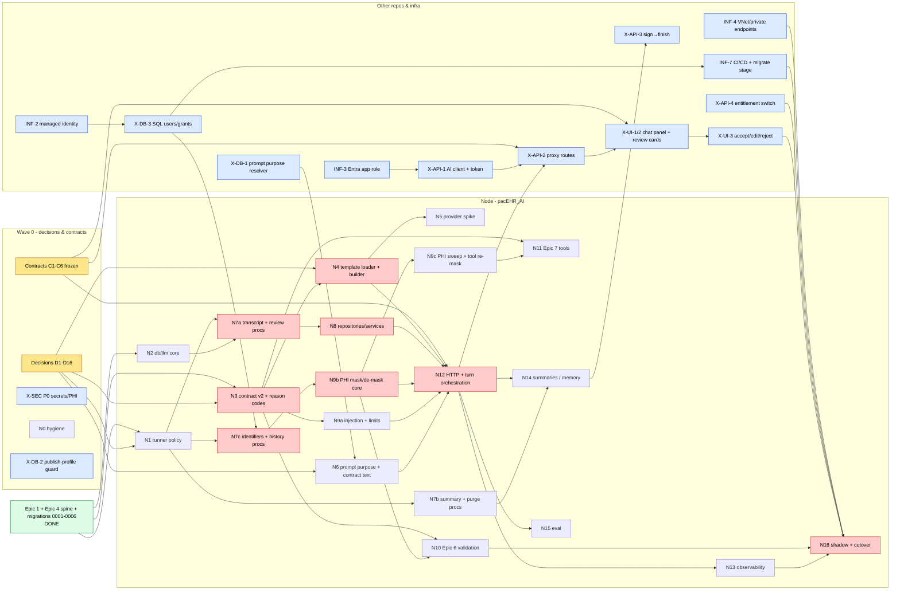
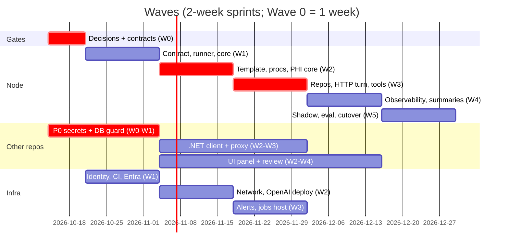

# PacEHR AI Encounter Agent: Node.js delivery plan

| | |
|---|---|
| **Date** | 2026-10-13 |
| **Baseline** | `pacEHR_AI` `PacEHR-AI-Develop-Main` @ `058308d` (111/111 unit tests pass, `tsc --noEmit` clean) · `pacEHR_API` `PacEHR-DevelopAPI-Main` @ `cd7fb39d4` · `PacEHR` `PacEHR-DevelopUI-Main` @ `aa3c70d32` |
| **Backlog source** | `dev-stories/Tickets-Original-Python` (75 stories, 12 epics, written for Python) |
| **Design of record** | `docs/user-custom/2026-10-07-ai-encounter-schema-design.md` (rev 7) and `dev-stories/Work-In-Progress/Epic-02/DELIVERY-PLAN.md` (owner withdrawals) |
| **Standard** | `pacEHR_AI/CLAUDE.md` (Node). The Python standard in `TicketsByAkash/CLAUDE.md` does not apply. |

---

## 1. Summary

1. **The foundation is done, but the product cannot complete a run yet.**
   - Done: Epic 1 (settings, database, LLM, auth module, logging, errors), the Epic 4 agent spine (guard, then model call with a provider-enforced schema, then outcome), the AI-schema migrations, and a Docker → ACR pipeline.
   - Blocking: three guard stubs (`src/guards/*.ts`) and the template loader stub (`src/templates/config.ts`) throw on purpose, so **every run currently ends as `GUARD_STEP_FAILED`**.
   - Missing: there is no HTTP route that invokes the agent.
2. **The backlog describes a different product from the one being built.**
   - The tickets describe a one-shot extractor: note in, auto-commit or review, `AI.agentRun` / `AI.fieldOutcome`.
   - Rev 7, which is already merged as migrations `0001`–`0006`, is a **suggest-first chat turn per encounter**. Each turn still runs the Epic 3–7 extraction inside it.
   - As a result, roughly **15 stories are superseded or withdrawn** (Epic 2, 8, 9 and 12 table and endpoint stories), and Epic 12's summaries move into Phase 1.
3. **Three defects in merged code would mislead the model or the data.** Fix these first.
   - **ABSENT and ABSTAINED are defined backwards** in `src/schema/contract.ts:15-16`.
   - **Fields are selected with the wrong flag.** `templateService.ts:13,29` uses `allowAISummary` / `aiSummaryPrompt`, which belong to the *Field AI Summary* feature (11 of 3,105 fields). Today's extraction uses every template field, with `fields.prompt` / `section.prompt` (`encounter-ai.facade.ts:883-900`).
   - **Migrations cannot run once deployed.** The Dockerfile does not copy `migrations/`, and no pipeline stage runs the migrate step.
4. **Other repositories must change.** About 30 items in total:
   - .NET has to proxy every call, because the browser has no Entra token.
   - SSDT has to provide a deterministic prompt resolver, grants and a publish-profile guard.
   - Angular has to provide the chat panel and review cards.
   - DevOps has to provide identity, networking, the deploy slot and the CI gate.
5. **P0 security findings outside AI scope** (verified):
   - OpenAI `sk-` keys are committed to git in 6 tracked `pacEHR_API/PacEHR.API/appsettings*.json` files.
   - Today's AI path sends unmasked PHI to `api.openai.com`: `maskPHI()` returns on its first line (`PacEHR/src/app/configs/phi-masker.ts:133`).
   - The browser encrypts traffic with a hard-coded key.

   Escalate these now. They do not wait for this plan.

**Plan shape.** Wave 0 takes one week (decisions and frozen contracts), then five two-week waves. Seven lanes run in parallel. The critical path is: contracts → contract/template fixes → AI procedures → turn API → .NET proxy → UI. A second critical chain is the PHI masker, because no real run can complete without it.

---

## 2. What is done and what is left, story by story

Status legend:
- **DONE**: built and tested in Node.
- **PARTIAL**: started; the remaining work is listed.
- **SUPERSEDED**: replaced by a rev-7 or owner decision; the replacement work is listed.
- **WITHDRAWN**: dropped.
- **TODO**: not started.
- **DEFER**: Phase 2.

The **WP** column points to the work packages in §4.

**Totals:** 10 DONE · 17 PARTIAL · 10 SUPERSEDED or WITHDRAWN · 34 TODO · 4 DEFER.

### Epic 1: Foundation (6/6 done)

| Story | Status | Remaining | WP |
|---|---|---|---|
| PEA-101 Scaffold / Node floor | DONE | Docs say `src/pacehr/` but the tree is flat. Remove the dead `#pacehr/*` path from `tsconfig.build.json`. Declare `openai` and `@langchain/langgraph` in `package.json`; they are imported directly but only present in the lock file. | N0 |
| PEA-102 Settings | DONE | New fields: prices per million tokens, `SUMMARIES_ENABLED`, `MAX_NOTE_LENGTH_CHARS`, `MAX_MODEL_CALLS_PER_RUN`, `APPLICATIONINSIGHTS_CONNECTION_STRING`. Remove the stale "Functions host" comments. | N0, N13 |
| PEA-103 Database singleton | DONE | Typed parameter binding (`VarChar` for keys, `Decimal(12,6)` for cost). A procedure call with OUTPUT parameters. An error serializer that drops driver messages, because those can echo values. | N2 |
| PEA-104 LLM manager | DONE | Request `timeout` must be under the App Service 230 s limit. `'gpt-4.1'` is a literal. Optionally add a summary-model getter. | N2 |
| PEA-105 Errors / PHI-safe logs | DONE | `app.ts:35` logs `e.message`; remove it. | N2 |
| PEA-106 Entra token → oid | DONE (module only) | Not wired to any route. Check the app role or `azp` against the .NET caller. Return the claims, not just the `oid`. | N12 |

### Epic 2: Data layer (rev 7 replaced the table model)

| Story | Status | Remaining | WP |
|---|---|---|---|
| PEA-201 AI schema + runner | PARTIAL | Validator defects (verified): `CREATE OR ALTER` slips through unqualified, `GRANT … INSERT ON` is rejected, any read of a foreign schema is rejected, and `ALTER TABLE AI.x ADD` is banned. The image must ship `migrations/`. A pipeline migrate step must run under a deploy identity. | N1, INF-7 |
| PEA-202 `AI.agentRun` | SUPERSEDED → `AI.EncounterTranscript` (table done) | Procedure `AI.usp_addEditEncounterTranscript` (start/finish), repository, `turnService` | N7a, N8 |
| PEA-203 `AI.fieldOutcome` | SUPERSEDED → `AI.EncounterFieldReview` + `aiResponse.fields[]` (table done) | Procedure `AI.usp_addEditEncounterFieldReview` (copies its snapshot from `aiResponse`), repository, service | N7a, N8 |
| PEA-204 Retention purge | SUPERSEDED → `AI.usp_purgePatientData`; retention period is O8 (Compliance) | Purge procedure, repository, hook into the .NET purge | N7b, X-API-6 |
| PEA-205 `AI.promptFragment` | WITHDRAWN (2026-10-06) | Use `AI.prompt` + `promptId`/`promptHash` instead | — |
| PEA-206 `AI.fieldConstraint` | TODO (deferred to Epic 6 by rev 7) | Migration `0007` with a JSON `compiledGuard`, so all six guard parts fit (GAPS #7) | N10 |
| PEA-207 `AI.fieldDescription` | WITHDRAWN → `Template.fields.prompt` / `section.prompt` | **The code does not follow the decision yet.** | N4 |

### Epic 3: Template → schema

| Story | Status | Remaining | WP |
|---|---|---|---|
| PEA-301 Per-mapping description | TODO; folded into D2 | Phase 1 uses `fields.prompt`, which is global per field. Known risk: a field mapped into two sections gets one description. A per-mapping description is Phase 2. | N4 |
| PEA-302 Author / validate description | TODO (other repos) | One-line, length and control-character validation. The UI must separate the extraction prompt from the "AI Summary Prompt". | X-UI-5 |
| PEA-303 Load template once | PARTIAL | **Two loaders exist** (`templates/config.ts` stub and `services/templateService.ts`), so there are two reads per request with different filters. Merge them into one. Also: `isActive` filters, deterministic order, `customSectionName`, options without fan-out, and a check that `templetID` matches the encounter (tenancy). | N4 |
| PEA-304 Schema per request | PARTIAL | Dispatch on field type: dropdown/radio → enum, multi-select → array of enum, `None` → excluded. Drop `.nullable()`; the slot description currently sits in `anyOf[0]` (measured). Zero slots → `TEMPLATE_UNAVAILABLE`. | N4 |
| PEA-305 `ExtractedValue` contract | PARTIAL, **wrong** | Fix the status semantics. Add `remark`, and a top-level `message` for chat. Evidence length cap of 500. Map to the rev-7 §8 `fields[]`. | N3 |
| PEA-306 Edit takes effect next request | PARTIAL | An integration test: change a mapping, then the next request's wire schema changes | N4 |
| PEA-307 New field gets full contract | TODO (small) | `authored` flag and unauthored count | N4 |

### Epic 4: Agent core

| Story | Status | Remaining | WP |
|---|---|---|---|
| PEA-401 Provider enforcement spike | PARTIAL | `provider.test.ts` checks the request shape, not enforcement. Re-run it with a real schema of 100+ slots, add a `json_object` control, and record the verdict and API version in the repo. | N5 |
| PEA-402 Spine + typed state | DONE | Final hook list: `beforeAgent` guard · `wrapModelCall`+`wrapToolCall` · `afterModel` validation · `afterAgent` outcome | — |
| PEA-403 `beforeAgent` fail-closed | DONE | Add the `patient_identifiers_load`, `constraint_load` and `memory_load` steps | N9, N10, N14 |
| PEA-404 Compose / hash prompt | PARTIAL | Resolve the prompt row by purpose (D8). Contract text owned in code. Remove the `<<encounterFields>>` schema echo. Map `promptTemplateHash` (not `promptHash`) to the transcript column. | N6 |
| PEA-405 Model, temperature, tokens | DONE | — | — |
| PEA-406 Per-request binding | DONE (unit tests) | Prove live with a schema produced by the builder | N5 |
| PEA-407 One failure mode per outcome | PARTIAL | Split run codes from field codes (GAPS #2) | N3 |

### Epic 5: Guardrails (stubs only)

| Story | Status | Remaining | WP |
|---|---|---|---|
| PEA-501 Injection scan | TODO | 5 coded classes. Port the SPA `prompt-sanitizer.ts`, but fix `act as the`, which flags caregivers. Also scan history and summaries. | N9 |
| PEA-502 Fail-closed + size | PARTIAL (fail-closed is done) | Limit check from `settings()`, plus `NOTE_EMPTY` | N9 |
| PEA-503 Mask / de-mask | TODO, **critical path** | See §6 D10. Identifiers come from a narrow procedure. One token per distinct surface form (`[NAME_1]`). Re-mask tool and history output. De-mask in `afterAgent` only. | N9, N7c |
| PEA-504 Guard corpus | TODO | Fixture corpus plus a full-chain unit test | N9 |

### Epic 6: Validation (nothing built)

| Story | Status | Remaining | WP |
|---|---|---|---|
| PEA-601 Spine | TODO | An `afterModel` hook with a per-field verdict of ACCEPT, REVIEW or BLOCK, plus field reason codes | N10 |
| PEA-602 Constraint compiler | TODO (L) | Migration `0007`, closed grammar, a seed script for pilot vitals (no editor in Phase 1) | N10 |
| PEA-603/604/606/607 Range, units, dates, evidence | TODO | Pure functions that can be built in parallel. Decimals as scaled BigInt. Bind evidence against masked text. | N10 |
| PEA-605 Cross-field | TODO | Blood-pressure ordering, BMI recompute | N10 |
| PEA-608 Derived confidence | TODO | Replaces the model's own band. Keep the model's band as `modelConfidence`. | N10 |

### Epic 7: Tools (nothing built)

| Story | Status | Remaining | WP |
|---|---|---|---|
| PEA-701 Tool contract | TODO | Register tools through a middleware `tools` property (JS needs them at compile time; GAPS #26). Use `wrapToolCall` re-masking, built-in `toolErrorMiddleware` and `toolCallLimitMiddleware`, and a model-call cap inside `wrapModelCall`. **Do not** use the built-in `modelCallLimit` or `pii*` middleware (they skip `afterAgent` or share state across requests). | N11 |
| PEA-702/703/704 Date / BMI / ICD-CPT format | TODO (S each) | Pure functions. The ICD/CPT format check must *also* be an Epic 6 validator. | N11 |
| PEA-705 Context loaders | PARTIAL | The prompt and template loaders are guard steps. Load history from a new procedure (D12). `load_note_text` is superseded by `clinicianQuery`. | N11, N7c |

### Epic 8: Prompt ownership (mostly superseded: `AI.prompt` stays and .NET owns it)

| Story | Status | Remaining | WP |
|---|---|---|---|
| PEA-801 Fragment write path | SUPERSEDED | None for Phase 1 | — |
| PEA-802 Precedence resolver | PARTIAL | Precedence stays in SQL. Needs a purpose filter and a guaranteed 0 or 1 row (X-DB-1). | N6, X-DB-1 |
| PEA-803 Migrate legacy prompts | SUPERSEDED → `npm run prompts:check` (rev-7 O20 sweep) | A script that reports unfilled or legacy placeholders per row | N6 |
| PEA-804 Promotion gate | DEFER | Needs prompt versioning | — |
| PEA-805 Placeholder contract | PARTIAL | Export the allowed set. .NET validates prompts at save time. | N6, X-API-5 |
| PEA-806 Contract fragment | TODO | `CONTRACT_V1` owned in code and prepended to the prompt. Needs clinical sign-off on the text. | N6 |
| PEA-807 Rollback / A-B test | DEFER | — | — |

### Epic 9: Review + API (endpoint model superseded by rev-7 chat turns)

| Story | Status | Remaining | WP |
|---|---|---|---|
| PEA-901 Extract endpoint | TODO → `POST /v1/encounters/:id/turns` | `node:http` router, body cap, problem+json errors, app-role check, transcript start and finish in `finally` | N12 |
| PEA-902 Commit-or-hold | Commit SUPERSEDED (suggest-first); audit TODO | `afterAgent`: de-mask, then build the §8 `aiResponse` | N12 |
| PEA-903 Persist outcomes | SUPERSEDED (`aiResponse` JSON) | `GET /v1/encounters/:id/turns` for page refresh | N12 |
| PEA-904 Resolve without a model call | PARTIAL-SUPERSEDED | `POST …/turns/:tid/reviews`, which writes review rows through the procedure | N12 |

### Epic 10: Observability

| Story | Status | Remaining | WP |
|---|---|---|---|
| PEA-1001 Spans | TODO | `@azure/monitor-opentelemetry` loaded through `--import`; span inside each existing hook | N13 |
| PEA-1002 Hash, model, tokens | PARTIAL | `?? 0` hides missing usage. Record cached tokens. Cost from settings. | N13 |
| PEA-1003 Audit row | SUPERSEDED target (transcript) / TODO | Turn start and finish (N12) | N12 |
| PEA-1004 Reason codes / metrics | PARTIAL | Snapshot test; metrics rebased on `EncounterFieldReview` | N3, N13 |
| PEA-1005 Dashboard | DEFER → Azure Monitor workbook | — | INF-6 |
| PEA-1006 Memory control arm | DEFER (Phase 2) | — | — |
| PEA-1007/1008 Eval set + gate | TODO, blocked | Needs prompt versioning and the D7 decision | N15 |
| PEA-1009 Isolated judge | TODO | Can be built after N15 starts | N15 |

### Epic 11: Deployment (written for Functions; actual platform is Web App for Containers)

| Story | Status | Remaining | WP |
|---|---|---|---|
| PEA-1101 Hosting topology | PARTIAL | P1v3, Always On, `WEBSITES_PORT=3000`, health path `/health` (**never** `/health/ready`, which makes a billed model call), staging slot | INF-1 |
| PEA-1102 Image build / release | PARTIAL | No CI gate (`pr: none`, no test stage). Deploy the `BuildId` tag (today it restarts onto `latest`). Pin the base image digest. Scan images. | INF-7 |
| PEA-1103 Managed identity | PARTIAL (code done) | User-assigned managed identity, roles, SQL contained user, pull from ACR with the managed identity (the pipeline uses ACR admin credentials today) | INF-2, X-DB-3 |
| PEA-1104 Private network | TODO | VNet integration for the AI app **and the .NET API app**, private endpoints for OpenAI and SQL, inbound restricted to the API | INF-4 |
| PEA-1105 App Insights | TODO | Connection string, Entra-based ingestion | INF-6, N13 |
| PEA-1106 Shadow / cutover | TODO, redefine | Shadow means .NET calls Node in parallel with the legacy path and the UI hides the result. Per-account switch. | N16 |

### Epic 12: Memory (schema done; moved into Phase 1 by rev 7)

| Story | Status | Remaining | WP |
|---|---|---|---|
| PEA-1201 Capture corrections | SUPERSEDED (schema done: `EncounterFieldReview`) | Review procedure (N7a) | — |
| PEA-1202 Condense summaries | SUPERSEDED (schema done: 3 summary tables) | `usp_addBehaviorSummary` / `usp_resetBehaviorSummary`. Three summarisers. Retry sweep on a jobs host. | N7b, N14 |
| PEA-1203 Inject into agent | TODO | Replace `PHASE_1_MEMORY=''` (`guard.ts:19`). **`ExtractionContext` has no `patientId`.** | N14 |
| PEA-1204 Memory never relaxes validators | TODO | Type-level and lint boundary; Epic 6 must recompute confidence | N14 |
| PEA-1205 Edit rate + kill switch | TODO | `SUMMARIES_ENABLED`, control-arm hash | N14 |

---

## 3. Contracts to freeze in Wave 0 (these unlock parallel work)

Each team builds against a fixture or mock from day one, so the UI, .NET and Node lanes can run at the same time.

| # | Contract | Owner | Consumers |
|---|---|---|---|
| C1 | **Turn request, .NET → Node.** `POST /v1/encounters/:encounterId/turns`. Body: `{ clinicianQuery, clientRequestId? }`. Headers: `x-pacehr-user-id`, `x-pacehr-account-id` (trusted only after the app-role check). | Node | .NET, UI |
| C2 | **Turn response.** Rev-7 §8: `{ transcriptID, message, fields:[{sectionID, fieldID, status, value?, unit?, confidence?, remark, evidence{transcriptID,quote,match}, display, decision?, reasonCodes?}] }`. Refusals as problem+json `{reasonCode, transcriptID?, traceId}`, with a status table (400/401/403/404/409/413/422/500/502/504). | Node | .NET, UI |
| C3 | **Review request.** `POST …/turns/:transcriptID/reviews`, body `[{sectionID, fieldID, finalValue, finalUnit, isEvidenceDeleted, isDeleted}]`. The procedure copies the AI snapshot itself. | Node | .NET, UI |
| C4 | **Reason-code catalog.** Run-level codes (≤ 40 characters, which go into `transcript.reasonCode`) and field-level codes (which go into `aiResponse`), each with a UI message. Unknown codes fall back to a generic message. | Node | UI |
| C5 | **Finish signal.** `POST /v1/encounters/:id/finish` returns 202 and is idempotent through `lastTranscriptID`. .NET sends it fire-and-forget after a successful sign. | Node | .NET |
| C6 | **Write ownership.** The chart (`Encounter.encounterData`) is written **only** by the existing UI save, which calls `insertEncounterData` → `usp_insertEncounterData`. ⚠️ Rev 7 §9.6 names `usp_updateEncounterData`, but the encounter form calls `insertEncounterData` (`encounter-form.component.ts:2332`); update is only called from the PDF header. Node writes only `AI.*`. Review rows are written by Node `/reviews`, which .NET calls after the chart save succeeds. | All | All |

---

## 4. Work packages and dependencies

Sizes: S ≤ 3 days, M ≤ 1 sprint, L > 1 sprint (one developer).

### Node (pacEHR_AI)

| WP | Scope | Size | Depends on |
|---|---|---|---|
| **N0** | Hygiene. Rebase the AITP-99 dropdown branch and fix it: multi-select becomes an array, trim/dedupe options, validate with the JSON-Schema validator rather than zod `safeParse`. **Archive** `origin/3p-dev/PEA-201-ai-schema-data-layer`: its migrations `0001`–`0006` collide with the merged ones; salvage the `fieldConstraint` DDL and the transaction test first. **Delete** `origin/feature/docker-webapp-pipeline`: its diff only deletes AITP-68. Declare `openai` and `@langchain/langgraph`. Add an `npm run lint` script. Fix doc drift. | S | — |
| **N1** | Migration runner policy (D11). Close the `CREATE OR ALTER` hole. Allow `GRANT`, read-only references to `Encounter`/`Patient`/`Template`/`Account` inside `AI.*` procedure bodies, and `ALTER TABLE AI.x ADD`. Keep the ban on writes and DDL outside AI. Add a deny-list entry for `AI.prompt`, which SSDT owns. | S | D11 |
| **N2** | DB and LLM core: typed parameters, procedure calls with OUTPUT parameters, error serializer, LLM `timeout`, a readiness check that does not log `message` | S | — |
| **N3** | **Contract v2 + reason-code taxonomy.** Fix ABSENT/ABSTAINED. Add `remark`; evidence cap. Drop `.nullable()`. Split `RUN_REASON_CODES` from `FIELD_REASON_CODES` and split the 5 injection codes. Add a `CompiledGuard` zod type stub. Snapshot test. | S–M | D9 |
| **N4** | **Single template loader + schema builder.** Use `fields.prompt`/`section.prompt` and every field except `None`. Field-type dispatch. Description at slot level. Deterministic order. Tenancy check. Options read without fan-out. `authored` flag. | M | N3, D2, (X-DB-4 if a procedure is chosen) |
| **N5** | Provider-enforcement spike re-run (PEA-401/406 live) with the builder-produced schema; verdict recorded | S | N4 (or a fixture) |
| **N6** | Prompt: resolve by purpose, `CONTRACT_V1` owned in code, exported placeholder set, `prompts:check` script, drop the `encounterFields` echo, decide `<<todayDate>>` | M | D8, X-DB-1, N3 |
| **N7a** | Migrations for `AI.usp_addEditEncounterTranscript` (start/finish, account check, signed/deleted refusal) and `AI.usp_addEditEncounterFieldReview` (OPENJSON snapshot, upsert) | M | N1, N2 |
| **N7b** | Migrations for `AI.usp_addBehaviorSummary`, `AI.usp_resetBehaviorSummary`, `AI.usp_purgePatientData` | M | N1 |
| **N7c** | Migrations for `AI.usp_getPatientIdentifiers @encounterId,@accountId` and `AI.usp_getEncounterHistory`; roles and grants migration | S–M | N1, X-DB-3 (ownership chaining confirmed) |
| **N8** | Repositories and services R1–R7: `turnService`, `fieldReviewService`, the summary repositories, usage, purge. Can be built against a mocked `database` before N7 lands. | M | N7a/b (integration) |
| **N9** | **Epic 5.** 9a: 501 and 502 (S). 9b: 503a, patient-demographics masking and de-masking with surface-form tokens. 9c: 503b, regex sweep plus relatives and providers, the skiplist rule, `wrapToolCall` re-masking. 504 corpus. | L | N3, N7c (for 503) |
| **N10** | **Epic 6.** 601 spine (`afterModel`). 603/604/606/607 in parallel. 602: migration `0007 AI.fieldConstraint`, compiler and pilot-vitals seed. 605. 608. | L | N3; 606/607 need N9b |
| **N11** | **Epic 7.** 701 registry and limits. 702/703/704 in parallel. 705 history load (D12). | M | N3; 705 needs N9c, N7c |
| **N12** | **HTTP and turn orchestration (Epic 9).** Router, auth (app role / `azp`), C1–C5 routes, `aiResponse` builder, de-masking in `afterAgent`, transcript start/finish in `finally`, cancellation through `AbortSignal`, timeouts | L | N8, N3, N4; full E2E also needs N9b |
| **N13** | **Epic 10.** Telemetry preload and spans, usage and cost fixes, metric queries, alert definitions | M | N12 (spans), INF-6 |
| **N14** | **Epic 12 in Phase 1.** Three summarisers; finish logic idempotent through `lastTranscriptID`; summary read in the guard (add `patientId` to the context); kill switch; 1204 boundary; retry sweep job | L | N7b, N12, N9a, INF-8 |
| **N15** | Eval: dataset from reviews, replay that never writes the transcript, deterministic gate, isolated judge | M | N12, D7 |
| **N16** | Shadow mode and cutover: per-account switch, parity metrics against legacy, sign-off gate | M | everything above, X-API-4/7 |

### pacEHR_API (.NET)

| WP | Scope | Size | Depends on |
|---|---|---|---|
| **X-SEC** | **P0, independent of this plan.** Rotate the OpenAI keys committed in `appsettings*.json` and purge them from git history. Move secrets to Key Vault. Replace the browser's hard-coded encryption key. Get a Compliance ruling on PHI already sent to `api.openai.com` and stored in `Log.AILogs`. | M | — |
| X-API-1 | `AIEngineClient`: named HttpClient, `DefaultAzureCredential.GetTokenAsync("api://<ai-app>/.default")`, client timeout below 230 s and above the Node model timeout | M | INF-3 |
| X-API-2 | Proxy routes `aiEncounterTurn`, `aiEncounterTurns` (GET), `aiEncounterReview`. Inject `userId`/`accountId` **from `HttpContext.Items`, never from the body.** Map Node's 4xx/5xx and `reasonCode` through; do not let `JWTMiddleware` turn errors into 400. | M | C1–C3, X-API-1 |
| X-API-3 | Sign flow (`FileUploadController.cs:361`): call `finish` fire-and-forget | S | C5 |
| X-API-4 | AI entitlement and kill switch per account or template, enforced in the proxy and exposed to the UI | M | D13 |
| X-API-5 | Prompt save: validate placeholders against the Node allowed set; server-side role check for System/Universal (today it is only checked in the browser) | S | N6 |
| X-API-6 | Patient purge calls `AI.usp_purgePatientData` | S | N7b |
| X-API-7 | Put the legacy passthrough routes (`streamTemplateCompletion`, `getCompletion`, `AddEditAILogs`) behind a flag, then retire them after parity | M | N16 |

### PacEHR.Database (SSDT and release scripts; DBA)

| WP | Scope | Size | Depends on |
|---|---|---|---|
| **X-DB-2** | **Before any deploy.** Commit a publish profile with `DropObjectsNotInSource=False`, plus an ownership note: `AI.Encounter*`, `AI.*Summary` and `AI.EncounterUsage` are owned by pacEHR_AI migrations. Without this, a Schema Compare against the project drops the Node tables. | S | — |
| X-DB-1 | Add an `AI.prompt.purpose` column (`type` already means scope) and `usp_getAIPrompt @accountId,@templateId,@purpose` returning exactly 0 or 1 row. Add a PK on `AI.prompt`. Fix `usp_getPrompt`: `isDeleted`, the priority-2 comment/filter mismatch, and only legacy-purpose rows, so new summary prompts do not break the legacy UI. | M | D8 |
| X-DB-3 | Per environment: contained users for the AI managed identity (runtime: EXECUTE on `AI` plus the named `dbo` reads) and for a deploy identity (DDL on `SCHEMA::AI` only). Entra admin on SQL. Confirm ownership chaining for `AI.*` procedures that read `Encounter`/`Patient`. | M | INF-2 |
| X-DB-4 | *Optional, per D2.* `dbo.usp_getAITemplateConfig`, if DBA policy requires a procedure instead of an inline SELECT | S | D2 |

### PacEHR (Angular)

| WP | Scope | Size | Depends on |
|---|---|---|---|
| X-UI-1 | AI Encounter chat panel behind a flag. Calls the .NET proxy with ids only. Removes prompt assembly, the unbounded `fixMalformedJson` loop and `storeOpenAILogs` from the new path. | L | C1, C2 (mock first) |
| X-UI-2 | Review cards: value and unit edited separately, evidence quote with strike, confidence chip, distinct ABSENT ("not in note") and ABSTAINED ("AI unsure"), `display` states | L | C2 |
| X-UI-3 | Accept, edit, reject and add. Write form controls **by sectionID+fieldID** (today it is by `fieldName`), then the existing save, then the review call | M | C3, C6 |
| X-UI-4 | Reason-code → message map; disable Send while a turn is running | S | C4 |
| X-UI-5 | Template editor: separate labels for "AI extraction prompt" (`fields.prompt`) and "AI Summary prompt"; authoring guidance. Constraint editor is Phase 2. | M | D2 |
| X-UI-6 | Prompt admin: purpose selector, placeholder lint errors | M | X-DB-1, X-API-5 |
| X-UI-7 | Clinician summary view and reset | S | N14 |

### Azure / DevOps

| WP | Scope | Size | Depends on |
|---|---|---|---|
| INF-1 | Web App settings: P1v3, Always On, `WEBSITES_PORT=3000`, health path `/health`, staging slot with slot-sticky switches | S | D3 |
| INF-2 | User-assigned managed identity per environment. *Cognitive Services OpenAI User* and *AcrPull* roles. Web App pulls from ACR with the managed identity, then disable the ACR admin user. | M | — |
| INF-3 | Entra app registration for the AI service (`requestedAccessTokenVersion: 2`, app role `AIEngine.Invoke`, assignment required), granted to the API's managed identity | S | — |
| INF-4 | VNet integration for the AI app **and** the API app; private endpoints and DNS for OpenAI and SQL; inbound access restricted to the API subnet. ⚠️ Do not disable public access on the shared OpenAI account until every caller is on the VNet. | L | INF-2 |
| INF-5 | Dedicated OpenAI deployment for the AI service, Data Zone US or regional (not Global, for PHI), with a TPM quota; BAA/ZDR confirmed | M | D14 |
| INF-6 | App Insights connection string with Entra ingestion; alerts (5xx, p95 latency, OpenAI 429, `GUARD_STEP_FAILED` > 0, interrupted turns); budget on the OpenAI deployment; workbook | M | N13 |
| INF-7 | Pipeline: Validate stage (typecheck, lint, test) plus a PR-validation pipeline; `COPY migrations` in the Dockerfile; migrate stage under the deploy identity; deploy the `BuildId` tag to the slot, smoke test, approval, swap; image scan; a check that refuses key or SQL-login app settings | M | X-DB-3 |
| INF-8 | Jobs host for the summary retry sweep and purge (Node Functions on Flex Consumption with VNet, or an ADO scheduled pipeline) | M | INF-4 |
| INF-9 | Bicep for INF-1 to INF-6 (none exists today) | L | can run in parallel |

---

## 5. Dependency chart

**Critical path:** decisions/contracts → N3 → N4 → N7a → N8 → N12 → X-API-2 → X-UI-1/2/3 → E2E in DEV → N16.

**Parallel critical chain:** INF-2 → X-DB-3 → N7c → N9b (PHI). Until N9b lands, every real run fails closed.

---

## 6. Decisions needed before Wave 1

Each decision has a recommendation. The ones marked ★ block the critical path.

| # | Decision | Recommendation |
|---|---|---|
| ★D1 | Product shape | Adopt rev 7 (suggest-first chat turn) as Phase 1. Mark the superseded stories in §2 as closed in the tracker. Epics 3–7 become the internals of a turn. |
| ★D2 | Field source and enablement | Use every template field except `fieldType='None'`, with text from `Template.fields.prompt` / `section.prompt` (owner decision 2026-10-06). **Stop using `allowAISummary` / `aiSummaryPrompt`.** Read with an inline parameterised SELECT unless the DBA requires a procedure (X-DB-4). Per-mapping descriptions are Phase 2. |
| ★D3 | Hosting | Adopt Web App for Containers. Retire the Functions assumptions in Epics 9 and 11. Use a jobs host for background sweeps. |
| ★D4 | Caller and transport | The **.NET proxy is mandatory**: the SPA uses PacEHR session tokens, not Entra. Phase 1 uses request/response JSON. SSE streaming, which rev 7 asks for, waits until latency is measured. |
| ★D5 | Clinician identity | `userId`/`accountId` as INT, forwarded by .NET and trusted only after the app-role check. Replace `ExtractionContext.clinicianOid` with `userId`. Add `patientId`. |
| ★D6 | Write ownership | As in C6. Chart writes go through the existing .NET save, with value and unit joined as today. Node writes only `AI.*`. Correct rev 7 §9.6 to name `usp_insertEncounterData`. |
| D7 | Tracing backend | Azure Monitor OpenTelemetry. `traceId` holds the W3C trace id. Keep LangSmith on the refused list unless Compliance approves a BAA or self-hosted option. Rev 7 and the `0004` comments currently assume LangSmith, so revise the doc. |
| ★D8 | Prompt resolution | A purpose-tagged `AI.prompt` row through `usp_getAIPrompt` (X-DB-1). Prompt admin stays in .NET/Angular. Node owns the contract text, the placeholder set and the provenance hashes. |
| ★D9 | Contract v2 | Fix the status semantics. Remove `.nullable()`. Multi-select as an array. Keep `s{sectionID}_f{fieldID}` as the wire key and map it to §8 `fields[]` in code. Show the model's confidence band until Epic 6 derives one. |
| ★D10 | PHI masking | Deterministic: exact-value masking from patient demographics plus the ported regex sweep (but **not** its "mask all dates" rule). Tokens per surface form. Mask history and summaries too. De-mask in `afterAgent` only. Azure AI Language PII is an optional Phase 2 second pass. |
| D11 | Migration runner policy | As in N1 |
| D12 | History | Phase 1 loads history deterministically in the guard and records `historyEncounterIds`, which keeps model calls and egress bounded. A model-invoked history tool is Phase 2. |
| D13 | Enablement and shadow | Per-account and per-template switch in the DB, enforced by .NET. Shadow means Node runs in parallel with the legacy path, the result is hidden, and parity is measured. |
| D14 | OpenAI deployment | Dedicated, Data Zone US or regional, with a TPM quota. Confirm the BAA and ZDR. |
| D15 | Retention (O8) | Compliance decides; this does not block Phase 1 build |
| D16 | Parity scope | Legacy extraction also fills ICD, CPT (with justification), Follow-up and DOS/POS, which are not template fields. Product decides whether Phase 1 covers them or leaves them on the legacy path. |

---

## 7. Parallel delivery: lanes and waves

These lanes assume about 4 Node developers, 1 .NET developer, 1 Angular developer, part-time DevOps and a DBA. Merge or split lanes to match actual capacity. Every lane builds against the frozen contracts and fixtures from Wave 1, so no lane waits for another lane's merge to start coding.

| Lane | Owner | Wave 1 | Wave 2 | Wave 3 | Wave 4 | Wave 5 |
|---|---|---|---|---|---|---|
| **L1 Data platform** (Node) | Dev A | N1, N2 | N7a, N7b, N7c | N8 | N14 summaries | N15 eval |
| **L2 Extraction core** (Node) | Dev B | N3, N5 (fixture) | N4, N6 | N5 live, PEA-306 tests | N16 parity metrics | Cutover |
| **L3 Safety** (Node) | Dev C | N9a (501/502), corpus data | N9b (503a) | N9c, 504 | Hardening, egress tests | — |
| **L4 Validation + tools** (Node) | Dev D | N10 spine + pure validators | N11 701–704 | N10 602/605/608, N11 705 | 1204 boundary | — |
| **L5 API + observability** (Node) | Dev A/B, or a 5th developer | Mock server for C1–C5 | N12 skeleton, auth | N12 complete | N13 | Shadow |
| **L6 .NET + DB** | .NET developer + DBA | **X-SEC**, X-DB-2, X-DB-3 | X-API-1, X-DB-1 | X-API-2, X-API-5 | X-API-3/4/6 | X-API-7 |
| **L7 Angular** | UI developer | Design review cards against C2 | X-UI-1, X-UI-4 (mock) | X-UI-2, X-UI-3 | X-UI-5/6/7 | Polish |
| **L8 DevOps** | DevOps | INF-7 CI gate, INF-1, INF-2, INF-3 | INF-4, INF-5 | INF-6, INF-8 | Slot / shadow setup | INF-9 |

**First end-to-end milestone:** end of Wave 3. In DEV, a clinician sends a turn through the UI, .NET and Node, sees masked-then-restored suggestions, accepts a field, and the chart save and review row are both written.

**Shadow mode:** Wave 5, gated on parity metrics and clinical sign-off of `CONTRACT_V1`.

---

## 8. Defects in merged code to fix

| # | File:line | Defect | WP |
|---|---|---|---|
| 1 | `src/schema/contract.ts:15-16` | ABSENT and ABSTAINED definitions are swapped. `found_in` is forced empty for ABSTAINED. | N3 |
| 2 | `src/services/templateService.ts:13,29` | Uses `allowAISummary`/`aiSummaryPrompt`, which belong to the wrong feature. The slot description loses its field and section name. | N4 |
| 3 | `src/templates/config.ts` vs `src/services/templateService.ts` | Two template paths: prompt and schema can disagree, and the template is read twice per request | N4 |
| 4 | `src/schema/builder.ts:16,19` | `.nullable()` adds a fourth state and hides the description in `anyOf[0]`. Zero slots raises `GUARD_STEP_FAILED`. | N3/N4 |
| 5 | `Dockerfile:19-23` + pipeline | `migrations/` is not in the image and there is no migrate step | INF-7 |
| 6 | `pipelines/templates/push-image-stage.yml:57,74` | Pushes `latest` and restarts onto it, so a deploy is not traceable. ACR admin credentials. | INF-7 |
| 7 | `src/core/databaseMigrations.ts:28,33,38,71` | Rejects `GRANT`, rejects cross-schema reads and `ALTER … ADD`; lets an unqualified `CREATE OR ALTER` through | N1 |
| 8 | `src/core/app.ts:40-44` | `/health/ready` is unauthenticated and makes a billed model call on every hit | N2/INF-1 |
| 9 | `src/agents/middleware/guard.ts:31,48,54` | `templetID` from the caller is never checked against the encounter. `usp_getPrompt` resolves the template from the DB, so prompt and schema can come from different templates. | N4/N6 |
| 10 | `src/agents/middleware/guard.ts:34-36` | A block before masking leaves the raw note in public `noteText` | N9 |
| 11 | `src/agents/middleware/model-call.ts:47,57-58` | Tool messages are sent unmasked. Missing usage is recorded as 0. | N9/N13 |
| 12 | `src/agents/state.ts:35` | `clinicianOid` has no source in PacEHR; `patientId` is missing | N12/N14 |
| 13 | `src/agents/prompt.ts:61` | `<<encounterFields>>` repeats the schema in the prompt. No test uses the real slot-keyed schema with real `AI.prompt` rows. | N6 |
| 14 | `tests/integration/agents/provider.test.ts` | Does not distinguish provider enforcement from client parsing, skips silently, and records no verdict | N5 |
| 15 | `package.json` | Imports `openai` and `@langchain/langgraph` without declaring them (`npm ci` passes; the dependency rule is broken) | N0 |

---

## 9. Risks

| Risk | Impact | Mitigation |
|---|---|---|
| SSDT Schema Compare or `DropObjectsNotInSource` drops the Node-owned `AI.*` tables | Data loss | X-DB-2 before any non-DEV deploy; get written confirmation from DevOps (rev-7 O19) |
| Adding summary prompts to `AI.prompt` makes `usp_getPrompt` return several rows | Legacy UI silently takes the wrong prompt; Node blocks with `PROMPT_AMBIGUOUS` | X-DB-1 purpose column before any summary prompt row is inserted |
| Dual write during shadow mode: legacy "Continue" and the new review flow | Chart written twice, metrics polluted | One per-encounter switch (X-API-4); shadow runs never write review rows |
| PHI egress through history, summaries or tool output | Compliance breach | N9c `wrapToolCall` re-mask; an egress test that greps every captured body for every identifier |
| Azure strict-mode limits on 100+ slots or large enums | Requests rejected with 400 | N5 in Wave 1 with the largest real template |
| Latency through .NET and App Service approaches 230 s | Timeouts | Timeout budget: Node model < Node request < .NET client < 230 s; measure in N5 |
| Prompt drift: three code paths fill placeholders (browser, .NET, Node) | Different behaviour per path | A dedicated purpose row for Node; freeze edits to shared legacy rows |
| Field descriptions are global per field (D2) | A field in two sections gets one description | Accept for Phase 1; per-mapping descriptions in Phase 2 (PEA-301) |
| Stale trackers (`docs/status.md`, `docs/plans/*` dated 2026-10-06 still track `agentRun`/`fieldOutcome`) | Teams build superseded work | Re-baseline the trackers on this plan; revise rev 7 to rev 8 (traceId, insert vs update, field source, ABSTAINED example) |

---

## 10. Immediate next actions (this week)

1. Architect, PO, .NET lead, DevOps and Compliance sign D1–D16.
2. Freeze C1–C6 as a zod module in `pacEHR_AI` plus an OpenAPI export for .NET and the UI.
3. Raise X-SEC with the security owner: key rotation, git history purge, and a PHI ruling.
4. DBA lands X-DB-2 (publish profile guard).
5. Node: N0 hygiene PR, N3 contract PR, N1 runner PR. All three are small and unblock everything else.
6. DevOps: INF-7 CI gate, so every subsequent PR runs typecheck, lint and tests.
7. Create tracker items per WP and close the superseded stories with a link to this plan.
