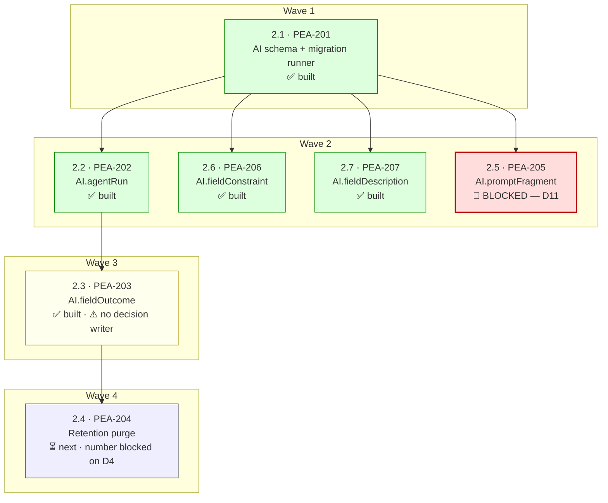

# Implementation Plan — PacEHR Encounter Agent

**Date**: 2026-10-05
**Author**: AIRE_PRODUCT_OWNER
**Status**: Draft — awaiting user approval
**Team size**: 1 (solo)
**Active Cycle**: N/A — no build cycles defined

**Based On**:
- `docs/requirements.md` (rev. 2026-10-05)
- `docs/architecture/design/02-target-architecture-brownfield.md`
- `docs/architecture/design/03-patterns-and-standards-brownfield.md`
- `dev-stories/Work-In-Progress/Epic-02/epic-02-data-layer.md` (Revision 8) — **authoritative acceptance criteria**

---

## 🔴 Read this before using the story files

**The story files under `docs/plans/stories/` are pointers, not copies.** The authoritative
description, Gherkin acceptance criteria, DDL and Definition of Done for every story in this plan
live in `dev-stories/Work-In-Progress/Epic-02/epic-02-data-layer.md`, which is actively maintained and at Revision 8.

Each AIRE story file carries the planning metadata that document does not — wave, requires/enables,
files touched, pattern references, current build state — and cites the epic doc for everything else.
Copying the AC here would create a second source of truth that goes stale the moment Revision 9
lands. **When the two disagree, the epic doc wins.**

---

## Dependency Graph

### Wave summary

| Wave | Stories | State | Notes |
|---|---|---|---|
| 1 | 2.1 | ✅ Built | Nothing else in the epic compiles without the schema and runner |
| 2 | 2.2, 2.5, 2.6, 2.7 | 3 built, **1 blocked** | All four need only the schema. `migrations/sql/` numbers must be allocated before writing — 0002/0004/0005 spent, 0006 reserved for 2.5 |
| 3 | 2.3 | ✅ Built | Waits on 2.2 because `FK_fieldOutcome_agentRun` needs `AI.agentRun` to exist |
| 4 | 2.4 | ⏳ Next | Mechanism buildable now; the retention **number** is blocked on D4 |

### Wave workload distribution

Solo, so every wave is one developer. The waves still matter: they say which story is safe to pick
next without re-deriving the dependency chain, and wave 2's four stories can be done in any order.

| Wave | Dev 1 |
|---|---|
| 1 | 2.1 |
| 2 | 2.2, 2.6, 2.7 (+ 2.5 when D11 lands) |
| 3 | 2.3 |
| 4 | 2.4 |

---

## 1. Overview

### What this plan covers

Epic 2 of the PacEHR Encounter Agent: the `AI` schema inside the existing production Azure SQL
database, its forward-only migration mechanism, and the repository surface other epics call. Seven
stories, 24 points, mapping 1:1 onto PEA-201…PEA-207.

### What it does not cover

Epics 1 and 3–12. Epic 1 (foundation) is **already delivered** — `PacEHR_AI` commit `e86c54e`,
2026-10-01. Epics 3–12 consume this epic's tables and are planned elsewhere.

### Current state

**Four of five tables are built and verified.** In a scratch clone of `pacEHR_AI@e86c54e`:
`npm run typecheck` clean, `npm test` 88 pass / 0 fail, `npm run build` emits `dist/migrate.js` and
`dist/core/databaseMigrations.js`. The scope check was mutation-tested against the full script set —
each planted violation caught and named.

This plan therefore records mostly *completed* work, with one story blocked on a decision, one
ready to build, and a set of open blockers that prevent the epic from being **closed** even though
most of it is **done**.

---

## EPIC 2: DATA LAYER — AI SCHEMA

**Goal**: five tables in the `AI` schema of the existing production database, created by one
forward-only, reviewable, idempotent migration mechanism that touches nothing outside that schema.
No existing clinical table is altered, dropped or written to.

**Stories**: 2.1 → 2.7 (PEA-201 → PEA-207) · **Points**: 24

| Story | PEA | Title | Wave | Points | State |
|---|---|---|---|---|---|
| 2.1 | PEA-201 | Create the AI schema via a forward-only migration mechanism | 1 | 5 | ✅ Built |
| 2.2 | PEA-202 | Record one append-only `AI.agentRun` row per invocation | 2 | 3 | ✅ Built |
| 2.3 | PEA-203 | Store the AI's proposal beside the clinician's decision | 3 | 5 | ✅ Built ⚠️ |
| 2.4 | PEA-204 | Purge `AI.fieldOutcome` rows past the retention window | 4 | 2 | ⏳ Next |
| 2.5 | PEA-205 | Store versioned prompt fragments in `AI.promptFragment` | 2 | 3 | ✅ Built |
| 2.6 | PEA-206 | Store per-mapping field guards in `AI.fieldConstraint` | 2 | 3 | ✅ Built |
| 2.7 | PEA-207 | Store the per-mapping description in `AI.fieldDescription` | 2 | 3 | ✅ Built |

Full story detail: `docs/plans/stories/epic-2-story-2.N-*.md` → each citing
`dev-stories/Work-In-Progress/Epic-02/epic-02-data-layer.md`.

---

## Quality Gates

Per `docs/architecture/design/03-patterns-and-standards-brownfield.md`:

- `npm test` passes — unit tier, network blocked, exit code not 99
- `npm run test:integration` passes, or its skip reason is stated
- `npm run typecheck` clean
- ESLint guards pass; a guard change ships with its planted violation
- Coverage ≥85%
- Every guarantee enforced by absent or scoped code has a **planted-violation test**
- Migration reviewed by a second engineer and dry-run against a staging copy of production
  before production application
- `post-apply-checks.sql` run after every apply; **check #5 returning any row is a failed
  deployment** — stop, keep the output, do not proceed

⚠️ **"Enforced in CI" is currently aspirational.** `11-test-infrastructure-cicd-deep-dive.md`
records that `test-validation-pipeline.yml`'s `pr:` trigger is ignored by Azure DevOps for Azure
Repos Git, so tests are not gated on pull requests today.

---

## Risks

Carried from `docs/architecture/design/02-target-architecture-brownfield.md`. Ordered by what
blocks the epic soonest.

| # | Risk | Blocks | Owner | Effort to clear |
|---|---|---|---|---|
| ~~R5~~ | ✅ **Resolved 2026-10-06** — D11 settled as sentinel `0` + plain `UNIQUE` over all five columns; story 2.5 built | — | — | — |
| R6 | **D4 — retention window undecided.** Two documents have already stalled on it. Purge fails closed meanwhile, so the table grows at ~10.95M rows/year. | Story 2.4's enablement (not its mechanism) | Clinical + Compliance | Longest lead in the epic |
| R2 | **M11 — no deployment path.** Every story's exit criterion ends *"against staging"*. | **Closing any story** | DevOps, unowned | 5–8 pts |
| R3 | **SSDT may propose dropping the `AI` tables.** Two deployment mechanisms, one database, no exclusion designed (ADR-04). | First production apply | Epic 11 | Unscoped |
| R4 | **`AI.agentRun` is not immutable at the server.** ADR-01 — convention, not control. Substitute is an `INSTEAD OF UPDATE, DELETE` trigger. | The compliance claim | Architecture + Compliance | ~6 lines |
| R1 | **`AI.fieldOutcome` accepted-value columns have no writer** (M4/D7). Table stays half-NULL; edit rate uncomputable. | The epic's whole purpose | Product | Decides ~31 vs ~75 pts |
| R7 | **Clinician identity undefined.** `decidedByProviderID INT` has no agreed source. | Story 2.3's decision path | Architecture | — |
| R10 | **`DECIMAL(6,2)` arrives in Node as a double** (ADR-06); a boundary comparison can flip. | Story 2.6's read path, Epic 6 | Epic 6 | Decide before first bound check |
| R12 | **`post-apply-checks.sql` check #4 expects 5 tables; 4 ship.** First real deployment reports a false failure. | Deployment evidence | Epic 2 | One line |

**The honest summary**: the engineering in this epic is largely done. What remains is four decisions
and a deployment path, none of which are code.

---

## Critical Rules

1. **No existing clinical table is altered, dropped or written to.** Everything else in this plan is
   subordinate to that.
2. **Forward-only.** No file under `migrations/sql/` reverses another. Undoing a bad migration is a
   new numbered script, never an edit to a merged one.
3. **Allocate the migration number before writing the script.** The sequence is shared and a merged
   number is permanent.
4. **`PacEHR_AI/CLAUDE.md` governs**, not the clean-architecture rulebook (ADR-03).
5. **The epic doc is the authority on acceptance criteria.** These story files are pointers.
6. **Do not write `0006_create_prompt_fragment.sql` until D11 is settled** — building to the written
   spec would ship a hole.

---

## Validation Checklist

- [x] Dependency graph written to `docs/plans/dependency-graph.yml` — single file, no variants
- [x] Every story has `wave`, `requires`, `enables`, `files_touched`
- [x] `shared_files` non-empty and user-confirmed
- [x] Step 7 validation: seed-wave, disjoint-files, wave consistency, requires resolution — all pass
- [x] Mermaid mirror at the top of this document, colour-coded by state
- [x] Wave workload distribution table present
- [x] Story files are self-contained for planning purposes and cite their AC source
- [x] Risks carry an owner and an effort estimate
- [ ] User approval

---

**Next workflow**: `aire-review-code` — review story 2.1 (PEA-201), the work on branch
`3p-dev/PEA-201-ai-schema-data-layer`.
