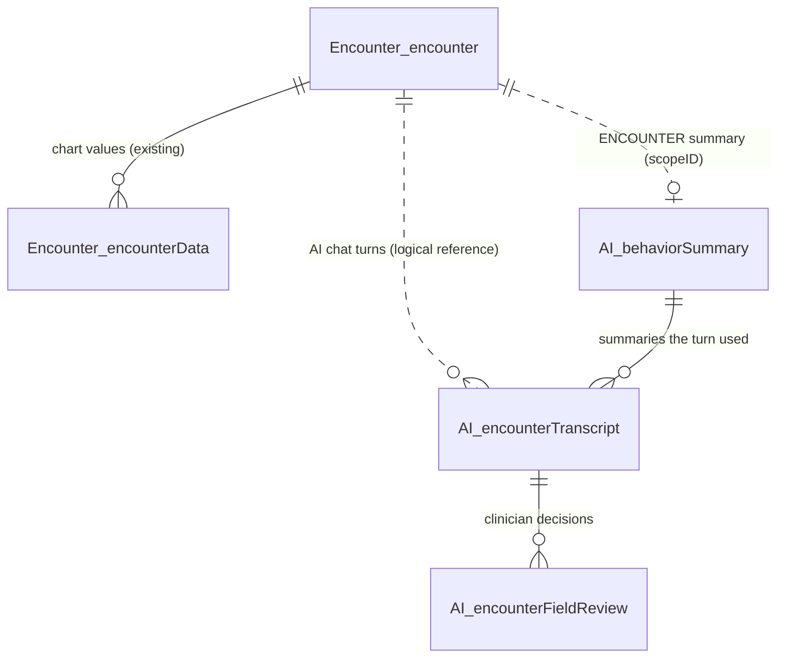

# AI Encounter Schema — Design

**Date:** 2026-10-07 · **Owner:** Akash Saxena · **Status:** draft for review, rev 5 (owner's key changes on `AI.encounterFieldReview` and `AI.behaviorSummary`)
**Repository:** `PacEHR_AI`, forward-only migrations under `migrations/sql`, `AI` schema only.
**Supersedes:** `2026-10-06-ai-data-schema-design.md`. Its still-valid parts are folded in here: driver rules, concurrency, retention law and delivery.

**Aligned with:**

- `pacEHR-Encounter-Agent-4Pager.md`
- `pacEHR-AI-Approach-2-Proposed.md`
- `pacEHR-Encounter-Agent-Proposal.md`
- `pacEHR_API-Database-Tables-and-CRUD.md`
- `ai-agent-observability.md`
- `ai-agent-observability-per-agent.md`
- `docs/tickets` Epics 1–12
- the exports in `docs/data`

---

## 1. Summary

A clinician opens **AI Encounter** and chats about the encounter. The AI suggests field values, each with a unit, confidence, a remark and the quoted source text. The clinician accepts, edits, rejects or adds each value, and can strike a quote that isn't the real source. When the encounter is finished (signed), the AI writes behaviour summaries for the encounter, the patient and the clinician. Those summaries make the next encounter better.

**Three new tables and one view. No existing table is changed.**

| Object | One row is | Serves | Without it |
| --- | --- | --- | --- |
| `AI.encounterTranscript` | one chat turn: the clinician's text and what the AI showed back | chat history; audit of every AI call, interrupted and failed ones included; template, prompt version, summaries used, model, tokens, cost, latency, trace | no follow-up context, no audit of AI calls, no cost per call |
| `AI.encounterFieldReview` | one clinician decision on one field, beside what the AI showed | strict accuracy (value wrong, unit wrong, or both); confidence calibration; evidence quality; the D2.4 confirmation record with the AI's remark and evidence | no accuracy number, no proof of what a clinician confirmed |
| `AI.behaviorSummary` | one version of one behaviour summary for an encounter, a patient or a clinician | context that improves the next turn for that patient and clinician; a readable record of each encounter | every encounter starts from zero |
| `AI.encounterUsage` (view) | one encounter's AI totals | turns, tokens and cost per encounter; computed, never stored | — |

---

## 2. Decisions

1. **The encounter is the conversation.** There is no AI-side encounter table, because `Encounter.encounter` already holds everything it would.
2. **One chat turn is one row.** It holds the clinician's text and the structured-output JSON as shown.
3. **No system prompt is stored.** Only `promptId` and `promptHash` (the wording version).
4. **Every clinician decision on a field is a row:** accepted, edited, rejected or added.
   - The verdict is strict: the value is right or wrong, and the unit is right or wrong.
   - The row carries the AI's confidence, remark and source quote.
   - The clinician can strike the quote as wrong (`isEvidenceDeleted`); the quote itself is kept as shown.
   - Undo is `isDeleted`; `createdDate` and `updatedDate` show the first and latest decision.
5. **Behaviour summaries** exist at encounter, patient and clinician level. They are generated **only when an encounter is finished**.
6. **Tokens and cost are recorded** per turn and per summary. Encounter totals are a view.
7. **Clinical text is stored in full,** under the existing client contract.
8. **The new agent does not write `Log.AILogs`.**
9. **The gold set and experiments live in LangSmith.** SQL is the record of production decisions.
10. **Retention is decided later** (§13).
11. **Naming.**
    - Names say what the object is.
    - camelCase, keeping live spellings (`templeteId`, `sectionID`, `fieldID`).
    - House columns `createdBy`, `createdDate`, `updatedDate`, `isDeleted`.
    - Every user id is `Account.users.userId`.
12. **Delivery.** DDL and procedures ship as `PacEHR_AI` migrations (§14).

---

## 3. Clinician flow

| # | Clinician | System | Writes |
| --- | --- | --- | --- |
| 1 | Clicks **AI Encounter** | Opens the SSE/WebSocket connection; checks the encounter exists and is not signed or deleted | nothing |
| 2 | Sends text | Inserts the turn; loads the active patient and clinician summaries; runs the agent with the chat history and the current chart values; finishes the turn | `AI.encounterTranscript`: inserted on arrival, completed with the reply or the reason it failed |
| 3 | Sees suggestions | Each field shows its value, unit, confidence, the AI's remark and the quoted source text | — |
| 4 | Accepts, edits, rejects or adds a field; may strike the AI's quote as wrong; may undo | The chart value is saved through the existing `usp_updateEncounterData` | `AI.encounterFieldReview`: the decision plus a snapshot of what the AI showed; a struck quote sets `isEvidenceDeleted`; undo sets `isDeleted` |
| 5 | Sends more text | As step 2. A field that already has a value is never overwritten; a different AI value is shown as a suggestion against it | `AI.encounterTranscript` |
| 6 | Signs: the encounter is finished | The sign flow calls the AI service, which writes the encounter's summary, then refreshes that patient's and that clinician's summaries, in the background. The clinician never waits | `AI.behaviorSummary` |



---

## 4. Existing data reused, not copied

| Need | Comes from |
| --- | --- |
| Patient | `Encounter.encounter.patientID` |
| Clinician of record | `Encounter.encounter.providerID`, which joins to `Account.users.userId` |
| Who acted (sender, reviewer) | `createdBy` / `reviewedBy`. These are also `Account.users.userId`, so `createdBy <> providerID` means a scribe acted |
| Account, place and date of service | `Encounter.encounter.accountID`, `POS`, `DOS` |
| Signed, deleted | `Encounter.encounter.encounterSignedDate`, `isDeleted` |
| Current template | `Encounter.encounter.templeteId` |
| Chart's current value per field | `Encounter.encounterData` (`Value`, `byUser`, `createdDate`) |
| Chart's value history per field | `Encounter.encounterDataAddendumHistory`, written by `usp_updateEncounterData` on every save |
| Prompt wording, including the summary prompts | `AI.prompt` (`type` tells the prompts apart) |
| Fields, sections, dropdown options | `Template.fields`, `Template.section`, `Template.fieldOptions` |

Considered and **not** reused:

- **Altering `Encounter.encounter`.** Its `AFTER UPDATE` trigger copies the whole row to `Log.encounter_Audit_History`. It is used by 145 procedures, and pacEHR_API CLAUDE.md rule 8 forbids reshaping existing tables.
- **`Log.AILogs`.** It is browser-written, copies `accountId`/`patientId`, and stores the whole prompt. Its `resp_role` and `modified*` columns carry nothing (§5). The new path does not write it; legacy features keep it.
- **PacEHR's existing AI summaries**, which do different jobs (O14):
  - *Field AI Summary* summarises one field across up to 20 prior signed encounters, on request. Only 11 of 3,105 fields have it enabled. `Log.AISummaryLog` records the selection only; the summary text is not stored apart from the chart.
  - *HIE summary* stores one summary per HIE document in `HIE.HIEDocumentAISummary`.

---

## 5. What today's data shows

These are profiles of the exports in `docs/data`:

- `AILogs`: 595 calls, Sep 2025–Oct 2026;
- `AISummaryLog`: 221 uses;
- `AmbientDetails`: 143 segments;
- the template tables.

The exports are DEV and test-heavy: one account, with inputs such as "fever" and "test". Read the numbers as shape, not production volume. No clinical text was printed.

| Finding | Design response |
| --- | --- |
| **180 of 595 calls (30%) sent the model unfilled placeholders**: `<<templateName>>` 180, `<<encounterPOS>>` 90, `<<DOSDate>>` 45, … | The agent refuses unfilled prompts (`PROMPT_PLACEHOLDER_UNFILLED`), and every live prompt is tested before shadow mode (O20) |
| 82 calls (14%) logged 0 tokens and 78 (13%) an empty reply, with no reason recorded | Turns are written server-side with `reasonCode`, and usage on every model call (rules 3 and 8) |
| Temperature 51 of 51, BP 59 of 59 and pulse 37 of 37 values carry no unit; 9 of 36 weights are bare numbers | Separate `value`/`unit`; `ABSTAINED` with a remark when a unit is unclear; unit vocabulary (O4) |
| 793 "NA"-style values (~6% of 13,936) despite "do not add N/A" in the prompt | `status: ABSENT` instead of placeholder text |
| Replies are keyed by **section and field name** (160 names); 46 replies weren't JSON | The contract keys by `sectionID`/`fieldID`; the provider enforces the schema |
| The prompt text is stored on every call (mean ~9,000 characters), with the note embedded in it | `promptId` + `promptHash` only; the clinician's text has its own column |
| One table mixes template extraction, Field AI Summary calls (166) and handoff notes, with no purpose column | Turns and summaries live in separate tables |
| One system prompt does six jobs: extraction, A/P, ICD, CPT with justification, follow-up, handoff note | Input to the multi-agent spike (O21) |
| One encounter has 150 calls; 159 calls sent an identical prompt | "Disable Send" covers clicks during a turn, not re-runs. Watch in shadow mode before ruling out `requestID` (§15) |
| Today's average call is ~2,000 tokens in and ~340 out, about $0.007 | The $0.02-per-turn estimate (§12) assumes a larger reply, with every field, remark and evidence |
| Field AI Summary: 16 users, 67 encounters, a median of 8 prior encounters picked; Code Status is 166 of 221 uses | Confirms it is a separate, narrow feature (O14) |
| Ambient speakers are numbered 1–5 with no role; some `createdDate` values are in the future | Not this schema's job; flag both to the ambient team |

---

## 6. Principles

- **Stored as presented.** `aiResponse` is what the clinician was shown, after validation. A review row is the decision next to what the AI showed for that field.
- **Snapshots, not copies.** Three values that would otherwise change or be lost are captured on purpose:
  - the template at the time of the turn (`templeteId`);
  - the cost at that day's price;
  - the review's AI columns. The procedure takes these from the turn's own JSON, never from the client, so they cannot disagree with what was shown.
- **Every decision is a row.** Undo is `isDeleted = 1` and is excluded from every report. A struck quote is `isEvidenceDeleted = 1`; `aiEvidence` stays as shown. Rows are physically deleted only by the patient purge.
- **Summaries are context, never authority.** They cannot relax a validator, change a confidence band, or override the never-overwrite rule (Epic 12, PEA-1204).
- **No foreign keys into SSDT-owned tables.** `Encounter.encounter` belongs to the SSDT project; a foreign key it doesn't know about would block an SSDT table rebuild. The procedures check that the encounter exists instead. Foreign keys inside the `AI` schema stay.
- **Types:** the approved list, plus `NVARCHAR(MAX)` ×4 and `DECIMAL(12,6)` ×4, which need approval (O5).
  - Text is `NVARCHAR`, like `roundingNotes.noteDetails` and `encounterData.Value`.
  - Times are `DATETIME2(3)` from `SYSUTCDATETIME()`.
  - Ids are `INT`. At about 1M rows a year it lasts about 2,000 years, and the Node driver returns `BIGINT` as a string.
  - The native `json` type is deferred: `tedious` has no `json` type yet.
- **No `NOLOCK`.** Azure's read-committed snapshot already keeps readers from blocking, without dirty reads.
- **PHI** lives in these rows and never in logs or traces. The patient purge covers every table (rule 9).

---

## 7. Tables

Create them in this order: `AI.behaviorSummary`, then `AI.encounterTranscript`, then `AI.encounterFieldReview`. Each references the one before it.

### 7.1 `AI.encounterTranscript`: the chat turns

```sql
CREATE TABLE AI.encounterTranscript (                                           -- one chat turn; inserted on arrival, completed when it ends
  transcriptID        INT IDENTITY   NOT NULL,                                  -- turn id; ascending = conversation order
  encounterID         INT            NOT NULL,                                  -- Encounter.encounter.encounterID = the conversation id; logical reference, checked by the procedure (§6)
  templeteId          INT            NOT NULL,                                  -- Encounter.encounter.templeteId when the turn started (its spelling); per-template reporting
  clinicianQuery      NVARCHAR(MAX)  NOT NULL,                                  -- text exactly as the clinician sent it
  aiResponse          NVARCHAR(MAX)  NULL,                                      -- what the clinician was shown (§8); NULL while running or when the turn failed
  reasonCode          VARCHAR(40)    NULL,                                      -- why there is no reply: the agent's REASON_CODES, e.g. INJECTION_BLOCKED, PROMPT_PLACEHOLDER_UNFILLED, MODEL_CALL_FAILED
  promptId            INT            NULL,                                      -- AI.prompt.promptId (no FK: AI.prompt has no primary key); NULL if blocked before the prompt loaded
  promptHash          VARCHAR(64)    NULL,                                      -- SHA-256 of AI.prompt.prompt as read, before placeholders: the wording version, since AI.prompt is edited in place
  patientSummaryID    INT            NULL,                                      -- AI.behaviorSummary version given as patient context; NULL = none (cold start, or summaries switched off)
  clinicianSummaryID  INT            NULL,                                      -- AI.behaviorSummary version given as clinician context; NULL = none
  historyEncounterIds NVARCHAR(400)  NULL,                                      -- JSON array of prior encounterIDs the history tool loaded; NULL if it wasn't called (Epic 7)
  modelName           VARCHAR(50)    NULL,                                      -- model version the provider reports, e.g. gpt-4.1-2025-04-14; NULL if the model was never called
  inputTokens         INT            NULL,                                      -- summed over every model call in the turn, cached tokens included
  outputTokens        INT            NULL,                                      -- summed over every model call in the turn
  inputCostUsd        DECIMAL(12,6)  NULL,                                      -- at that day's price; cached tokens at the cached price
  outputCostUsd       DECIMAL(12,6)  NULL,                                      -- at that day's price
  latencyMs           INT            NULL,                                      -- the clinician's wait, arrival → reply or refusal; NULL while running
  traceId             VARCHAR(36)    NULL,                                      -- LangSmith run id: feedback is posted against it, and the trace ↔ audit check joins on it
  createdBy           INT            NOT NULL,                                  -- Account.users.userId of the sender
  createdDate         DATETIME2(3)   NOT NULL DEFAULT SYSUTCDATETIME(),         -- when the request arrived
  CONSTRAINT PK_encounterTranscript PRIMARY KEY (transcriptID),
  CONSTRAINT FK_encounterTranscript_patientSummary FOREIGN KEY (patientSummaryID) REFERENCES AI.behaviorSummary (summaryID),
  CONSTRAINT FK_encounterTranscript_clinicianSummary FOREIGN KEY (clinicianSummaryID) REFERENCES AI.behaviorSummary (summaryID),
  CONSTRAINT CK_encounterTranscript_result CHECK (aiResponse IS NULL OR reasonCode IS NULL),                         -- a reply or a reason; neither = running, or interrupted if old
  CONSTRAINT CK_encounterTranscript_finished CHECK ((aiResponse IS NULL AND reasonCode IS NULL) OR latencyMs IS NOT NULL),  -- a finished turn records its latency
  CONSTRAINT CK_encounterTranscript_reply CHECK (aiResponse IS NULL OR modelName IS NOT NULL),                        -- a reply always carries its usage
  CONSTRAINT CK_encounterTranscript_usage CHECK ((modelName IS NULL AND inputTokens IS NULL AND outputTokens IS NULL AND inputCostUsd IS NULL AND outputCostUsd IS NULL) OR (modelName IS NOT NULL AND inputTokens IS NOT NULL AND outputTokens IS NOT NULL AND inputCostUsd IS NOT NULL AND outputCostUsd IS NOT NULL)),  -- the model was called (all five set) or not (none set)
  CONSTRAINT CK_encounterTranscript_json CHECK (ISJSON(aiResponse) = 1),
  CONSTRAINT CK_encounterTranscript_history CHECK (ISJSON(historyEncounterIds) = 1)
);
CREATE INDEX IX_encounterTranscript_encounter ON AI.encounterTranscript (encounterID) INCLUDE (createdDate, createdBy, modelName, inputTokens, outputTokens, inputCostUsd, outputCostUsd);  -- history, totals and cost reports never touch the text
```

### 7.2 `AI.encounterFieldReview`: the clinician's decisions

```sql
CREATE TABLE AI.encounterFieldReview (                                          -- one clinician decision on one field, beside what the AI showed; accepts included
  transcriptID      INT            NOT NULL,                                    -- the turn whose suggestion was on screen
  sectionID         INT            NOT NULL,                                    -- same key as Encounter.encounterData
  fieldID           INT            NOT NULL,                                    -- same key as Encounter.encounterData
  aiValue           NVARCHAR(MAX)  NULL,                                        -- value the AI showed; NULL = it showed none (ABSENT or ABSTAINED), so the decision is ADDED
  aiUnit            NVARCHAR(20)   NULL,                                        -- unit the AI showed; NULL for unitless fields
  aiConfidence      VARCHAR(6)     NULL,                                        -- HIGH | MEDIUM | LOW as shown; NULL when the AI returned ABSENT
  aiRemark          NVARCHAR(500)  NULL,                                        -- the AI's note on where and how it got the value, or why it abstained
  aiEvidence        NVARCHAR(500)  NULL,                                        -- the clinician's own words the value came from, verbatim: the ground truth shown on the card
  isEvidenceDeleted BIT            NOT NULL DEFAULT 0,                          -- 1 = the clinician struck the AI's evidence as wrong or not the source; aiEvidence is kept as shown
  finalValue        NVARCHAR(MAX)  NULL,                                        -- value the clinician confirmed; NULL = rejected
  finalUnit         NVARCHAR(20)   NULL,                                        -- unit the clinician confirmed; the value/unit split exists nowhere else (encounterData.Value is one string)
  action            AS CAST(CASE WHEN aiValue IS NULL THEN 'ADDED' WHEN finalValue IS NULL THEN 'REJECTED' WHEN finalValue = aiValue AND ISNULL(finalUnit, '') = ISNULL(aiUnit, '') THEN 'ACCEPTED' ELSE 'EDITED' END AS VARCHAR(8)),  -- computed: never disagrees with the values
  isValueCorrect    AS CAST(CASE WHEN finalValue = aiValue THEN 1 ELSE 0 END AS BIT),                         -- computed: 1 = value right
  isUnitCorrect     AS CAST(CASE WHEN ISNULL(finalUnit, '') = ISNULL(aiUnit, '') THEN 1 ELSE 0 END AS BIT),    -- computed: 1 = unit right
  isDeleted         BIT            NOT NULL DEFAULT 0,                          -- 1 = decision withdrawn (undo); excluded from every report; re-deciding sets it back to 0
  reviewedBy        INT            NOT NULL,                                    -- Account.users.userId of the latest decision, undo or evidence strike
  createdDate       DATETIME2(3)   NOT NULL DEFAULT SYSUTCDATETIME(),           -- when the field was first decided
  updatedDate       DATETIME2(3)   NOT NULL DEFAULT SYSUTCDATETIME(),           -- the latest decision, undo or evidence strike; equals createdDate until then
  CONSTRAINT PK_encounterFieldReview PRIMARY KEY (transcriptID, sectionID, fieldID),  -- one decision per field and turn; a change of mind updates it
  CONSTRAINT FK_encounterFieldReview_transcript FOREIGN KEY (transcriptID) REFERENCES AI.encounterTranscript (transcriptID),
  CONSTRAINT CK_encounterFieldReview_confidence CHECK (aiConfidence IN ('HIGH', 'MEDIUM', 'LOW')),
  CONSTRAINT CK_encounterFieldReview_aiUnit CHECK (aiValue IS NOT NULL OR aiUnit IS NULL),        -- no unit without a value
  CONSTRAINT CK_encounterFieldReview_decision CHECK (aiValue IS NOT NULL OR finalValue IS NOT NULL),  -- something was suggested or added
  CONSTRAINT CK_encounterFieldReview_rejected CHECK (finalValue IS NOT NULL OR finalUnit IS NULL),  -- a rejected field has no unit
  CONSTRAINT CK_encounterFieldReview_evidenceDeleted CHECK (isEvidenceDeleted = 0 OR aiEvidence IS NOT NULL),  -- only evidence that was shown can be struck
  CONSTRAINT CK_encounterFieldReview_dates CHECK (updatedDate >= createdDate)
);
CREATE INDEX IX_encounterFieldReview_reviewer ON AI.encounterFieldReview (reviewedBy, updatedDate);  -- clinician-level reports and the clinician summary
```

**The verdict is strict.** Comparison is exact, ignoring only case and trailing spaces. There is no partial credit.

| AI showed | Clinician | `action` | `isValueCorrect` | `isUnitCorrect` |
| --- | --- | --- | --- | --- |
| `82` kg, HIGH | accepted | ACCEPTED | 1 | 1 |
| `820` kg, MEDIUM | `82` kg | EDITED | 0 | 1 |
| `82` lbs, HIGH | `82` kg | EDITED | 1 | 0 |
| `82` kg, HIGH | `82.0` kg | EDITED | 0 | 1 |
| `Full Code`, LOW | rejected | REJECTED | 0 | 1 (unitless) |
| *(ABSTAINED, LOW)* | added `72` bpm | ADDED | 0 | 0 |

### 7.3 `AI.behaviorSummary`: encounter, patient and clinician summaries

```sql
CREATE TABLE AI.behaviorSummary (                                               -- one version of one behaviour summary; context for the AI, never authority
  summaryID        INT IDENTITY    NOT NULL,                                    -- version id; the turns that used it point here
  scopeType        VARCHAR(10)     NOT NULL,                                    -- ENCOUNTER | PATIENT | CLINICIAN
  scopeID          INT             NOT NULL,                                    -- encounterID | patientID | Account.users.userId, by scopeType (no FK: three targets)
  summaryText      NVARCHAR(4000)  NOT NULL,                                    -- capped (~800 tokens) and rewritten each version, never appended
  version          INT             NOT NULL,                                    -- 1, 2, … within the scope
  sourceEncounters INT             NOT NULL,                                    -- finished encounters folded in; a CLINICIAN summary is used only from 30 (cold start)
  lastEncounterID  INT             NOT NULL,                                    -- newest encounter folded in: the high-water mark for the next refresh
  isActive         BIT             NOT NULL DEFAULT 1,                          -- 1 = the version in use; 0 = superseded, rolled back, or reset by its owner
  modelName        VARCHAR(50)     NOT NULL,                                    -- model that wrote this version
  inputTokens      INT             NOT NULL,                                    -- tokens sent to write it
  outputTokens     INT             NOT NULL,                                    -- tokens returned
  inputCostUsd     DECIMAL(12,6)   NOT NULL,                                    -- at that day's price
  outputCostUsd    DECIMAL(12,6)   NOT NULL,                                    -- at that day's price
  traceId          VARCHAR(36)     NULL,                                        -- LangSmith run of the summarising call
  createdDate      DATETIME2(3)    NOT NULL DEFAULT SYSUTCDATETIME(),           -- when this version was written
  updatedDate      DATETIME2(3)    NOT NULL DEFAULT SYSUTCDATETIME(),           -- when isActive last changed (superseded, rolled back or reset); equals createdDate until then. The text never changes
  CONSTRAINT PK_behaviorSummary PRIMARY KEY (summaryID),
  CONSTRAINT UQ_behaviorSummary_version UNIQUE (scopeType, scopeID, version),   -- every version stays addressable for rollback
  CONSTRAINT CK_behaviorSummary_scope CHECK (scopeType IN ('ENCOUNTER', 'PATIENT', 'CLINICIAN')),
  CONSTRAINT CK_behaviorSummary_dates CHECK (updatedDate >= createdDate)
);
CREATE UNIQUE INDEX UX_behaviorSummary_active ON AI.behaviorSummary (scopeType, scopeID) WHERE isActive = 1;  -- at most one version in use per scope; the read is one seek
```

| Scope | Written | Built from | Holds | Never holds | Used by |
| --- | --- | --- | --- | --- | --- |
| `ENCOUNTER` | When the encounter is finished (signed), first | Its turns and review rows | What was dictated, what the AI filled, what the clinician accepted, edited, rejected or added, the AI's remarks, which quotes were struck, and anything left open | — | Patient and clinician refresh; the history tool for later encounters; audit |
| `PATIENT` | Same finish, right after the `ENCOUNTER` summary | The previous `PATIENT` version plus the new `ENCOUNTER` summary | Standing facts across encounters: chronic conditions, baselines such as usual weight and BP range, recurring corrections ("AF is chronic, not new") | — | Every turn for that patient |
| `CLINICIAN` | Same finish, right after the `PATIENT` summary | The previous `CLINICIAN` version, the new `ENCOUNTER` summary and the clinician's review rows | Style: shorthand, units habitually omitted, dictation habits, fields they usually correct and how | Any patient value, identifier or date of service (observability doc §4) | That clinician's turns, once `sourceEncounters` ≥ 30 |

### 7.4 View

```sql
CREATE VIEW AI.encounterUsage AS                                                -- per-encounter totals, computed from the turns, never stored
SELECT encounterID, COUNT(*) AS turns, SUM(inputTokens) AS inputTokens, SUM(outputTokens) AS outputTokens,
       SUM(inputCostUsd) AS inputCostUsd, SUM(outputCostUsd) AS outputCostUsd, MIN(createdDate) AS firstTurnDate, MAX(createdDate) AS lastTurnDate
FROM AI.encounterTranscript GROUP BY encounterID;
```

---

## 8. AI response contract: what the clinician was shown

```json
{ "message": "Filled weight and BP. Temperature has no unit; please confirm °F or °C.",
  "fields": [
    { "sectionID": 2, "fieldID": 26, "status": "FOUND", "value": "82", "unit": "kg", "confidence": "HIGH",
      "remark": "Weight stated in kg in the latest message.",
      "evidence": { "transcriptID": 9002, "quote": "Weight 82 kg", "match": "EXACT" },
      "display": "SUGGESTED" },
    { "sectionID": 2, "fieldID": 28, "status": "ABSTAINED", "confidence": "LOW",
      "remark": "99.1 given without a unit; °F or °C is unclear.",
      "evidence": { "transcriptID": 9002, "quote": "temp 99.1", "match": "EXACT" } },
    { "sectionID": 2, "fieldID": 1, "status": "ABSENT" } ] }
```

| Property | Rule | Needed for |
| --- | --- | --- |
| `message` | The chat reply text, shown in the conversation | The chat itself |
| `fields[]` | **Every** field of the turn's template, each with `status` `FOUND`, `ABSENT` or `ABSTAINED`; no "NA" text | Recall, abstention rate |
| `value`, `unit` | Present only when `FOUND`. Kept separate; `unit` is omitted for unitless fields. Multi-select values are sorted and comma-joined. Dropdown and checkbox values must be one of `Template.fieldOptions` | The value/unit verdict; order can't fake an error |
| `confidence` | `HIGH`, `MEDIUM` or `LOW`, never a number. Present for `FOUND` and `ABSTAINED` | Calibration (§11) → `aiConfidence` |
| `remark` | The AI's one-line note on where and how it got the value, or why it abstained. Plain text, ≤ 300 characters, display only, never trusted by a validator | The review card → `aiRemark` |
| `evidence` | `transcriptID` names which message; `quote` is verbatim; `match` (`EXACT`, `NORMALIZED`, `NOT_FOUND`) is set by code, not the model | D2.4 "what they were shown" → `aiEvidence`; evidence-bind failure rate; a quote the clinician strikes → `isEvidenceDeleted` |
| `display` | `SUGGESTED` (offered for accept), `PREFILLED` (written to an empty field once auto-fill is ON) or `KEPT_CLINICIAN_VALUE` (the field already had a value; the AI value is shown against it). Present only when a `FOUND` value was shown; a value Epic 6 blocks has none | "Offered" counts only what was shown |
| `decision`, `reasonCodes` | Epic 6 validators: `ACCEPT`, `REVIEW` or `BLOCK`. Absent until Epic 6; absent reads as `ACCEPT` | Block rate, review burden |

The schema is built from the turn's template and enforced by the provider, so the AI can't return a field from another template or reply with anything but this JSON.

---

## 9. API rules

1. **Open.** Check that the encounter exists, `isDeleted = 0` and `encounterSignedDate IS NULL`. Write nothing.
2. **Turn start.** `AI.usp_addEditEncounterTranscript` checks the encounter exists, then inserts the query, `encounterID`, `templeteId` (read from `Encounter.encounter`) and `createdBy`, and returns `transcriptID`.
   - Refuse if the encounter is signed or deleted.
   - Read the active `PATIENT` summary and the active `CLINICIAN` summary (only if `sourceEncounters` ≥ 30). Record their ids on the turn.
   - Disable Send while a turn runs.
3. **Turn end.** The same procedure completes the row, once, with the reply or `reasonCode`, plus usage, latency and `traceId`. A row with neither, older than the model timeout, is an interrupted turn.
4. **History.** Send earlier completed turns as messages:
   - the clinician's text as the user message;
   - the reply's `message` plus each field's value and unit as the assistant message, without remarks or evidence, to keep tokens down;
   - the chart's current values from `encounterData` as context, so the AI sees the clinician's edits.
5. **Never overwrite.**
   - The AI writes only to empty fields, and only once auto-fill is ON.
   - A field that has a value gets `display = KEPT_CLINICIAN_VALUE`, and the AI's value is shown against it as a suggestion.
   - Billing and safety-critical fields are never `PREFILLED` (D2.4).
6. **Review.** `AI.usp_addEditEncounterFieldReview` takes only the decision from the client: `transcriptID`, `sectionID`, `fieldID`, final value and unit, `isEvidenceDeleted`, `isDeleted`, and the user.
   - **It copies `aiValue`, `aiUnit`, `aiConfidence`, `aiRemark` and `aiEvidence` from that turn's `aiResponse` itself**, so the client can't alter what was shown.
   - The row is written against the latest turn that showed the field.
   - The chart write goes through the existing `usp_updateEncounterData`, with the value and unit joined as today.
   - The first decision sets `createdDate`. A change of mind, an undo (`isDeleted = 1`) or a struck quote updates the row and its `updatedDate`.
7. **Behaviour summaries** (§7.3) are generated only when an encounter is finished.
   - After a successful sign, the .NET sign flow calls the AI service's finish endpoint with the `encounterID`, without waiting for it.
   - The service writes the `ENCOUNTER` summary, then the `PATIENT` summary, then the `CLINICIAN` summary, through `AI.usp_addBehaviorSummary`.
   - An encounter with no AI turns gets no summaries.
   - The call is idempotent: if an `ENCOUNTER` summary already exists, it does nothing.
   - If the call is lost or fails, a retry sweep finds the encounter with the §11 query and runs the same steps.
   - Summary text passes the same injection scan as clinician text before it is used.
   - A clinician can see their own `CLINICIAN` summary and reset it through `AI.usp_resetBehaviorSummary`, which sets every version to `isActive = 0` (observability doc §4 rule 6).
   - One configuration switch stops all summaries from being injected. Turns then record `NULL` summary ids.
   - Summary prompts are `AI.prompt` rows, told apart by `type`.
8. **Tokens and cost**, for turns and summaries alike.
   - They are recorded whenever the model was called, even when the call then failed, because Azure bills those calls.
   - A turn that calls the model more than once records the sum of all its calls.
   - `inputCostUsd` = (input − cached) × input price + cached × cached-input price, and `outputCostUsd` = output × output price. The cached count is `usage_metadata.input_token_details.cache_read`.
   - Prices are per 1M tokens, set in configuration per deployment. Today, gpt-4.1 Global is $2.00 input, $0.50 cached input and $8.00 output; Data Zone is 10% higher.
   - Cost is rounded to 6 decimals.
9. **Patient purge.** `AI.usp_purgePatientData @patientID` deletes, in this order:
   1. review rows for that patient's encounters;
   2. their turns;
   3. their `ENCOUNTER` summaries;
   4. the patient's `PATIENT` summaries.

   It is called from the existing patient-data purge. `CLINICIAN` summaries hold no patient data and are kept.
10. **LangSmith feedback** is posted from review rows asynchronously, keyed by `traceId`. SQL is the record; LangSmith is fed from it.

---

## 10. Writes, concurrency and driver rules

All writes go through the five procedures above. That matches CRUD doc §2: every PacEHR write is a procedure.

| Procedure | One transaction does |
| --- | --- |
| `AI.usp_addEditEncounterTranscript` | Start: check the encounter, insert. Finish: `UPDATE … WHERE aiResponse IS NULL AND reasonCode IS NULL`, which must hit exactly 1 row, so a turn finishes once |
| `AI.usp_addEditEncounterFieldReview` | Read the snapshot from the turn's JSON, then upsert under `UPDLOCK, HOLDLOCK` on the key, so two tabs can't insert twice. Insert sets `createdDate`; every update sets `updatedDate` |
| `AI.usp_addBehaviorSummary` | Set the scope's active version to 0 and stamp its `updatedDate`, then insert the new one. The filtered unique index guarantees one active version |
| `AI.usp_resetBehaviorSummary` | Set every active version of one scope to `isActive = 0`, stamping `updatedDate` |
| `AI.usp_purgePatientData` | Delete in foreign-key order (rule 9) |

- **No lock is held during a model call.** Turn start and turn finish are separate calls.
- **Every procedure** runs `SET XACT_ABORT ON` with `TRY/CATCH`. The driver's default leaves a failed transaction open.
- **Node `mssql` / `tedious` parameter binding:**
  - Text and JSON bind as `NVarChar`, matching the columns.
  - Key, status, code, hash and trace parameters bind as `VarChar(n)`. An `NVARCHAR` parameter against a `VARCHAR` column scans the index instead of seeking.
  - Cost binds as `Decimal(12, 6)`.
  - Check text with `isWellFormed()` before storing or hashing it.
  - Filtered-index predicates are written as literals.

---

## 11. Queries

```sql
-- Chat history for the next turn
SELECT clinicianQuery, aiResponse FROM AI.encounterTranscript
WHERE encounterID = @encounterID AND aiResponse IS NOT NULL ORDER BY transcriptID;

-- Context for a turn: the active patient summary, and the clinician summary once it has 30 encounters behind it
SELECT scopeType, summaryID, summaryText FROM AI.behaviorSummary
WHERE isActive = 1 AND ((scopeType = 'PATIENT' AND scopeID = @patientID) OR (scopeType = 'CLINICIAN' AND scopeID = @userId AND sourceEncounters >= 30));

-- Field accuracy per template and field, signed live encounters only (an unsigned one may not be reviewed yet). Needs compatibility level >= 130
-- decided = accepted + edited + rejected + added
-- precision = accepted ÷ (decided − added) · recall = (decided − added) ÷ decided · abstention = abstained ÷ attempts
-- ignored = offered − (decided − added): suggestions never acted on, including ones a later turn replaced
WITH f AS (
  SELECT t.transcriptID, t.templeteId, j.sectionID, j.fieldID, j.status, j.display
  FROM AI.encounterTranscript t
  JOIN Encounter.encounter e ON e.encounterID = t.encounterID AND e.encounterSignedDate IS NOT NULL AND ISNULL(e.isDeleted, 0) = 0
  CROSS APPLY OPENJSON(t.aiResponse, '$.fields') WITH (sectionID INT, fieldID INT, status VARCHAR(10), display VARCHAR(30)) j)
SELECT f.templeteId, f.fieldID, COUNT(*) AS attempts,
       COUNT(f.display) AS offered,
       COUNT(r.action) AS decided,
       SUM(CASE WHEN r.action = 'ACCEPTED' THEN 1 ELSE 0 END) AS accepted,
       SUM(CASE WHEN r.action = 'EDITED' AND r.isValueCorrect = 0 THEN 1 ELSE 0 END) AS valueWrong,
       SUM(CASE WHEN r.action = 'EDITED' AND r.isUnitCorrect = 0 THEN 1 ELSE 0 END) AS unitWrong,
       SUM(CASE WHEN r.action = 'REJECTED' THEN 1 ELSE 0 END) AS rejected,
       SUM(CASE WHEN r.action = 'ADDED' THEN 1 ELSE 0 END) AS added,
       SUM(CASE WHEN f.status = 'ABSTAINED' THEN 1 ELSE 0 END) AS abstained
FROM f LEFT JOIN AI.encounterFieldReview r
  ON r.transcriptID = f.transcriptID AND r.sectionID = f.sectionID AND r.fieldID = f.fieldID AND r.isDeleted = 0
GROUP BY f.templeteId, f.fieldID;

-- Calibration: is HIGH confidence actually right more often than LOW?
SELECT aiConfidence, COUNT(*) AS decided, AVG(CASE WHEN action = 'ACCEPTED' THEN 1.0 ELSE 0 END) AS acceptedShare
FROM AI.encounterFieldReview WHERE isDeleted = 0 AND aiValue IS NOT NULL GROUP BY aiConfidence;

-- Evidence quality: how often clinicians strike the AI's quoted source, per template and field
SELECT t.templeteId, r.fieldID, COUNT(*) AS withEvidence, SUM(CAST(r.isEvidenceDeleted AS INT)) AS struck
FROM AI.encounterFieldReview r JOIN AI.encounterTranscript t ON t.transcriptID = r.transcriptID
WHERE r.isDeleted = 0 AND r.aiEvidence IS NOT NULL GROUP BY t.templeteId, r.fieldID;

-- Retry sweep: finished (signed) encounters with AI turns but no ENCOUNTER summary, because the finish call was lost or failed
SELECT DISTINCT t.encounterID FROM AI.encounterTranscript t
JOIN Encounter.encounter e ON e.encounterID = t.encounterID AND e.encounterSignedDate IS NOT NULL AND ISNULL(e.isDeleted, 0) = 0
WHERE NOT EXISTS (SELECT 1 FROM AI.behaviorSummary s WHERE s.scopeType = 'ENCOUNTER' AND s.scopeID = t.encounterID);

-- AI spend per month and model, turns and summaries together
SELECT month, modelName, SUM(calls) AS calls, SUM(costUsd) AS costUsd FROM (
  SELECT DATEFROMPARTS(YEAR(createdDate), MONTH(createdDate), 1) AS month, modelName, 1 AS calls, inputCostUsd + outputCostUsd AS costUsd
  FROM AI.encounterTranscript WHERE modelName IS NOT NULL
  UNION ALL
  SELECT DATEFROMPARTS(YEAR(createdDate), MONTH(createdDate), 1), modelName, 1, inputCostUsd + outputCostUsd FROM AI.behaviorSummary) x
GROUP BY month, modelName;

-- Refusals and failures by reason (today 30% of calls would show as PROMPT_PLACEHOLDER_UNFILLED, §5)
SELECT reasonCode, COUNT(*) AS turns FROM AI.encounterTranscript WHERE reasonCode IS NOT NULL GROUP BY reasonCode ORDER BY turns DESC;

-- Interrupted turns: started, never finished
SELECT transcriptID, encounterID, createdBy, createdDate FROM AI.encounterTranscript
WHERE aiResponse IS NULL AND reasonCode IS NULL AND createdDate < DATEADD(MINUTE, -5, SYSUTCDATETIME());

-- Scribe activity: turns sent by someone other than the clinician of record
SELECT t.encounterID, t.createdBy, e.providerID FROM AI.encounterTranscript t
JOIN Encounter.encounter e ON e.encounterID = t.encounterID WHERE t.createdBy <> e.providerID;
```

---

## 12. Storage and spend

These are assumptions, not measurements:

- 365k AI encounters a year, 2.5 turns each;
- ~15 field decisions per encounter;
- three summaries per finished encounter.

| Object | Rows / year | Size / year |
| --- | --- | --- |
| `AI.encounterTranscript` | ~0.9M at ~19 KB (query ~6 KB; reply with 30 fields, remarks and evidence ~13 KB, as `NVARCHAR`) | ~17 GB |
| `AI.encounterFieldReview` | ~5.5M at ~1.1 KB (decision plus the AI snapshot, remark and evidence) | ~6 GB |
| `AI.behaviorSummary` | ~365k each of `ENCOUNTER`, `PATIENT` and `CLINICIAN` versions, at ≤ 8 KB | ~6.6 GB |

That is about 30 GB a year, or roughly $3.50/month at $0.115/GB-month (East US 2). For comparison, `Log.AILogs` stores ~9,000 characters of prompt on every call; this design stores none.

**Model spend dominates.** Assumptions: gpt-4.1 Global, uncached.

| Calls | Assumed tokens (in / out) | Per call | Per year |
| --- | --- | --- | --- |
| Turns | ~4,000 / ~1,500 | ~$0.02 | ~$18k |
| `ENCOUNTER` summaries | ~6,000 / ~600 | ~$0.017 | ~$6.2k |
| `PATIENT` summaries | ~2,000 / ~600 | ~$0.009 | ~$3.2k |
| `CLINICIAN` summaries | ~3,000 / ~600 | ~$0.011 | ~$4k |

That totals roughly $31k a year (~$2,600/month).

- The turn figure is deliberately high. Today's calls average about $0.007, but the new reply carries every field with a remark and evidence.
- Summaries run right after each finish, so a batch deployment (up to 24 hours turnaround) doesn't fit. A smaller model for summaries would cut their share (O15).
- The cost columns replace these estimates with real numbers from the first day.

---

## 13. Retention

Nothing is deleted except by the patient purge (rule 9) until a retention period is set (O8). Then a retention migration:

- adds `redactedDate` to the three tables;
- empties the clinical text: `clinicianQuery`, `aiResponse`, the review's AI snapshot and final values, and `PATIENT`/`ENCOUNTER` summary text;
- keeps ids, usage, cost and reason codes;
- has reports read the verdict only from unredacted rows, or from figures computed before redaction.

HIPAA sets no medical-record period; state law does ([HHS](https://www.hhs.gov/hipaa/for-professionals/faq/580/does-hipaa-require-covered-entities-to-keep-medical-records-for-any-period/index.html)). Medicare sets floors where state law is silent: for a skilled nursing facility, 5 years after discharge ([42 CFR 483.70](https://www.law.cornell.edu/cfr/text/42/483.70)). The 6-year rule in 45 CFR 164.316 covers Security Rule documentation, not clinical data. LangSmith traces carry the same PHI and need the same period.

---

## 14. Delivery

- **Where it ships.** The `AI` schema objects (3 tables, 1 view, 5 procedures) ship as forward-only migrations in `PacEHR_AI` `migrations/sql`. Each is guarded by `IF NOT EXISTS` / `CREATE OR ALTER`, and only `AI` objects are touched.
- **SSDT.** The objects are not in the pacEHR_API SSDT project. A publish run with "drop objects not in source" would delete them (O19). This is also why `encounterID` has no foreign key into `Encounter.encounter` (§6).
- **Approvals** under pacEHR_API CLAUDE.md rule 3: `NVARCHAR(MAX)` ×4 and `DECIMAL(12,6)` ×4 (O5).
- **Before shadow mode:**
  - apply to the dev DB;
  - verify every referenced column with `sys.columns` (CRUD doc finding #5);
  - check compatibility level ≥ 130 for `OPENJSON`;
  - run every live `AI.prompt` row through the placeholder filler (O20).

---

## 15. Not built, and why

| Not built | Why | Add when |
| --- | --- | --- |
| `AI.encounter` | Every column is in `Encounter.encounter` or derived by `AI.encounterUsage` | — |
| Columns on `Encounter.encounter` | Its update trigger would write a full audit row per turn; rule 8 | — |
| Reusing `Log.AILogs` | Browser-written; copies `accountId`/`patientId`; stores the whole prompt; mixes features (§5) | — |
| Stored token/cost totals | `AI.encounterUsage` plus the covering index | — |
| A verdict view | The review row holds the AI snapshot, so the verdict is three computed columns | — |
| `extractionSession`, epochs, `fieldState`, protection, merge actions, merge trigger, `reviewStatus` (2026-10-06 design) | The chart holds values; rule 5 replaces protection; review rows replace turn-level review | Conflicts must be held as turn-level review state |
| `requestID` | Send is disabled during a turn | Shadow mode shows duplicate turns. Today's data already has 150 calls on one encounter (§5) |
| `AI.fieldConstraint` | Epic 6 | Epic 6 validators are built |
| Gold-set and evaluation tables | LangSmith datasets hold the gold set and experiments | — |
| `AI.memoryEvent` (Epic 12) | Review rows and `ENCOUNTER` summaries already hold proposal vs decision, clinician and patient | — |
| Memory control arm per turn (Epic 10, PEA-1006) | `NULL` summary ids show "none used", but not whether that was cold start or the off arm | The memory-on/off experiment starts |
| Auto-fill switch per template and risk category (D2.3), field → risk-class map | Observability phase O4; no risk-class data exists yet | The switch is built; R3 billing can never promote |
| Per-agent usage rows | Depends on the multi-agent spike; traces hold per-agent detail | One turn fans out to several agents |

---

## 16. Alignment

| Source | Says | Here |
| --- | --- | --- |
| Observability D2.1 | Evaluation set from de-identified charts across accounts | LangSmith dataset; production signal from review rows |
| Observability D2.2 | Accuracy **and** structural failure, per field and template | §11 accuracy query by `templeteId`/`fieldID`; `reasonCode` for structural failures |
| Observability D2.3 | Auto-fill off by default, suggest-first | `display = SUGGESTED`; `PREFILLED` only once ON; accepts recorded |
| Observability D2.4 | Record proposed vs confirmed value, who, when, evidence and confidence shown | `AI.encounterFieldReview` row, snapshot copied by the procedure |
| Observability §2 | Four outcomes: accepted, edited, deleted, added | `action`: `ACCEPTED`, `EDITED`, `REJECTED`, `ADDED` |
| Per-agent universal alert | "Any run with no audit record" | Turn inserted on arrival; `traceId` joins traces to rows |
| Epic 2 (PEA-202/203) | Server-side audit row per run; proposal beside decision | `AI.encounterTranscript`; `AI.encounterFieldReview` |
| Epic 9 | Review decisions without calling the model again | Rule 6; no model call on review |
| Epic 10 (PEA-1002) | Prompt hash, model, tokens, latency per call | `promptHash`, `modelName`, tokens, `latencyMs`, plus cost |
| Epic 12 | Clinician, clinician–patient and template-field memory; never authority | `CLINICIAN` and `PATIENT` summaries (O12); principle in §6 |
| 4-pager / Approach 2 | One entry point; review survives a refresh; audit written server-side | Turns and reviews are durable rows; the agent writes its own audit |
| CRUD doc §2–§4 | Procedure writes; soft deletes; approved types | §10 procedures; `isDeleted`; approvals in O5 |

---

## 17. Open items

| # | Item | Owner |
| --- | --- | --- |
| O1 | The Epic 3 output schema must follow §8, and the review card must edit value and unit separately | AI + UI |
| O2 | Is the chat message also saved as a `Patient.roundingNotes` row? If so, store `notesId` instead of copying the text | Owner |
| O3 | Who writes review rows: the AI service through a resolve call, or the .NET API on form save | API |
| O4 | Unit vocabulary: without a fixed list, `kg` vs `kgs` counts as a unit error (§5: most vitals carry no unit today) | Clinical + UI |
| O5 | Approval under pacEHR_API CLAUDE.md rule 3: `NVARCHAR(MAX)` ×4 (`clinicianQuery`, `aiResponse`, `aiValue`, `finalValue`) and `DECIMAL(12,6)` ×4. The cost fallback is `INT` micro-dollars | DBA |
| O6 | Which clinician the metrics key on: `providerID` (clinician of record) or `createdBy` / `reviewedBy` (who acted) | Owner |
| O7 | D2.4: the signed list of safety-critical fields, and whether "confirmation" means never pre-filled (observability Q7, Q8) | Clinical |
| O8 | Retention for transcripts, reviews, summaries and LangSmith traces (all PHI except `CLINICIAN` summaries), and hooking rule 9 into the existing purge | Compliance |
| O9 | Where model prices are configured, and who updates them | Infra + AI |
| O10 | Add `OUTPUT_TRUNCATED` (`finish_reason = length`) to the agent's reason codes | AI |
| O11 | Apply to the dev DB and run the §14 checks. The firewall currently blocks this machine | Infra |
| O12 | Should the `PATIENT` summary be shared across clinicians (this design), or kept per clinician and patient as in Epic 12's `CLINICIAN_PATIENT` scope? | Owner + Clinical |
| O13 | Decision history: `createdDate` and `updatedDate` show the first and latest decision, not the ones in between. If D2.4 auditors need every intermediate decision, add the house audit-trigger pattern (`Log.<table>_Audit_History`) | Compliance |
| O14 | Naming: PacEHR already has AI summaries (Field AI Summary and HIE summary, §4). The UI and documentation must keep "behaviour summary" distinct from them | Product |
| O15 | Summary prompts (`AI.prompt` rows by `type`) and the summary model (gpt-4.1 or a smaller one) | AI |
| O16 | Who may read a `CLINICIAN` summary, and is per-clinician accuracy reportable to management (observability Q4, Q5)? | Owner + Clinical |
| O17 | Addenda: AI turns are refused once an encounter is signed. Confirm AI is not wanted for addenda | Product |
| O18 | The finish signal: the .NET sign flow must call the AI service's finish endpoint after a successful sign (rule 7). Agree the contract with the .NET team | API |
| O19 | Confirm no SSDT publish runs "drop objects not in source", which would delete the `AI` objects | DevOps |
| O20 | Run every live `AI.prompt` row through the placeholder filler before shadow mode. 30% of today's calls had unfilled placeholders and would be refused (§5) | AI |
| O21 | Today's prompt rows bundle six jobs (§5). Decide which prompt rows this agent uses, as part of the multi-agent spike | Owner + AI |

**Next:**

1. The owner reviews this document and answers O2, O6 and O12.
2. Request the O5 approvals and agree O3 and O18 with the .NET team.
3. An implementation plan produces the migrations: tables, view and procedures.
4. Build the repositories and the turn, review and finish writes on Hem's branch `3p-dev/PEA-201-ai-schema-data-layer`.
