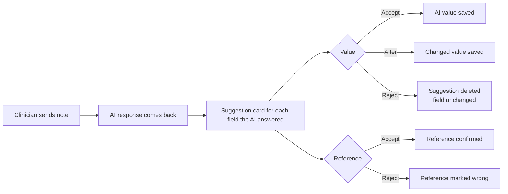

# 1 · About the product

## What it does

When a clinician fills in an encounter (a visit record) in PacEHR, they usually type or dictate a note and then fill in many form fields by hand: weight, blood pressure, symptoms, and so on.

The **AI Encounter Assistant** reads what the clinician writes and **suggests** values for the form fields. The clinician then decides, field by field, whether to use each suggestion.

**The AI never fills the chart on its own.** Nothing is saved until the clinician accepts it.

## How a clinician uses it

1. Opens an encounter and clicks **AI Encounter**. A chat panel opens.
2. Types or pastes their note (for example: *"Wt 82 kg. BP 150/90. Denies chest pain."*) and sends it. The request goes to the AI.
3. The AI's response comes back: a short message, plus a **suggestion card** for every field where the AI gave a response.
4. On each card the clinician makes **two separate decisions**:

   **a) The value**

   | Option | What it means | What happens to the form field |
   |---|---|---|
   | **Accept** | The AI's value is right | The AI's value is saved in the field |
   | **Alter** | The AI's value needs changing | The clinician changes the value (or unit), and **the changed value** is saved |
   | **Reject** | The AI's value is wrong or not wanted | The AI's suggestion is **deleted**. The field stays exactly as it was (empty, or its existing value) |

   **b) The reference** (the words from the note that the AI says the value came from)

   | Option | What it means |
   |---|---|
   | **Accept** | The reference is right: the value really comes from these words |
   | **Reject** | The reference is wrong: these words are not where the value came from, or are not in the note |

   The reference decision is recorded separately and **does not change the value**. For example, a clinician can accept a correct value but reject a wrong reference.

5. The clinician can send more messages, such as corrections or more details. The AI sends updated suggestions. **A value already in the form is never replaced automatically.** The AI shows its suggestion next to the existing value, and the value only changes if the clinician accepts.
6. For a field the AI didn't fill, the clinician types the value into the form as usual.
7. The clinician **signs** the encounter as usual.

## What a suggestion card shows

| Part | Meaning | Example |
|---|---|---|
| Field | Which form field this is for | Weight |
| Value | What the AI suggests | 82 |
| Unit | The unit, shown separately | kg |
| Confidence | How sure the AI is: **High**, **Medium** or **Low** | High |
| Remark | A short note from the AI about where it got the value, or why it is unsure | "Weight stated in kg in the latest message." |
| Reference | The exact words from the clinician's note that the value came from. The clinician can accept or reject it | "Wt 82 kg" |
| Buttons | **Accept / Alter / Reject** for the value; **Accept / Reject** for the reference | |

## The three answers the AI can give for a field

| Answer | Meaning | Example | May appear on screen as |
|---|---|---|---|
| **Found** | The note gives a value | "Wt 82 kg" → Weight 82 kg | FOUND |
| **Not mentioned** | The note says nothing about this field | No pulse in the note → Pulse: not mentioned | ABSENT |
| **Unclear** | The note mentions it, but it can't be filled safely | "temp 99.1" with no °F/°C → Temperature: unclear, please confirm | ABSTAINED |

## It learns over time ("memory")

The assistant gets smarter about each **patient** and each **clinician**:

- **Patient memory.** When an encounter is signed, the AI writes a short summary of the patient, such as long-term conditions and usual values. It uses that summary at the patient's next visit.
- **Clinician memory.** The AI notices a clinician's habits, such as writing weight in lb, using certain abbreviations, or correcting a particular field often. It starts using what it has learned **after about 30 visits** with that clinician.
- **Visit details.** The date of service, place of service and the form being used are also sent with each message.

**The rule:** memory can *help* the AI understand, but it is **never** a source for a value. If today's note doesn't say it, the AI must not fill it in, even if it "remembers" it from last time.

## What can go wrong (what you are protecting against)

| Risk | Why it matters |
|---|---|
| A **made-up value**: the AI fills a field the note never mentioned | The clinician may accept it without noticing. Wrong information gets into a medical record |
| A **wrong value or wrong unit** | Same as above, e.g. 82 lb recorded as 82 kg |
| A **guess** when the note is unclear | It should say "unclear", not guess |
| A **clinician's value overwritten** | Data loss |
| **Another patient's information** appearing | A serious privacy breach |
| **Trick messages**: text in a note that tries to give the AI instructions | The AI must ignore or block them |
| **Slow or broken replies** | Clinicians won't use it |

## Words used in this guide

| Word | Meaning |
|---|---|
| Encounter | One visit record for one patient |
| Template / form | The set of sections and fields for an encounter type |
| Field | One box on the form (Weight, Pulse, Allergies, …) |
| Turn | One message from the clinician plus the AI's reply |
| Suggestion card | The AI's proposal for one field |
| Reference | The exact words from the note that the AI says a value came from |
| Accept / Alter / Reject (value) | Use the AI's value / change it and use the changed value / delete the AI's suggestion |
| Accept / Reject (reference) | Confirm that the reference is right / mark that it is wrong |
| Answer sheet | Your written list of the correct answers for a test note |
| Build | A version of the system; every build has a number |
| Important field | Fields where mistakes matter most: medications, allergies, code status, vital signs, diagnoses |
